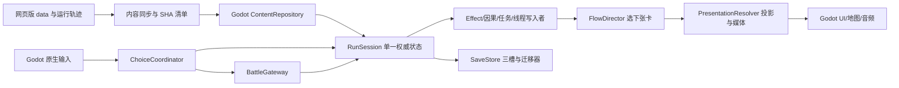

# 《一念仙途》网页版非战斗内容 → Godot 桌面版完整迁移任务书

**当前正式验收（2026-11-04）**：N0–N11 共 12 阶段，按下表完整出门条件仅 **N0 签收，1/12**；N1–N11 未签收。N4 固定 `Math.random=0.45` 的清洁体修网页/Godot `slot_2` 路线已逐卡和决定时钟对照决定 0–33，并核到炼气道侣危机左选后的 `promise_result_648444c4`；生产态随机流、其他修路和更长后续仍未验。旧 v2 存档坊市因果种子计时与第二世白狐回归已补专项，尚无对应浏览器跨世逐卡对照。N10 二号槽首世剑修首战撤离结果卡导入、冷读和下一卡专项通过，待战/回合两份真实 Chromium 夹具的当前 UI SHA、原始槽字节及关键战斗断言 `--check` 均通过；其他槽与中途/跨世/长历史旧档未完成。N1 动态 NPC 卡同人物对重复发卡和延迟队列这一小批独审未见确定 P0/P1，但全目录来源索引仍未验收。完整 Godot 后段门禁仍在续跑，Windows 包尚未按本次源码重导出。下方按旧日期写的 `0/12`、旧 N4 首分歧和旧 N10 夹具待重采均为当时历史状态，不代表当前签收结论。

**2026-11-03 N4 体修决策 14 立绘读取副作用修复（局部，待独审）**：真实 Chromium 公开 UI 固定 `Math.random=0.45` 重放中，`q_bodyTrial.left` 先把 `ch_qi_60` 放进 Flow；选择尚在决定 13 时，同伴耳语更新 HUD 立绘调用会抽卡的 `GameLogic.getCurrentCard()`，提前消费并标记第 50 点章节里程碑，选择尾部又清空该临时卡，因此旧网页轨迹决定 14 错显白刃导师卡。新增公开 UI 红例精确记录提交前 `pending=ch_qi_60` 的抽卡；`src/ui.js` 两处立绘上下文现只窥 `currentCard`，空卡按非亲密场景解析，修后红例转绿，决定 14 正式显示 `ch_qi_60`。旧网页误触发存档原样保留，不推断补偿。旧 0.45 轨迹、开局/序章轨迹及覆盖账本已留历史副本；当前网页重采与来源/Godot 副本 SHA 对齐，道侣危机仍自然出现在决定 31。`noncombat_n4_quest_source_order.gd` 现核决定 0–15 同轨（命盘无 ID，以 `DESTINY_WHEEL` 类型对照）；下一首真实分歧在命盘左翻后：浏览器决定 15 展示 `k_chapter_body_left`，Godot 展示 `mentor_bai_ren_stage_INNER_DISCIPLE`，本批未改该链。公开 UI 红例、来源 `--check`、N0 目录账本 `--check`、开局/序章 parity、whisper、自然体修危机及旧死亡存档专项退出 0；N10 战中夹具另需按新 UI SHA 由其负责人重采。N4 未签收。

**2026-11-03 N4 旧 v2 固定来源 pin 兼容与下一分歧（局部）**：白狐入口调度纠偏后的死亡卡旧档 `pill_decision54_death_probe_v2.json` 最初因 `normalFlow.choiceRuleSha` 为历史 `game.js` SHA `637d63a0…`，在严格回放前被当前 SHA `73d5038d…` 预检拒为 `SOURCE_MISMATCH`。只替换诊断副本的这一个 pin 后完整专项通过，证明该档的本次阻断是 pin 漂移，未证 QuestFlow 次序也使其失败。现仅对 v2 已知旧 pin/既有非战斗来源形状允许严格历史回放，首次真实决定提交升级为当前 pin；原旧档恢复时不改字节，未知 pin 仍拒。死亡卡旧档、普通卡运行、白狐入口和新增的体修 0.45 决定 0–13 同轨专项退出 0；新专项已注册总门禁并使用其默认超时。下一 N4 批需查决定 14 的浏览器重绘/里程碑消费时序：双方修为 55、白仁传承值 21/入室阶段、白仁物理在场一致；浏览器将 Qi 第 3 里程碑记为已触发却展示白仁事件，Godot 展示 `ch_qi_60`。不能未经时序证据直接改调度优先级；N4 仍未签收。

**2026-11-03 N4 白狐入口调度纠偏（局部）**：清洁体修 `Math.random=0.45` 浏览器轨迹在决定 8 发 `q_whiteFox_quest`，Godot 原发 `bazaar_encounter`。新增直接读取 `mortal-qi-browser.json` 的逐步红例，修前准确报该首分歧；`QuestFlow` 移除“Qi 15 和 30 两个里程碑都已发”这一来源未要求的额外门槛，保留里程碑调度优先级、来源 SHA 与任务资格检查。修后同选择路线决定 0–13 的卡 ID/决定序号相同；下一首分歧为决定 14：网页发 `mentor_bai_ren_stage_INNER_DISCIPLE`，Godot 发 `ch_qi_60`，当时 Godot 修为 55、已触发 Qi [15,30]。白狐入口、Qi 里程碑、自然体修道侣危机专项均退出 0。此批未证明决定 14 以后的 N4 逐步同轨，N4 仍未签收。

**当前正式验收（2026-11-03）**：N0 基线与目录在当前工作树已通过独立审查并签收，**1/12**；N1–N11 仍未签收。N0 证据为 `artifacts/godot-migration/n0-baseline-20261103T021310Z/manifest.json`、63 脚本/175 图覆盖账本、74 份来源 JSON、531 图/3 动画/32 音频 SHA、三项网页门禁、开局/序章真实来源轨迹及 Godot 对照。基线即时 `--check` 通过；Godot 全量后段门禁仍在运行。N0 签收只证明目录、用途裁定与基线门禁，不证明 48 个待审脚本的玩法一致性或后续阶段完成。

**2026-11-03 N0 目录范围纠偏（历史记录，现已签收）**：独立复核发现此前“230 张非战斗候选图”含 `assets/cards/combat/*` 下 55 张战斗卡图。目录工具现同时排除 `assets/combat/*` 与 `assets/cards/combat/*`，非战斗候选为 **175 张**；63 脚本/175 图账本重生及 `--check`、531 图/3 动画/32 音频资源 SHA 门禁退出 0。此前 230/228 的记录是历史统计，不能作为当前 N0 范围。逐图账本现为 **69 张目视/来源选图排除裁定、62 张溯源原图裁定、34 张已目视但未挂接的同伴事件候选、10 张其他已审未挂接候选、0 张待审，合计 175/175 已审**。最后 10 张逐图用途裁定为 6 张身份未证且未挂接的人物概念候选、2 张未挂接旧水墨背景、2 张仓库根多余的战斗房间图输出。背景现行 CSS 选 `bg_inkwash_masterpiece.png` 且 Godot 使用其 JPG 别名；正式青云战斗 profile 选 `qingyun_trial_room_v1.png`，两张根 room 图与同名 Godot 候选 SHA 亦不同。10 张均无当前运行来源的完整路径引用；该结论不证明候选身份、美术质量或可作为正式素材。当前 N0 图像裁定账本已满 175/175，N0 整段仍待当前源码/工作树基线、网页与 Godot 门禁及独立审查复核，不能据逐图数字直接签收。34 张同伴事件候选现逐图有源图 SHA、可能的事件 ID、具体画面/事件对照和人工判词：1 张主体相近，10 张仅主题部分相近，16 张画面与事件动作错位或泛化，4 张 `scene_sn_*` 无对应事件 ID，3 张 `scene_comp_*` 只有角色主题。校验器逐项查事件 ID 真实存在及当前 data/63 网页加载脚本/index/Godot 运行清单无原图完整路径引用；此状态只记录未挂接候选，不表示事件图已实现、自然可达或美术通过。该轮之后待裁定的 10 张为 6 人物、2 旧背景、2 room layer，现已按上文逐图复核。本轮单张追证：旧报告与美术来源清单确认 `card_bailuoshuang_pc98.png` 是 `bai_luoxuan`（白落霜）的身份参考，当前加载的 `PC98CardSystem` 已将该 ID 和旧别名 `bailuoshuang` 都选到 `collected/bai_luoxuan_pc98.png`，其 Godot 副本 SHA 相同，故旧卡图排除。该轮之后仍有 6 张人物、34 张同伴事件、4 张背景/房间图待裁定；同伴事件图的后续逐图审查见本段当前状态。本批再裁定 15 张剑灵儿/九尾溯月变体（其中 3 张与已审旧图 SHA 完全相同）；逐图比对当前阶段作者选图与 Godot 副本。该批之后余 7 张人物图，`yin_xue_intimate_*` 的黑衣女性画面与当前同名男性立绘身份不合，仅凭文件名无法裁定。本批另对剑灵儿 10 张、九尾溯月 5 张旧变体逐张目视，以当前阶段选图、原图/选图 SHA、Godot 同路径副本及当前入口无候选完整路径引用裁定；其余人物图继续待审。本批对剑灵儿与九尾溯月 8 张旧阶段立绘逐张目视；以 `data/companions/portrait_stages.json` 当前选图、Godot 同路径副本及 SHA 对照后记为异图排除，未凭文件名批量签收。溯源原图逐项核 manifest raw/preEdit 与 finalPath 的路径和 SHA，且当前 data/网页入口/运行清单无原图引用；不据此声称 finalPath 已生产可达或美术通过。两张旧背景缺 Godot 同路径副本、两张房间图层缺生产选图路径，34 张同伴事件图无当前挂接路径，现已按上文逐图审为未挂接候选。路径分类不算裁定，N0 和 N0–N11 仍 **0/12**。

**2026-11-03 N7 手动交互独审补正**：闲聊的好感与台词改为两次独立、可严格重演的抽签，来源夹具增加不同顺序随机值样例；NPC 连续世界记录缺席或世次不符时不再提供实体拜访。专项及夹具复跑退出 0，最终快照只读独审未发现确定 P0/P1；赠礼和筑基论道的公开玩家路线仍未证实，N7 和 N0–N11 仍 **0/12**。

**2026-11-03 N7 人物志/手动交互（局部）**：真实 Godot 故事页的人物志入口已接来源当前境界与物理在场人物清单、详情、可读闲聊台词、已知情报和解锁秘闻；手动闲聊/赠礼/请教/论道通过领域事务写共享 NPC 记忆、好感、每 NPC 每回合单次深谈额度与物品扣数，动作按决策位置严格重演。来源四动作夹具与真实 UI 入口、公开领域闲聊/请教、失败写盘和跨下一决策冷读专项退出 0；赠礼/论道目前仅有流程源对照，无公开玩家取得礼物或筑基完整路线证明。网页版冷启动重置大部分 NPC 内存状态，Godot 为严格重演持久化本世交互，此差异已在切片证据簿说明。N7 与 N0–N11 **0/12**。

**2026-11-03 N7 动态 NPC 双人卡与全人物单人遭遇（局部）**：网页版 `index.html` 没有调用 `loadGrowthData()`；`realm_growth.json` 虽存在，却不是当前运行时日程。Godot 已改用实际运行的六时辰日程及默认地点。来源夹具现覆盖筑基宗门白刃/剑灵儿师徒动态双人卡、金丹月湖中立卡；白刃/血煞敌对卡仅验证模板，**不算自然可达证据**。双人持久队列、物理资格、关系抽签、12 回合冷却、失效待发卡清除及选择效果通过专项。15 人单人遭遇池与 720 个来源场景模板也接入，4 条来源样例逐字段通过；来源全局 6 次上限与已玩卡最多 5 次重抽通过；这并非 15 人自然路线全验收。原白刃首遇、左右选择、旧档与筑基公开双人卡长局已回归通过；后段总门禁续跑中。**其余 NPC 消费者、自然路线与全套 N7/N9 验收仍缺，N0–N11 0/12。**

**当前进度（2026-11-03）**：N0–N11 共 **12** 个大阶段，按各自完整出门条件仍 **0/12** 整段签收；代码在 N7 人物世界与 N9 桌面呈现继续补链，并持续复核 N2/N5/N8 回归。五张 NPC 交叉作者卡的来源资格、关系/好感结算、31→30 并发优先级、回合被动、旧档延迟启用与事务冷读已通过专项；公开路线自然到达剑崖师徒卡。双人物原立绘、长文和选择已在 Windows OpenGL 3.3 的 1280×800、1920×1080 截图目视，容器未越界。动态双人模板与冷却、15 人单人池的来源专项已通过；旧档与公开自然路线正在回归。另四张作者卡自然路线及其余 N0–N11 完整门禁仍待做；详见 `NONCOMBAT_MIGRATION_SLICE.md` 首段。

**2026-11-02 N7 NPC 交叉预设卡主流程（局部，待独审）**：五张作者卡现有双 NPC 实体/境界/区域资格、15% 与权重抽签、`narrative:31` 待发、语义 once、关系及 `bond_*` 与 `npcAffection` 两路好感结算，来源数据和规则均钉 SHA；旧档按启用点跳过旧历史，下一真实提交启用。五卡独立测试 `NONCOMBAT_NPC_CROSS_PRESET_PASS` 退出 0；公开雷关胜利到筑基宗门自然出现剑崖师徒卡，待选、失败写盘和选后严格冷读输出 `NONCOMBAT_NPC_CROSS_NATURAL_PASS`、退出 0。原白刃首次遭遇和雷关到筑基冷读通过。动态双人模板及冷却、五卡全自然路线、双人立绘 UI 与魔域到达仍缺，N7/N9/N11 及 N0–N11 **0/12**。

**2026-11-02 气宗同门三战果门禁时限**：后段总门禁在 `noncombat_q_fellow_outcomes.gd` 的 180 秒限时中止，日志已有胜利和战败通过；同脚本独立完整运行输出胜利、战败、撤离与 `NONCOMBAT_Q_FELLOW_OUTCOMES_PASS natural=true outcomes=3 replay=true`、退出 0。该项需从决定 27 的自然前缀重复三轮并逐轮冷读，门禁限时单项调至 300 秒，后段从下一项续跑。此为测试时限调整，N0–N11 **0/12**。

**2026-11-02 导师旧档门禁复核**：后段总门禁停在 `noncombat_mentor_trusted.gd` 的合成“当前来源内容 + 旧导师版本”档。合成档只回退导师版本，阵营进度仍来自当前运行，却未带当前阵营收集顺序启用标记，因而严格恢复正确拒绝了不一致的 `ticksSinceEvent`。两个当前来源合成导师档均补齐该标记，真实旧档原字节与严格恢复断言保持不变；专项复跑输出 `NONCOMBAT_MENTOR_TRUSTED_PASS stage=true replay=true choice=true`、退出 0。后段总门禁从下一项续跑，N0–N11 **0/12**。

**2026-11-02 N7 五张 NPC 交叉预设卡代码缺口**：`data/npcs/npc_cross_cards.json` 五张均已入运行包，但 Godot 当前只有白刃单 NPC 遭遇消费者，尚无来源 `NpcSystem` 的双 NPC 物理资格、15% 抽签、叙事优先级 31、待发队列、来源语义 once 和两路好感/关系结算。来源预设不按动态 pair 的 12 回合冷却或 NPC 日程筛选；选项中的 `bond_*` 与 `npcAffection` 原网会分别加一次。五张中魔域卡未找到干净首世当前位置到达来源，不能用预置地点证明自然可玩；最后一张 `location=坊市` 而文案写“天机阁顶层”，需在呈现和地图语义审核时注明。此为下一整族代码切片，N7 与 N0–N11 **0/12**。

**2026-11-02 筑基关后金丹普通卡门禁**：后段门禁在 `noncombat_foundation_gate_natural.gd` 的旧 24 次等待上限误报；固定来源路线在金丹到首张普通卡间实际经过 30 次前置处理。测试现记录前置卡 ID/阶段并将等待限调为 48，独立重跑输出 `NONCOMBAT_FOUNDATION_GATE_NATURAL_PASS ... pre_draw=30`、退出 0；玩法代码未因该误报更改，后段门禁从下一项续跑。N0–N11 **0/12**。

**2026-11-02 N9 背景灵气与体验设置（局部）**：槽页、剧情页的“体验设置”现保存低/均衡/高环境特效与“稳定背景”到玩法槽外配置，并实际驱动 2D 灵气层的 80/210/380 粒子预算、透明度、速度与呼吸缩放；进入来源战斗即停绘，返回剧情恢复。原网页的 3D 粒子/稳镜头在 Godot 静态 Control 上按当前真实背景消费者实现局部等效，不冒称所有地图/战场镜头已接入。`NONCOMBAT_EXPERIENCE_SETTINGS_PASS ... effects=true steady=true` 覆盖三档切换、重启偏好、非法值、双分辨率布局及玩法状态不变；`NONCOMBAT_QI_GATE_LIVE_FLEE_PASS` 另核战斗停绘与返程恢复，均退出 0。`output/godot/experience_effects/` 六张 Windows OpenGL 3.3 槽页/剧情页图已目视，独审未见本批 P0/P1。普通抽卡的来源阶段色/速度已接真实 normalFlow.phase，剧情过渡与其它移动镜头、低端帧耗时仍待验，N9 与 N0–N11 **0/12**。

**2026-11-02 雷关桌面撤离复审补记**：独立只读复核确认 `NONCOMBAT_QI_GATE_LIVE_FLEE_PASS` 的自然待战、桌面撤离/返回、结果卡前后严格冷读均已运行；网页版允许撤离，Godot 的章节卡转移 `sourceCardId` 与网页 `originalCard.id` 一致，未见本切片 P0/P1。此专项只核撤离结果卡 ID；既有 `noncombat_qi_gate_outcomes.gd` 核同一来源行的全文及资源差值。N5/N8 与 N0–N11 仍 **0/12**。

**2026-11-02 N2/N7 旧剑修试炼 NPC 行程冷读（局部）**：后段门禁发现 `foundation_sword_q3_heart_v2.json` 旧档在试炼前严格恢复失败。旧档有白刃第 25 回合闭关室、`reason=schedule`、revision 17 的世界状态，却没有 `worldContinuityActivationIndex`；现行逐选择更新行程提前生效，并以新元数据重演旧行程。恢复时把旧历史和启用标记后的新决定分别按各自元数据回放，全状态末态比较仍严格。`NONCOMBAT_FOUNDATION_SWORD_TRIAL_CONTRACT_PASS directions=2 replay=true` 与六种战果的 `NONCOMBAT_FOUNDATION_SWORD_TRIAL_OUTCOMES_PASS directions=2 outcomes=3 replay=true rollback=true` 修后均退出 0；NPC 新档两方向、旧死亡档回归退出 0，独立只读审查未见 P0/P1。后段总门禁续跑，N0–N11 **0/12**。

**2026-11-02 N5/N8 炼气百点雷关桌面交接（局部）**：自然剑修路线先到 `_warning_ch_qi_100`，备战选择后严格冷读 `BATTLE_PENDING`，Godot 现按章节卡认证 HP 5 的惊雷石傀及四态 `planGraph`，加载独立来源战场与石傀原图/动作图；没有套用通用遭遇目录的 HP 8 敌人。战斗域按来源在第三回合敌行动后存活取胜，也支持先击破；筑基丹 flag 对来袭攻击先乘 0.5；同次出牌信号按作者转移数组顺序处理，转移记录保留来源章节卡 `ch_qi_100`。`NONCOMBAT_QI_GATE_ENTRY_PASS` 已覆盖桌面开战、来源首领 BGM、源敌人/场景、界面结束回合/承受/返回/结果确认按钮、三回合敌存活胜利、返回剧情破境及冷档，并用独立规则探针对照 4→2 伤害和重复牌型优先级。新增 `NONCOMBAT_QI_GATE_LIVE_FLEE_PASS` 从同一自然前缀经桌面撤离按钮返回来源撤离卡、确认并严格冷读，已纳入总门禁；筑基/金丹关及首剑桌面回归退出 0。真实服丹购买→备战→实战、先击破及真实战败的整条桌面路线仍未同测，完整门禁待结；独立只读复审未见本切片 P0/P1。N0–N11 **0/12**。

**2026-11-02 N9 来源音乐状态（局部）**：桌面音轨现能随宗门、因果展示、普通战斗和来源首领战斗切换，实测首剑入战/返程与自然雷关首领入战，因果展示由真实 `Domain.changed` 信号触发。BGM 基础增益已从 Godot 的 0.32 对齐来源 `AudioManager.bgmVolume=0.45`，四轨、五声景和旁白 duck 专项退出 0；Windows 导出物的压缩/听感及更长场景状态矩阵仍未验收，N9 与 N0–N11 **0/12**。

**2026-11-02 N0 目录复核（未签收）**：重新运行 `audit_noncombat_migration.py`、`audit_noncombat_coverage.py` 与 `validate_noncombat_asset_coverage.py` 均退出 0；当前来源为 59 份非战斗 JSON、615 个带选择节点、1257 条分支，入口脚本 63 个，未入运行包候选图 230 张且逐张有源 SHA 与用途候选，已引用的 531 张节点场景图无缺失复制。候选用途主要按路径和当前源码引用判别，48 个脚本消费者仍标为待完整行为对照，逐张实际运行用途和全可达路线未由此证明；N0–N11 **0/12**。

**2026-11-02 旧二周目阵营时序冷读（局部）**：总门禁发现真实 `spell_second_life_fatal_source_v2.json` 旧档在新调度顺序下严格恢复失败。旧档有阵营状态且导师弧线版本低于 4 时，恢复器在旧决定中按旧阵营收集顺序回放，下一次真实提交记录新顺序启用决定；首世无阵营状态的旧档不启用此兼容分支。`noncombat_generic_normal_death.gd` 已验证旧档恢复、致死选择、失败回滚、切换标记和死亡档冷读，退出 0；`noncombat_death_rebirth_journey.gd` 长测亦通过首世无阵营旧档的死亡、冷读与转世后路线，门禁已越过此项。独立只读审查未发现 P0/P1。标记只能证明回放结果一致，现有历史不足以证明唯一的原始切换时点。后续总门禁仍在运行，N0–N11 **0/12**。

**2026-11-02 N9 弹窗高对比扩展（局部）**：阅读偏好只开高对比时，后建万物志行、文件选择器及现有剧情弹窗也会收到高对比字色；弹窗按钮多状态色可随设置重置恢复。专项验证动态行、主题色、玩法档隔离，OpenGL 抓取设置与万物志双分辨率画面，独审复核未见本批 P0/P1。禁用立绘阶段、原生文件窗口和全卡大字布局仍待实拍，N9 与 N0–N11 **0/12**。

**2026-11-02 N2 同槽并发与强退恢复（局部，未签收）**：`RunSession` 的 v1/v2 读、提交、网页档替换及归档已纳入同槽目录锁。双 Godot 进程同修订号并发选择仅一个提交；归档须持锁核对失败时读取的文件 SHA。锁现先在候选目录写 owner、再原子改名发布，强退若留下已发布孤锁，仅在 Windows `tasklist` 确认原 PID 不存在后移入按旧 token 固定命名的保留目录。双进程同一孤锁屏障专项验证恰一者取得锁、活锁不被回收、原存档字节与最终冷读不变；输出 `NONCOMBAT_SLOT_LOCK_PARALLEL_PASS ... recovery_race=true`，退出 0。归档、RunSession、网页替换和导入界面回归退出 0，独立只读审查未见本批 P0/P1。无有效 owner 或系统进程查询失败时仍保守报忙，不擅自移走锁；N2 的全状态/旧档/战斗合同总体门禁尚未签收，N0–N11 仍 **0/12**。

**2026-11-02 商店结果后的装备冷恢复纠正**：真实自然购买档在结果卡与随后普通卡共用决定序号时，旧恢复器过早核对普通卡的装备事件并误拒。现在仅在商店结果待确认阶段暂缓该事件，之后仍逐事件及全状态严格核验；`NONCOMBAT_TREASURE_EQUIPMENT_COLD_PASS` 包含购买、装备、卸下、回滚、两次冷读，退出 0，独审未见 P0/P1。总门禁已越过该项继续运行，N0–N11 仍 **0/12**。

**2026-11-02 N7 场景层宗门深处自然验收（局部）**：旧固定剑修避战路线在第 75 决定道心归零、第二世又移至洞府，200 次选择内宗门仅 1 访，不能证明 `loc_sect_deep` 可达；尝试首战后山径原卡右选也被现行 `first_session_cohesion` 来源串行改写为坊市。最终改用已验证的公开炼气百点关胜利→筑基宗门路线，按来源 `q_sword_1.right` 放弃快速任务及 `ch_foundation_20.right` 保持距离；不注入地点/访问次数。第 61 决定自然出现筑基宗门第 8 访的 `loc_sect_deep`，取得 `sect_alchemy_secret`，待选与已选全状态严格冷读专项输出 `NONCOMBAT_SCENE_LAYER_NATURAL_PASS visit=8 clue=true disk=true`、stderr 空；删去未触达测试分支后的最终同轨复跑仍 PASS，独审 VERIFIED。N7 和 N0–N11 仍 **0/12**。

**2026-11-02 世界地图入口回归**：UI 新布局把 `OpenWorldMap` 按钮放入工具行，旧 `noncombat_world_map.gd` 仍按剧情页直属子节点查找而误报入口缺失。测试改按剧情页内按钮名递归查找后，13 节点、12 路线、11 编年、只读地图与玩家按钮专项 `NONCOMBAT_WORLD_MAP_PASS`、退出 0；玩法 UI 未改。N0–N11 **0/12**。

**2026-11-02 选择回响公开播种门禁计时**：`noncombat_choice_echo_public_seed.gd` 总门禁默认 30 秒超时；独立约 116 秒完整跑完，输出 `NONCOMBAT_CHOICE_ECHO_PUBLIC_SEED_PASS turn=37 location_guard=true disk=true`、stderr 空，门禁专限调为 180 秒。其它选择回响专项仍在后段总门禁继续跑，N0–N11 **0/12**。

**2026-11-02 势力战斗与自然长局门禁计时**：`noncombat_faction_combat.gd` 三战果及桌面撤离专项总门禁默认 30 秒超时；单独跑完 `NONCOMBAT_FACTION_COMBAT_PASS`、stderr 空，专项上限调至 180 秒。`noncombat_faction_natural.gd` 公开体修第 55 决定势力卡、结算、战斗撤离及重放专项也在默认时限超时，单独跑完 `NONCOMBAT_FACTION_NATURAL_PASS`、stderr 空；连同已多次遇到的自然长局脚本，门禁默认上限设为 600 秒，已有更长专项上限继续优先适用。N0–N11 **0/12**。

**2026-11-02 命盘延迟自然长局门禁**：`noncombat_destiny_deferred_natural.gd` 超出原 300 秒门禁，单独完整跑完约 10 分钟，输出 `NONCOMBAT_DESTINY_DEFERRED_NATURAL_PASS hidden=true shown=true flip=true disk=true`、stderr 空；该脚本门禁按实测扩至 1200 秒。NPC 行程更新同时去掉“不适用或位置不变仍深拷贝整份状态”的开销，保持实际位置变化时复制与来源记录；优化后 NPC 入口和 4–14 决定浏览器导入专项重跑均 PASS、stderr 空，独审未见别名副作用及 P0/P1。后段总门禁从炼气关章节后续脚本继续。N0–N11 **0/12**。

**2026-11-02 天机自然回应与白狐来源归因门禁**：天机弧线公开自然路线的回应选择 `choose=true`、事件只记一次，且恰逢金丹每 10 决定命盘打断，状态合法为 `DESTINY_WHEEL_PENDING`；旧测试只接受 `FLOW_PENDING`，已按来源命盘节奏修正，专项输出 `NONCOMBAT_SEER_ARC_NATURAL_PASS`。白狐第三幕来源漂移专项发现恢复器已拒绝漂移但 `last_error` 留空；现在势力标记在结构校验前先做来源 SHA 归因，普通与转世恢复均保留 `SOURCE_MISMATCH`，`NONCOMBAT_WHITEFOX_THIRD_PASS`。后续总门禁继续，N0–N11 **0/12**。

**2026-11-02 N10 网页中途档第 13–14 决定（局部）**：新的真实剑修网页快照覆盖剑修章节因果与囤积秘本因果；导入器已从 12 决定扩至 14 决定，重演第二套残卷掉落、因果涟漪与致死燃血，并补回每次选择时的 NPC 行程更新。原始快照的准备、空槽导入和严格冷读专项已通过第 13/14 决定。独审抓到待发集市卡未核验，已补来源全对象对照及两个篡改反例；更新专项输出 `NONCOMBAT_BROWSER_MID_IMPORT_PASS ... decisions=4-14 ... pity=two-sets ... cold=true atomic=true reject=true`、stderr 空，独审结论 VERIFIED，无剩余 P0/P1。槽页真实入口另用第 14 决定来源文件走预览→导入空槽→进入剧情，`NONCOMBAT_BROWSER_IMPORT_UI_PASS ... chapter_karma=true`、stderr 空。战中、跨世、超过完整选择史的浏览器旧档仍未导入，N10 与 N0–N11 **0/12**。

**2026-11-02 N10 已占用玉简替换（局部）**：来源网页档在正式替换前重新严格重演；已占用的可读 Godot 槽在预览页明确显示“备份并替换”，二次确认时按原档修订号提交，先复制原 v2 或仅有的 v1 原始字节并核对 SHA，再写独立 v2 待提交文件。写盘失败时原档不变，成功后校验写盘快照，旧原档备份路径显示给玩家。`noncombat_browser_replace.gd` 覆盖 v2 与仅有 v1 的备份、失败写盘、写后校验失败回退原始字节、成功冷读和顺序过期修订号拒绝；`noncombat_browser_import_ui.gd` 从实际槽页验证先确认后替换及备份。独审发现预览与确认两个独占弹窗冲突，已改为弹确认前关闭预览；修后 UI 专项 `NONCOMBAT_BROWSER_IMPORT_UI_PASS ... replace_backup=true`、stderr 空，底层专项 `NONCOMBAT_BROWSER_REPLACE_PASS ... legacy=true`、退出 0。尚未覆盖两个进程同时写同一槽；战中、跨世、长历史导入仍缺，N10 与 N0–N11 **0/12**。

**2026-11-02 N11 导出前置复核**：本机 `%APPDATA%/Godot/export_templates/4.7.2.stable` 现已有 `version.txt=4.7.2.stable` 与 Windows x86_64 release/debug 模板；10-30 记录的“模板不存在”已过时。随后完成的首轮导出与隔离启动见下一条；N11 整项仍未签收。

**2026-11-02 N11 Windows 导出及隔离启动（局部）**：使用本机 4.7.2 模板和项目现有 Windows Desktop 预设，release 导出退出 0，产出 `output/godot/windows_release/xiuxian.exe`（109,127,680 字节）与 `xiuxian.pck`（2,616,307,847 字节），导出日志 `godot/.godot/windows_export.log` 未检出错误。两文件复制到独立 `output/godot/windows_smoke_clean/` 后，SHA256 分别与导出原件一致；以该目录为工作目录、隔离 `%APPDATA%`、`--headless --quit-after 120` 运行导出物退出 0，主场景及其剧本/贴图在详细启动日志中成功加载。命令、哈希、隔离目录和退出码另存 `output/godot/windows_smoke_clean/smoke-evidence.json`。复制的导出物另以 Windows OpenGL 3.3 录制 30 帧，`opening.png` 展示 1280×800 三槽初始界面，无可见裁切。此为包体与初始画面冒烟，尚无桌面键鼠长局、重启/切槽/导入实测，也未完成全部生产路线与包体审查；N11 和 N0–N11 **0/12**。

**2026-11-02 N9 阅读设置弹窗对比度（局部）**：高对比开关现同步应用到阅读设置弹窗的标签、普通按钮与内部“返回”按钮主文字色，关闭/恢复默认时还原原主题覆盖。`noncombat_experience_settings.gd` 从真实槽页进入并验证开、关与玩法状态隔离，输出 `NONCOMBAT_EXPERIENCE_SETTINGS_PASS ... dialog=true`、退出 0；OpenGL 实画面 1280×800/1920×1080 已重新抓取，独审在 1280×800 图上核见 `#FFF6DF` 字形像素及暗灰背景，未见 P0/P1。其它弹窗与全来源卡大字号布局仍未完成，N9 和 N0–N11 **0/12**。

**2026-11-02 全新槽页“上次使用”标记纠正**：导出物首屏显示一号空白玉简仍写“上次使用”，原因是 `active_slot()` 为兼容默认选择返回 `slot_1`，而摘要把该回退误作真实索引。`inspect_slot.active` 现仅在活动索引文件存在且有效时为真；新目录无标记，实际选择后有标记，旧有效/损坏索引与槽恢复行为保留。`noncombat_save_slot_ui.gd` 和 `noncombat_save_slots.gd` 专项均退出 0，独审未见 P0/P1。上述首轮 Windows 导出包生成在此代码修正之前，须在最终交付前重导并重跑可见启动；N11 仍未签收。

**2026-11-02 N10 跨启动备份名校正**：浏览器原始导出暂存和已占用玉简替换原来只用进程内微秒数命名备份，两个新启动进程可能重名并覆盖更早的备份。现两处都用墙钟秒、PID、进程内微秒组合命名，并在复制前拒绝已存在的目标；暂存专项还检查连续两份备份路径不同且旧字节仍在。`noncombat_browser_save_staging.gd`、`noncombat_browser_replace.gd`、`noncombat_browser_import_ui.gd` 专项均退出 0、stderr 空。跨进程同时写同一目标槽的原子锁仍属 N2 未完成项；N10 与 N0–N11 **0/12**。

**2026-11-02 N7/N11 剑崖地点卡干净首世可达性裁定**：独立只读反证遍查 74 份来源 JSON 中 12 处 `playerLocation` 作者效果，目标仅宗门、武盟雷峰、`qingyun_sword_tomb`、`qingyun_trial_sword_terrace`、`deity_market_stone_street`、`upper_realm_heaven_gate`，无字面剑崖；新档从宗门起，地图点击只选择节点，地点卡在 `StoryNetworkSystem` 仅用当前地点取卡，不能反过来使玩家进入剑崖。`getLocationCard` 唯一生产调用固定传 `false`，首访卡不抽；变迁卡无生产调用且 `_flag_` 查询与 `_layer_` 索引不符。故三张剑崖地点卡不能标作干净首世自然可达，旧快照若已有剑崖位置需另审。来源明确允许同宗门区域内为预设交叉剧情赴剑崖，故宗门触发师徒卡本身不是 P1；但地图仍以宗门标主角当前点、剑崖不记亲历，三张地点卡全链仍不可自然解锁。Godot 五张交叉卡消费者、地图语义与地点卡可玩性待分别处理，N7/N11 与 N0–N11 **0/12**。

**2026-11-02 盟友弧线门禁时限复核**：`noncombat_ally_arc_natural.gd` 在总门禁默认 90 秒触发超时，单独跑完输出自然发卡、选择、回应、冷重放 PASS，退出 0；该脚本门禁限时调至 300 秒，后段总门禁续跑中。N0–N11 **0/12**。

**2026-11-02 N9 阅读设置（局部）**：槽页和剧情页现有独立于玩法槽的“阅读设置”，持久保存来源 `ExperienceSettings.js` 的较小/标准/较大字号（0.92/1/1.14）、易读字体、高对比度。动态生成的万物志等控件在出现后也接收字号/字体；作者标题在易读字体关闭后恢复原样。专项覆盖按钮、键盘焦点、跨槽偏好、大字/字体/剧情对比、运行时新建控件、恢复默认及 1280×800/1920×1080 剧情正文区域、选项行与万物志弹窗边界，退出 0；开局 UI 和万物志回归退出 0。Windows OpenGL 3.3 实画面四张 `output/godot/experience_settings/` 已目视检查当前教程卡与设置弹窗均未裁切。独审先发现脚本解析和动态弹窗漏应用，修后独立复跑未见剩余 P0/P1。高对比尚未覆盖全部弹窗，也未核对所有来源卡在大字下的完整布局；背景特效预算与呼吸稳定已另见本日新切片；其它镜头及战斗反应模式仍待迁移，N9 和 N0–N11 **0/12**。

**2026-11-02 最后一课商贩交易门禁计时修订**：总门禁默认 30 秒使 `noncombat_last_lesson_vendor_transactions.gd` 超时；同一专项独立运行约 43 秒，输出四种结局、混合商品、回购、因果订货、回滚、延迟装备及冷读全部 PASS，stderr 无错误。仅此脚本门禁上限调为 90 秒，玩法与测试断言未改，后续总门禁继续；N0–N11 **0/12**。

**2026-11-02 筑基升级宗门讨伐长路线续跑**：原固定种子 2 在当前新增因果展示排期下，210 次决断内既未命中营地，也无法进入“升级牌→宗门讨伐”验收；旧 2026-10-28 成功轨迹在第 30 回合曾命中营地，已不代表当前规则。以当前来源抽签算法筛得固定种子 764850：公开法修开局经同门比试获灵石，第 30 回合营地抽中、31 回合正式付费升级首牌，第 66 回合自然抽到筑基宗门讨伐；严格冷读、来源战斗计划、战场资源、桌面开战与撤离回剧情专项输出 `NONCOMBAT_FOUNDATION_MISSION_UPGRADED_NATURAL_PASS`、退出 0。测试遇到第二个营地时按作者“飘然离去”选项，不再重复升级同一张已升级牌。玩法代码未改；总门禁从下一项续跑，N0–N11 **0/12**。

**2026-11-02 筑基宗门讨伐测试期望纠正**：续跑门禁在 `noncombat_foundation_mission_natural.gd` 胜利分支发现旧断言只算基础灵石 3 + 作者战利品 15 = 18，漏掉法修筑基功法对正向战利品额外 +3。当前来源 `DeckCombatSystem` 的基础灵石和 `EffectService` 的作者奖励分别结算，实收应 +21；专项从敌人攻击、作者 `combatRewards` 和功法配置计算期望，胜/败/逃三种战果、冷读及写盘回滚完整重跑退出 0。玩法代码未改，门禁继续。N0–N11 **0/12**。

**2026-11-02 元婴法修洞天测试期望纠正**：门禁的 `noncombat_nascent_items.gd` 旧断言将“获 10 灵石”直接加成 110，漏掉作者法修筑基功法 `spiritStoneBonus=0.2`；来源 `EffectService` 对正向灵石增量取整加成，现应为 112。同根的 `noncombat_nascent_cave.gd` 又把左选原获 30 灵石按未加成功法核对，现按来源实际入账 36。两专项从作者功法配置读取比率，原丹药、城市交易、洞窟节点和放弃分支保留，均退出 0；玩法代码未改，总门禁继续。N0–N11 **0/12**。

**2026-11-02 高境界体修因果测试期望纠正**：续跑门禁的 `noncombat_body_high_realm_karma.gd` 将金刚体因果卡的基础气血上限 8 误作实际可恢复上限；来源 `GameStateManager.getActualMaxHealth` 会合并体修筑基功法 `maxHp+2`，故原状态血量 8、选项恢复 2 后为 10。专项从作者 `config:path_skills` 验额外上限并保持修为、种子、一次性等断言，退出 0；玩法代码未改。总门禁从下一项续跑，N0–N11 **0/12**。

**2026-11-02 N9 集市音频（局部）**：网页版 `AudioManager.js` 的官坊、坊市、鬼市独立环境层和三种交易提示音现由 Godot 来源商会话的 `presentationProfile` 驱动，环境声叠在宗门音乐上，成交或商贩动作提交成功才播提示音，关店停环境声而不截断已触发的短音，静音时停止环境声且解除后恢复当前会话。三类来源配置与 PCM、自然坊市购买→返回玉简、商贩动作→关店、全局静音及开局音频专项均退出 0；独审抓到返回玉简后环境声仍响，真实槽页专项修前退出 1、修后退出 0，独审复跑未见剩余 P0/P1。专项已纳入总门禁；其它 BGM 场景和语义音效、Windows 可见长局仍未验收。N0–N11 **0/12**。

**2026-11-01 N0 作者文本归一化（局部）**：网页版 `TextPresentation.js` 的字面 `\\r\\n`/`\\n`、真实回车和连续空行规则已由共享 Godot 文本消费者接入剧情正文、天道画廊详情、普通万物志、因果簿和故事线。专项验证来源边界值与真实剧情/画廊显示退出 0，四个原界面专项回归退出 0；独审未见当前数据支持的 P0/P1，但仍有特殊剧情展示字段未统一审完。N0 账本仍 48 项待完整审查，N0–N11 **0/12**。

**2026-11-01 筑基体修测试期望纠正**：续跑门禁的 `noncombat_foundation_body_quest.gd` 原把体修基础 `maxHealth=12` 当作实际气血上限；来源 `GameStateManager.getActualMaxHealth` 会加筑基体修功法 `maxHp+2`，故守线结局从 11 回血 3 后应到 14。专项现从作者 `config:path_skills` 读取被动并核对实际上限，退出 0；此处修改测试期望，未改玩法结算。后续总门禁继续执行，N0–N11 **0/12**。

**2026-11-01 N8 首领残卷旧档重放修复（局部）**：总门禁在 `noncombat_foundation_sword_trial_contract.gd` 发现旧筑基试炼档严格冷读失败：新规则把历史境界首领胜利补成一笔原档不存在的待领残卷。现在首领奖励记录启用决定序号；旧档无待领/领取记录时，历史回放从快照末决定之后才启用，新档首次真实奖励写入标记。原试炼两方向冷读专项和自然首领胜利→待领→领取→写盘失败回滚→冷读专项退出 0；另构造“旧档刚停在胜利结果卡”严格冷读反例退出 0。总门禁从下一项继续执行，N0–N11 **0/12**。

**2026-11-01 N9 故事线侧栏（局部）**：剧情页“故事线”现按来源 `StoryThreadEngine` 展示本世活跃线程的作者标题、阶段、节点进度与主导方向，最近五条终结记录中已完成者的作者结语，以及未兑现因果种子摘要；页面只读当前领域状态。专项覆盖活跃/完成/种子来源值、空态/有数据入口、双分辨率和不改存档，退出 0。独审发现 `realm_expired` 原漏算最近五条，现已补入并以五条较新境界终止记录遮蔽旧完成记录的专项验证；独审独立重跑退出 0，本切片无剩余 P0/P1。有数据 UI 仍为内存注入，自然剧情到侧栏的桌面长路线未验；N9 与 N0–N11 **0/12**。

**2026-11-01 N9 天道因果簿（局部）**：Godot 剧情页现可按网页版 `KarmaSystem.getPlantedSeeds` 只读展示四类当前种子的类型、剩余决断、境界、优先级、播种时机和作者说明，空态与来源徽标一致，不改动 `karmaSeeds`。专项验证四类投影、负延迟、玩家入口、空/有种子视图及双分辨率退出 0；独审未见 P0/P1，并指出血脉/宿命短徽标差异，现已修正并复跑。种子态 UI 测试使用内存注入，自然播种→因果簿→兑现尚未成链；N9 和 N0–N11 **0/12**。

**2026-11-01 N9 普通万物志四页（局部）**：剧情页“万物志”在非天道模式现按当前槽显示道侣、万物、功法、残卷四页，天道模式转七类全览。道侣阶段解锁/手选、灵石寿元/法宝丹药、剑修等流派名/功法门槛、六套残卷绝学预览/激活加成均有来源数据消费者；立绘选择与残卷追踪调用已有原子存盘入口。专项先发现默认空残卷焦点的运行错误退出 1，修后真实入口、未结缘零好感阶段选择与追踪、严格冷读、双分辨率及天道分派退出 0；独审指出的中文流派名、绝学预览和激活加成已补并复跑通过。来源细节、可见 Windows 长局与 N9/N11 整体验收仍缺，N0–N11 **0/12**。

**2026-11-01 N9 天道万物志只读画廊（局部）**：来源 `HeavenlyGallery.js` 并非可忽略的 DOM 包装；桌面现可从槽页和剧情页打开七类收录，按当前来源作者模块读取 1099 条（立绘 35、人物 15、剧情 762、功法 190、器物 82、残卷 6、结局 9），按来源路径显示可载入的图、搜索、48 项分页、作者详情，天道模式偏好独立存储，不结算卡或改动玩法槽。专项先因无玩家入口退出 1；首次独审发现详情漏血月后续叙事和白落霜弧线抉择，针对来源原文补断言先退出 1，修后专项与独审重跑退出 0，本切片无剩余 P0/P1。来源完整体验设置、万物志其它页面、Windows 真可见运行与 N9 整体验收仍缺，N0–N11 **0/12**。

**2026-11-01 N0 账本纠偏**：来源 `HeavenlyGallery.js` 虽用浏览器 DOM 实现，但其七类可玩只读收录、搜索、分页和内容查看属于 N9 用户功能；Godot 目前没有对应屏幕，不能列为“浏览器专用替换已完成”。覆盖账本已改为待迁且无消费者。现行 63 脚本中 **48 待完整行为审查、12 浏览器原生替换、3 战斗边界**；下面旧批次记载的 47/13 是当时登记快照。N9 与 N0–N11 仍 **0/12**。

**2026-11-01 N9 全局声音开关（局部）**：网页版同一个“声音”按钮会静音环境和游戏音频，并把偏好留在玩法槽外；Godot 原有音乐、环境声、配音和选择音效无玩家总开关。现槽页与剧情页都有声音按钮，偏好独立持久，静音不停止播放。独审发现首次只静音非战斗总线会漏掉三套战斗舞台，于是改为控制 Godot `Master` 总线，真实战斗舞台两条音效节点已列入专项；修前缺入口退出 1，修后验证重启、按钮切换、新音效路由、战斗交接和双分辨率退出 0，独审复跑通过且本切片无剩余 P0/P1。原音频/开局 UI/道侣耳语回归通过。来源体验设置中的文字、对比度、特效等项目，以及其它来源 BGM/市场音效仍缺，N9 和 N0–N11 仍 **0/12**。山径战后 6 分支单独完整运行约 935 秒并退出 0，故仅该项总门禁限时从 900 调至 1200 秒，完整门禁尚未通过。

**2026-11-01 N7/N9 通用 NPC 道侣 HUD（局部）**：审计自然同伴 ID 时发现来源可获得 `ds_demoness`，但其无 `portrait_stages` 条目；Godot 原拼接不存在的 `concept_ds_demoness.webp` 且只查专属道侣表，导致 HUD 缺图与姓名。独审指出初次修补虽有图却把绯夜显示成素念；现从当前 `ui.js` 导出完整 NPC 肖像映射并钉住双 SHA，HUD 先用网页指定的 `card_demoness_pc98.png`，仅资源不可载入时回退素念图，从 `npcs:core` 取“绯夜”。道侣耳语专项先后捕获无图与错图两次失败，精确来源图断言修后输出 `generic=true`、退出 0。`whiteFox` 来源效果与 `bai_luoxuan` 专属数据 ID 不同，四套耳语/立绘的自然获得链仍未证实；N0–N11 **0/12**。

**2026-11-01 N7/N9 手选道侣立绘（局部）**：按现行 `CompanionSystem.getUnlockedPortraitStages/resolveSelectedPortrait/selectPortrait` 和 `data/companions/portrait_stages.json`，Godot 剧情页当前拥有道侣的 HUD 可打开来源阶段列表；玩家可把已解锁阶段明确写入当前槽，未解锁阶段拒绝，明确选择在解锁范围内优先于自动最高阶段（包括来源 `intimate_only`），好感回落时按来源退回可用阶段。唯一写入者是 RunSession 事务；`companionPortraitHistory` 按决定序号、生命身份、当前卡和阶段重演，`companionCosmetics.selectedPortraitByNpc` 在转世后保留，当前世操作日志不跨世复制。无选择字段的旧档照旧恢复；`tian_ji`、`xue_sha`、`jiuwei` 按来源归一到正式 NPC ID。修前专项因入口缺失退出 1，别名断言另先退出 1；修后专项验门槛、写盘失败不泄漏、严格冷读、后续选择、跨槽隔离、转世投影、别名及剧情页实际按钮与 HUD 换图退出 0，已接入总门禁。此专项的剧情页道侣状态由测试注入，**自然取得道侣并完成跨世桌面长路线未验**；N0–N11 仍 **0/12**。

**2026-11-01 N7/N9 常驻道侣 HUD 与空闲耳语（局部）**：在已接的选择耳语上，按现行 `ui.js` 的 `CompanionHUD` 再从来源实例导出四人的入场问候、低/中/高好感空闲语料，钉住 `ui.js` 与 `CompanionWhisper.js` SHA。Godot 剧情页现在从唯一权威 `resources.companions`、`companionProgress.states`、`npcAffection` 显示当前好感最高的道侣、来源阶段立绘与好感值；切入时按来源立即显示空闲台词，此后 15–35 秒循环，选择反馈仍显示 3500 毫秒，消失后肖像和好感保留。切槽会终止旧空闲循环，未拥有道侣不显示 HUD。`noncombat_companion_whisper.gd` 验来源问候/空闲文本、拒绝选择、成功选择、肖像好感、1280×800/1920×1080 横纵不裁切及计时关闭，原开局 UI、37 条道侣事件回归退出 0；导出 `--check` 和双来源 SHA 已进总门禁。自然获得道侣后的整段桌面存档路线、手选立绘和其它人物页面仍缺；现行网页 HUD 点击调用未定义的 `_openNpcCompPanel`，Godot 没有虚构该弹窗。N7/N9 与 N0–N11 仍 **0/12**。

**2026-11-01 N7/N9 羁绊耳语选择反馈（局部）**：逐脚本账本发现 `CompanionWhisper.js` 原无 Godot 消费者。现由来源 JS 实例导出四人反应库及 SHA，`noncombat_companion_whisper.gd` 按实际已拥有道侣、当前好感最高者、选项效果与来源 40/70 好感阈值选语；剧情页只在选择成功且决定时钟推进后显示 3500 毫秒气泡，失败选择不显示。`noncombat_companion_whisper.gd` 专项验证来源高/低好感语句、无道侣、实际剧情页按钮、1280×800 与 1920×1080 选项可见和定时关闭；首次布局检查发现容器宽仅 3 像素致选项落到屏外，修复伸展后专项退出 0。原开局 UI、道侣 37 事件专项退出 0，来源导出 `--check` 与 SHA 已接总门禁。网页持续道侣肖像 HUD、空闲耳语以及自然取得道侣后的桌面长路线尚缺；网页版善恶骤变危机目前生成无 `choices` 事件，现行构造器不能产出可选危机卡，不在 Godot 虚构分支。N7/N9 与 N0–N11 仍 **0/12**。

**2026-11-01 N0 入口脚本与候选图登记（局部）**：新增 `tools/audit_noncombat_coverage.py`，按当前 `index.html` 自动核对 63 个实际加载脚本及每项 Godot 对应消费者，生成 `artifacts/godot-migration/noncombat-coverage-ledger.json`；其中 47 项仍待完整行为审查、13 项属浏览器实现的原生替换（仍需 N9 可见验收）、3 项为战斗边界。现行来源目录中 230 张未入运行清单的图片逐张登记 SHA 和用途类别；工具核实这些候选没有被当前非战斗 JSON 或已加载网页源码以完整路径引用，且保持 `candidate_not_copied`，不把候选冒充已迁素材。`--check` 已进入 Godot 总门禁，目录重生输出 59 JSON / 615 作者节点 / 1257 分支，素材覆盖输出 531 图 / 3 动画 / 32 音频 / 1078 已复制原图。登记只能指出待审入口，不能证明 47 项行为完整或动态可达；N0 尚需逐消费者裁定与源轨迹，N0–N11 仍 **0/12**。

**2026-11-01 N8 因果涟漪的回合被动（局部）**：来源因果涟漪待选卡在体修金丹气血 4 时，Godot 原结算选后仍为 4；现选择效果与决定后按来源统一回合被动恢复为 5，并沿用 `passiveRegenExtensionIndex` 防止旧档历史提前改写。`noncombat_path_skill_ripple_regen.gd` 修前退出 1、修后输出 `health=4>5 legacy=4`；原涟漪待发/选择/严格冷读专项退出 0，新增专项已登记总门禁。N8 其它阶段与全迁移目标仍未签收，N0–N11 **0/12**。

**2026-11-01 N8 师尊选择的回合被动（局部）**：网页版师尊卡走普通选择的统一 `_applyPassiveRegen`；Godot 师尊结算漏掉该步骤。来源师尊待选卡投影到体修金丹后，选择前气血 4，修前选择后仍为 4；现在选择效果后、决定回执前按有效功法被动结算为 5。`passiveRegenExtensionIndex` 同时控制旧档重放：旧历史可跳过新增回血，下一次真实选择启用。`noncombat_path_skill_mentor_regen.gd` 输出 `health=4>5 legacy=4`；师尊阶段、可信阶段及转世师尊回归退出 0，新专项已登记总门禁。其余特殊非战斗选择、自然跨境界与全桌面验收仍需完成，N8 与 N0–N11 仍 **0/12**。

**2026-11-01 N8 天机选择的回合被动（局部）**：网页版 `game.js` 在普通选择效果与寿元消耗后统一执行 `_applyPassiveRegen`；Godot `HINT_PENDING` 原直交天机结算，体修金丹 4 点气血选后仍为 4，专项修前退出 1。现对天机已结算候选在写盘前恰好应用一次回合被动，显式使用该选择的决定序号，专项输出 `health=4>5`。为保护既有 Godot 长局，新增 `passiveRegenExtensionIndex`：旧档历史不补写这次回血，旧待选天机档下一次选择起启用并严格冷读通过；`noncombat_heavens_hint.gd` 输出 `old_regen=true`。功法旧档冷读、转世遗产及四修 16 份网页开局导入回归均退出 0，新专项已接入总门禁。其余特殊非战斗阶段的回合被动是否同源仍待逐入口审查，N8 与 N0–N11 仍 **0/12**。

**2026-11-01 N8 功法气血界面（局部）**：故事页原用传承基础上限显示气血，体修金丹即使已按技能获得 +2 上限，界面仍会把可用气血显示成超过上限。现与领域消费者共用 `PathSkillFlow.actual_max_health`，体修新档故事页 `10/10`、未启用技能的旧档 `8/8` 界面专项退出 0，并接入 Godot 总门禁。仍需实际跨境界、跨世玩家路线及全屏视觉验收；N8 和 N0–N11 仍 **0/12**。

**2026-11-01 N8 功法商店与回血消费者（局部）**：对照网页版四流派 12 项功法配置及 `EffectService`、`ShopSystem`、`game.js` 的实际读点，修复丹修元婴 `stoneToPill` 丹药八折绕过旧档技能启用点的问题；体修金丹 `hpRegen` 回合回血改按当前有效被动和真实生命上限结算，避免旧档提前回血或把超过旧上限的气血压低；官坊与师门商店治疗也统一读取该上限。`noncombat_path_skill_consumers.gd`、`noncombat_last_lesson_ambient_catalog.gd`、`noncombat_regulated_vendor.gd`、`noncombat_regulated_goods.gd`、`noncombat_last_lesson_vendor_transactions.gd` 均退出 0。官坊旧专项中“玄铁甲不支持购买”的断言已随当前来源装备购买能力更新为真实货位与非法货号检查。`poisonResist` 在现行网页来源中仅聚合/存储，没有可达的功法被动玩法消费者；Godot 保留聚合值，不虚构效果。跨境界与跨世自然路线、全部技能运行场景复核仍缺，N8 和 N0–N11 仍 **0/12**。

**2026-11-01 N10 来源因果涟漪档延至第 12 次决定（局部）**：第三份隔离来源轨迹在第 12 次决定从三条当次可选因果种子中抽中 `causal:hoarded_manual`，显示 `kx_path_sword_legacy`；导入器按来源涟漪时钟、种子列表、抽签与卡文反推初始种子，预检的可见卡、待发卡、涟漪历史和存档所有权逐项一致。空槽导入、严格磁盘冷读与伪造涟漪种子拒绝专项输出 `decisions=4-12 ripple=true`、退出 0。第 13 次以后的第二次残卷与因果卡、战斗待结、跨世、截断历史锚点仍缺，N10 和 N0–N11 仍 **0/12**。

**2026-11-01 N10 来源导入延至第 11 次决定（局部）**：第三份隔离抽签的真实剑修来源档在确认师门即时回应后显示 `ch_qi_80`，残卷账本保持“天书残卷”一片、失手 2 次，集市待发与涟漪时钟逐项重演一致；空槽导入后严格磁盘冷读通过。`noncombat_ripple_flow.gd` 的来源初始种子搜索现约束无事件轨迹直到来源时钟，不再只看第 3 次决定。第 12 次的后续进展见上方最新记录；N10 和 N0–N11 仍 **0/12**。

**2026-11-01 N10 来源导入延至第 10 次决定（局部）**：实测网页版 save10/causal18 剑修轨迹的第 9 次师门导师卡、第 10 次师门即时回应档，已按原选择重演并逐项核对。两次隔离抽签的第 9 次残卷保底分别获得一片“丹道真解”与“天书残卷”；导入器依据来源账本反推重演初始种子，两个真实变体的第 9/10 次档均可导入空槽并严格磁盘冷读，伪造保底残卷或回应内容会被拒绝。另采集了第三份走到第 15 次决定前的原始轨迹，后续卡与随机排期已记录；第 11 次的后续进展见上方最新记录。浏览器战斗待结、跨世及第 12 次以后的历史仍未支持，N10 与 N0–N11 仍 **0/12**。

**2026-11-01 N8 功法被动接线（局部）**：四流派 12 项来源功法技能按本世流派与境界派生，当前选择效果、最大气血、战斗请求、秘境通关和服丹突破已有消费者；带来源 `cultivation` 标签的卡与 `meditation` ID 同样适用冥想倍率。地点卡的道心损失、因果卡的道心损失与灵石收益也进入同次被动结算；`noncombat_scene_layer_flow.gd`、`noncombat_shared_karma.gd`、`noncombat_first_karma.gd` 回归通过。`noncombat_path_skill_flow.gd`、`noncombat_path_skill_consumers.gd`、`noncombat_path_skill_breakthrough.gd` 均退出 0；旧格式首战待发档在零决定预警中不提前写入新被动标记，`noncombat_path_skill_legacy_cold.gd` 严格冷读通过。仍需逐消费者审查全部来源效果与自然跨境界、跨世路线；N8 与 N0–N11 仍 **0/12**。

**2026-11-01 N10 早期网页中途任务档（局部）**：实测来源 save10/causal18 剑修首战避战第 4 次决定、章节卡第 5/6 次决定、白狐任务活动中的第 7 次及任务失败已关闭的第 8 次决定原始 localStorage 导出，按原选择重演并逐项核对可见卡、状态及来源 quest3 活动/关闭任务所有权；第 4–8 次决定均可直接导入空槽后严格磁盘冷读，伪造任务结局会被拒绝。两份隔离抽签实测在第 4/5 次决定分别有无待发因果，均预检通过；第 8 次决定另复现待发市场及死亡 NPC 的来源字段语义；`noncombat_browser_mid_import.gd` 退出 0。桌面从空槽预览/点击导入活动白狐任务档，保留先前教程槽原字节并拒绝战斗中样本；`noncombat_browser_import_ui.gd` 退出 0。对照发现网页版在章节卡优先出现时不推进势力事件节拍，Godot 已把势力收集移到章节/任务/因果之后；四修 16 份开局源档导入和体修势力自然路线回归通过，后者现于第 55 次决定出现事件。后续第 9/10 次决定的支持见上方最新记录；战斗待结、跨世及超过 10 条历史仍未导入，N10 与 N0–N11 仍 **0/12**。

**2026-11-01 N6/N7 自然长路线复核**：`noncombat_destiny_deferred_natural.gd` 从公开首世路线再次验证秘境遮挡、显示、翻牌及翻牌前后严格冷读，退出 0；旧冷读在 `thread_last_lesson_n3` 待战历史中断的问题已修。`noncombat_scene_layer_natural.gd` 仍红：旧剑修固定左选路线第 94 步气血耗尽，已有存档停在洞府、未形成宗门第八次访问；这条专项不能充当场景层自然验收。N0–N11 仍 **0/12**。

**2026-11-01 N9 证据星图入口（局部）**：剧情页已提供只读“证据星图”，展示来源五条核心线索、四项假说、三个结局条件与世界脉搏；旧存档的 `hintClues` 同样纳入。终局资格按冻结快照与已认证胜利门禁展示，缺冻结快照不会误报可达。`noncombat_evidence_atlas.gd` 验来源文字、旧线索、终局冻结与按钮弹窗，退出 0。仍缺真实终局玩家全程、两种桌面分辨率及 N9 全屏幕验收；N0–N11 **0/12**。

**2026-11-01 N5 高境界战果联动（局部）**：对金丹以上 13 张带来源 `outcomeLinks`、直接因果或敌方势力身份的非 Boss 遭遇，按胜、败、逃共 39 种结果核对声望、同伴与因果结算；`noncombat_higher_outcome_links.gd` 退出 0。另从五张代表卡的待战请求进入 `BattleReturnFlow`，验证胜利/逃离、势力声望、直接及联动因果、`combatGlory` 与 `knowledge` 奖励，`noncombat_higher_link_return.gd` 退出 0。此处是构造的合法来源状态和认证结果，不等于玩家逐场操作或 35 场全量可达验收；N0–N11 仍 **0/12**。

**2026-11-01 N5 高境界待战到战场链（局部）**：对金丹、元婴、化神、渡劫各取一张来源定期遭遇，已从来源卡生成待战请求，经 `BattlePlanResolver`、`CombatDomain.load_persisted_request`、源图战场场景实例绑定和 HD2D 资产检查，到认证胜利回传并累计对应境界配额。新增高境界目录中 35 个非 Boss 战场身份映射到当前支持来源图的 2D 战场；`duel_stage_fellow_2d.gd` 现接受六境界目录身份并只检查图片类型的媒体路径，避免把出处 JSON 当纹理读取。`noncombat_higher_catalog.gd` 输出 `realms=4 offers=4 requests=4 combat=4 stages=4 results=4 legacyDelayed=true avoidEffects=2`。这证明四张样本的装载和来源合同，不证明 35 场逐场实际胜败逃、玩家操作、可见画面或全部非战斗系统验收；N0–N11 仍 **0/12**。

**2026-10-31 N5/N6 金丹至渡劫定期遭遇（局部）**：已解除候选目录和定期排期仅炼气/筑基的限制，金丹、元婴、化神、渡劫四境界现可投影来源卡、生成战斗请求；来源避战 `tianji` 与 `pills` 效果已有消费者。同步新增高境界遭遇所需原图后运行清单为 74 数据/1078 图/32 音频，来源图覆盖检查 `copied=1078` 通过。`noncombat_higher_catalog.gd` 验四境界来源候选、待战请求、旧排期延迟启用及两个避战效果；旧规则生成的金丹 207 决定长局存档严格冷读，下一有效决定写入 `higherRealmActivationIndex=208` 后再次冷读通过，并立即自然呈现金丹炉焰配额卡。后者是本机一次性运行存档证据，尚未变成独立可复跑专项；四境界实际战场逐战、胜败逃与配额到突破自然路线未验收。新增高境界卡使旧固定路线上的命盘遮挡断言失效，200 步改走到转世但未出现待发命盘；该自然专项暂红。N0–N11 仍 **0/12**。

**2026-10-31 N6/N7 命盘延迟呈现与冷读（局部）**：公开首世剑修路线在秘境中于决定 86 排出命盘，但高优先级秘境/后续卡遮住了命盘；原实现到下一命盘周期会把待发牌当重复排期拒绝，并在翻牌后首周目严格回放时漏掉命盘历史条目。现按网页版活跃命盘规则保留原牌、后续 `FLOW_PENDING` 显示并恢复被遮挡流；首周目回放在命盘翻牌条目之前恢复命盘界面。`noncombat_destiny_deferred_natural.gd` 从公开路线验证秘境遮挡、实际显示、翻牌及待选/翻牌后两次磁盘冷读，退出 0。新增专项已接入总门禁；原 `noncombat_scene_layer_natural.gd` 的旧 80 步“宗门第八次访问”证据因新增内容改变路线而失效，延至 200 步仍未恢复，不能沿用旧签收。N0–N11 仍 **0/12**。

**2026-10-31 修复前记录：金丹以上定期遭遇缺口**：当日来源 `data/combat/encounters.json` 有金丹 11、元婴 8、化神 10、渡劫 10 条遭遇，而候选与排期仅允许炼气/筑基。上面的 2026-10-31 N5/N6 记录已解除该过滤并延迟启用旧档排期；本段当日路线的金丹突破不可达诊断已不再代表当前实现。`noncombat_scene_layer_natural.gd` 仍是红色自然验收，旧 10-28 的通过结论不得沿用；N5/N6/N11 及总目标未完成。

**2026-10-31 N7 白刃师徒境界高潮（局部）**：Godot 师徒状态 v4 按网页版金丹及以上且传承阶段≥3 排入「师尊·剑劫」，大乘及以上且阶段≥4 排入「师尊·薪火相传」；同人未结算阶段卡先于高潮卡，现有领域调度在道侣高潮后、道侣阶段前尝试 P52 师徒高潮。两张卡投影来源文案、立绘与效果；剑劫扣血、天命卡选择把白刃的本世实体状态转为飞升回响。v4 记录 `climaxActivationIndex`，v1–v3 历史仍按旧规则重放，下一真实选择才启用高潮；`noncombat_mentor_climax.gd` 验来源卡、阈值、结算和飞升，`noncombat_mentor_trusted.gd` 验当前 v4、v1/v2/v3 旧结构及升级后的严格冷读，`noncombat_mentor_arc.gd` 回归通过。网页版当前 `arcs.json` 使用 `secretReveal`，引擎却读取 `revelation`，白刃秘闻现行网页无法生产；本次没有把该不可达卡伪作已迁。高潮缺公开长局自然触发和桌面逐屏证据，N7 与全阶段仍 **0/12**。

**2026-10-31 Godot 尾段门禁续跑（非整门禁）**：从新增 `noncombat_lineage_v4_cold.gd` 起分段续跑到 `stage_router_contract.gd`，逐段越过 v4 谱系、Boss 残卷、第二世线程、师徒、鬼市、旧网页开局导入和桌面 UI；最后一段 `python tools/validate_godot_runtime.py noncombat_browser_opening_import.gd` 输出 `RUNTIME_MIGRATION_TAIL_PASS data=74 art=999 audio=32`。期间四条长路线触发旧时间上限，已按实测调整；`noncombat_rebirth_mentor.gd` 的旧构造死亡夹具缺合法选择回执，补齐后专项通过。分段成功不等于单次全量 `RUNTIME_MIGRATION_PASS`，更不等于 N0–N11 整体签收；仍 **0/12**。

**2026-10-31 N0 当前来源目录复核（未签收）**：重跑 `audit_noncombat_migration.py` 得 59 份非战斗源 JSON、615 个作者选择节点、1257 分支、531 个节点场景图引用、230 张尚未裁定且未收入运行清单的非战斗图片；`validate_noncombat_asset_coverage.py` 对当前代码/数据实际引用的 531 图、3 动画、32 音频及 999 份已复制原图通过 SHA 覆盖。自动目录只证明来源与拷贝，不证明 230 张候选用途、63 脚本逐消费者迁移状态或运行可达率，故 N0 仍未签收；N0–N11 **0/12**。

**2026-10-31 N8 轮回树真实图形检查（局部）**：`capture_rebirth_tree_v5.gd` 从真实死亡检查点转世后打开同一个桌面轮回树弹窗，Windows OpenGL 3.3 下采集 `output/godot/rebirth_tree_v5/rebirth_tree_1280x800.png` 与 `rebirth_tree_1920x1080.png`。两张实际画面已目视检查：弹窗、悟点标题、分支、节点文字、滚动条及返回按钮均在窗口内，无裁切；未解锁节点按不可购买状态显示。此证据限真实第二世轮回树一屏，N8 其他面板、动态购买后的视觉状态和全桌面验收仍未完成；N0–N11 **0/12**。

**2026-10-31 N8 真实第二世轮回树入口与空流派修复（局部）**：在真实死亡→转世 v5 冷档上装载桌面剧情页，先发现 `REBIRTH_PENDING` 尚未选流派时残卷追踪候选把 `path=null` 转字符串使渲染中断。`noncombat_legacy_fragment_flow.gd` 现在对此合法阶段返回空候选；同一真实存档已能显示轮回树按钮与 16 个来源节点，再完成节点买退及多次严格冷读。`noncombat_lineage_rebirth_cold.gd`、原 `noncombat_legacy_focus.gd` 均通过。此为 headless 实例化和控件断言，仍未取得实际屏幕截图与两种分辨率验收；N8 与 N0–N11 **0/12**。

**2026-10-31 N7 白刃师徒后两阶段（局部）**：网页版 `MentorArcEngine` 的 60/80 点传承阈值现在可在 Godot 把“衣钵传人／薪火相传”排入师徒队列，按原 `arcs.json` 投影“托剑／道同”卡与选择效果；托剑的气血正收益按当前上限结算。师徒状态 v3 记录后两阶段启用决定序号，旧 v1/v2 历史按旧规则严格重放，下一真实决定才启用新阈值。`noncombat_mentor_heir_legacy.gd` 验证阈值、来源卡、选择和 v2 延迟启用；`noncombat_mentor_trusted.gd` 增验 v1→v2→v3 后的磁盘冷读，既有四修师徒首阶段专项通过。师徒秘闻、境界高潮和加成消费仍缺，后两阶段尚无公开长局自然触发/桌面逐屏证据；N7 与 N0–N11 **0/12**。

**2026-10-31 N8 谱系功业与活跃商路补链（局部）**：对照网页版 `LineageSystem.js` 的成交事件与 `TradeRouteSystem.getActiveRoute`，新转世 v5 从普通／鬼市／官坊既有 `marketPurchaseHistory` 加上“最后一课”专用购买事件统计功业，并按归档时地点、动态商路数值和来源顺序写入 `activeRoute`。显式 v4 转世保留原归档投影。`noncombat_lineage_tree.gd` 验证新增购买、宗门商路和 v4 投影；`noncombat_rebirth_legacy.gd` 验证显式 v4 与默认 v5；真实死亡→转世→轮回树买退→多次磁盘冷读的 `noncombat_lineage_rebirth_cold.gd` 通过。追加 `noncombat_lineage_v4_cold.gd` 从真实死亡检查点写入 v4 转世快照，磁盘冷重开经领域严格重放一致。谱系及全部非战斗系统仍未整体验收；N0–N11 **0/12**。

**2026-10-31 N8 轮回树桌面入口（局部）**：剧情页现可从来源轮回树目录查看四分支 16 节点、剩余悟点、前置、效果与已解锁状态；按钮按领域既有原子购买/退款接口提交，依可用悟点和后继依赖禁用无效动作。`noncombat_opening_ui.gd` 在构造态来源树上实际点击“淬脉”并确认领域解锁，弹窗重开不再触发 Godot 独占窗口冲突；实际死亡→第二世买/退节点和磁盘冷读仍由 `noncombat_lineage_rebirth_cold.gd` 证明。真实第二世桌面可见布局与交互、1920×1080/1280×800 检查仍缺；N8/N9 与 N0–N11 整阶段仍 **0/12**。

**2026-10-31 N8 Boss 残卷与追踪目标（局部）**：认证战果胜利后，领域按来源 `boss/realm_boss` 身份在同一次提交中创建待领奖励；按来源 encounter ID、焦点优先及轮回树候选数排序，桌面剧情提供候选弹窗、稍后领取和原子领奖。领取写入片数、已领 encounter ID 和操作回执；完整八片沿用普通残卷的绝学入组与一次性被动。桌面“传承追踪”可选择/取消当前流派合法未完成套装，操作原子写盘并影响实际普通掉落和 Boss 候选首位；首世、转世严格重放均接收这些操作回执。`noncombat_legacy_focus.gd` 验证设置、取消、写盘回滚、普通掉落及冷读；`noncombat_boss_fragment_reward.gd` 用认证筑基关战果验证焦点候选首位、重复拒绝与构造态第八片绝学入组；`noncombat_boss_fragment_cold.gd` 从公开炼气路线到百点关验证待领冷读、领奖回滚、重试、领后与下一决定冷读，均退出 0。开局桌面 UI 专项按按钮实际选择追踪目标并通过。尚缺 Boss 弹窗桌面可见验收、跨世 Boss 领奖自然路线及全部非战斗系统总门禁。N8 与 N0–N11 整阶段仍 **0/12**。

**2026-10-31 N8 轮回树残卷节奏消费（局部）**：`noncombat_legacy_fragment_flow.gd` 从已存轮回树读取“残响／寻卷丝／古契共鸣”，按网页版 `LegacyFragmentSystem.getPacingContract` 将合法未掉保底 7→6、聚焦权重 0.60→0.70、炼气普通掉率 0.08→0.09，并在实际普通卡残卷结算中使用；来源无树旧档维持原节奏，坏树来源拒绝结算。Boss 候选选择器按来源哈希与焦点优先排序，已能把“战利天眼”候选数 3→4；Boss 胜利创建待选奖励、玩家领取与冷档 UI 链仍缺，故该节点尚未形成可达玩法。`noncombat_lineage_fragments.gd` 覆盖实际保底、掉率和聚焦选择以及 Boss 候选顺序，原八片残卷长专项通过；全量门禁未执行。N8 与 N0–N11 整阶段仍 **0/12**。

**2026-10-31 N8 轮回树核心运行链（局部）**：`noncombat_lineage_flow.gd` 读取网页版 16 节点树并钉住 `LineageSystem.js` SHA，从已落盘的战果、秘境回执、商路历史与集市购买记录构造本世谱系，按来源首次归档公式发悟点，支持前置节点、成本、购买、退款及四分支效果求和。转世 v4 保存谱系和树状态；“系缘”节点参与跨世好感 50%→70% 保留率，“道痕”参与流派记忆增加，并提供异途记忆换算；领域节点操作原子写盘，以操作时的决定序号、阶段和卡 ID 严格重放。`noncombat_lineage_tree.gd`、`noncombat_rebirth_legacy.gd` 与真实死亡→转世→赐福前购买→赐福后退款→后续冷读 `noncombat_lineage_rebirth_cold.gd` 均退出 0，第二世线程路线及既有转世专项回归通过。谱系事迹统计仍未覆盖所有商店购买/完整商路事件；残卷节点的后续接线状态见上，桌面轮回树界面与旧网页跨世存档导入未完成。N8 与 N0–N11 整阶段仍 **0/12**。

**2026-10-31 N8 跨世好感与境界加成（局部）**：对照网页版 `GameStateManager.recordLegacy`、`NpcSystem.resetForNewLife`、`CompanionSystem.loadData` 和 `GameLogic._reincarnate`，Godot 转世版本 v3 把 15 位核心 NPC 上世好感按基础 50% 写入遗产峰值，再按正值取整或来源初值生成新世好感；旧排期中未互动的白刃真人按网页版道侣初值 10 补齐，实际互动后归零不覆盖。白刃真人新世偶遇排期消费该好感。上一世达到筑基及以上时，来源修为／寿元境界加成也写入同一转世快照。旧 v0–v2 转世快照仍按原版本严格重放。`noncombat_rebirth_legacy.gd` 覆盖 15 人、峰值、负值、取整、旧版形状及五境界／第三世加成；赐福、体修因果、任务、NPC 旧档及真实死亡→第二世长路线均退出 0。此处记述 v3 基础保留率；后续 v4 轮回树接入见上。N8 与 N0–N11 整阶段仍 **0/12**。

**2026-10-31 N11 本机条件复核**：`%APPDATA%/Godot/export_templates/4.7.2.stable` 现有同版本 Windows Debug/Release x86_64 模板；下文 10-30 的“模板不存在”仅是当日记录。10-30 的 Windows 包曾导出并独立启动；10-31 新增源码尚未重新导出，也未逐屏验收，不改变 N11 签收状态。

**2026-10-31 N7 五人道侣弧线运行链（局部）**：`tools/export_companion_arc_cards.js` 以网页版 `StoryNetworkSystem.companionArcs` 实际构造函数导出五人共 40 张卡，记录 JS/数据 SHA；网页版个性化源数据中八个右选项缺文案和效果，导出仅用同一构造器的通用对应选项补这两字段，在 `fallbacks` 明记，原数据不改。`noncombat_companion_arc_flow.gd` 与领域接入本世阶段状态、P53/P51 排队、实体人物门槛、语义去重、卡牌与来源立绘、选项数值／悟性／关系／因果结算及即时回应，并按启用序号兼容旧 Godot 存档重放。总门禁登记来源哈希和专项；构造态覆盖五人各五阶段与三转折的排队，通用备选右选及负生命不额外扣寿元、领域选后新阶段均已结算。道侣事件、里程碑、语义准入、盟友自然路线、存档会话及定版第二世迷雾谷→鬼市债务长测通过；长测不含五人弧线选择。五人自然获得路径与弧线待选／选后磁盘冷档未证实，动态道侣危机链另缺；N7 与 N0–N11 整阶段仍 **0/12**。

**2026-10-30 N7 人物实体准入补链（局部）**：网页版 `WorldContinuityStore.canPhysicallyAppear` 在当前世人物登记缺失、非 ACTIVE 或非 PHYSICAL 时拒绝实体出现；Godot 道侣事件、同伴被动及普通剧情卡原把已有世界登记中的缺失 NPC 当作可出现。三处消费者现要求已有登记的当前世、当前人物身份与存活实体状态一致；无世界登记的早期 Godot 旧档仍按原兼容路径读取。道侣事件专项验证有效、缺失、旧世人物的事件和被动；普通剧情语义专项验证白狐首见的同一门槛。道侣 37 个纯剧情事件、里程碑、剑灵儿旧主战斗与自然叙事回归通过。网页版由善恶变化触发的临时道侣危机当前传入没有 `choices` 的事件，而 `CompanionSystem._fmtChoices` 对其直接枚举；此来源链仍需修订并迁入，五人个性化弧线与 N7 整体验收仍缺，N0–N11 整阶段 **0/12**。

**2026-10-30 N6 转世故事线程补链（局部）**：网页版 `StoryThreadEngine` 把线程按当前世存盘，转世后新世可重新调度；Godot v2 线程原将 `lifeCount > 0` 直接跳过。现转世重置线程启用序号，新世首次有效决定建立本世 12 条线程的空账本，触发、发卡和结算按本世身份运行，旧世线程不得跨世复用。`noncombat_rebirth_story_threads.gd` 验证第二世灵矿来源选择触发、节点选择与死亡→转世→首次决定的磁盘冷重放；`noncombat_rebirth_ghost_journey.gd` 从真实第二世自然路线发出迷雾谷两节点，逐节点严格冷读后仍可选择，随后鬼市长链回归通过。旧首世 v1/v2 线程档中省略 `lifeCount` 的兼容语义已复核，升级和延迟激活专项通过。尚未证明网页与 Godot 第二世全程逐值同轨，N6 与 N0–N11 整阶段仍 **0/12**。

**2026-10-30 旧浏览器档首段导入（N10 局部）**：新增只读 save10/causal18/quest3 三槽预检，可读取原始 localStorage JSON、Playwright storageState 和单槽对象；逐槽核对决定时钟、法宝所有权与战斗 owner。原始导出独立暂存，替换前备份，失败提升保持旧字节。真实网页版剑、法、体、丹四修教程／序章各 0–3 决定档共 16 个检查点按来源选择史、牌组、资源、势力、同伴、世界、商路、集市/天机/因果涟漪排期和残卷态对照后，可导入**空 Godot 槽**；桌面文件选择与逐槽预览已接入。四修第 2 决定档续至各自来源战斗邀约，数值/牌组/时钟与网页一致；剑修第 3 决定的待战网页档实际写盘导入、冷读邀约和涟漪、进入预警及再次冷读通过。战中档与占用目标槽拒绝且原字节不变。**中途任务、战斗待结、跨世、三槽整体提交和战斗 seal 尚未转换/验证**；N10 与 N0–N11 整阶段仍 **0/12**。

**2026-10-30 Windows 导出更新（N11 局部）**：包含本批旧浏览器教程／序章导入入口的 Godot 4.7.2 Windows Desktop release 已重新导出。导出日志原报 285 个空 `.import` 元数据；源文件确认存在后移除空元数据并由编辑器重导，现 0 个空 `.import`、编辑器与 Windows 导出日志 0 条 `ERROR:`。独立目录、独立 `APPDATA`/`LOCALAPPDATA` 的 `.exe --headless --quit-after 60` 退出 0，`.pck` 为 2,568,224,666 字节。可见桌面导入交互、包体和全路线验收仍缺，N0–N11 整阶段 **0/12**。

**2026-10-30 背包装备与官坊摘要（N8/N9 局部）**：Godot 桌面剧情新增已拥有法宝的装备/卸下入口，当前普通与线程待选卡可操作；操作按决定编号、阶段和卡 ID 原子写盘并严格重放。元婴“涅槃羽”构造来源由真实桌面按钮装备后拦截道心归零；筑基官坊“剑心佩”从公开新档自然购买、暂存、经过集市/战斗后在来源线程卡装备/卸下，失败写盘回滚与两次冷读通过。官坊法宝购买后旧会话引用造成交易摘要 0 笔、下一家集市拒绝关店已修复，官坊专项及重放通过。其它待选阶段、自然元婴复活整档、旧浏览器存档导入等仍缺，N0–N11 整阶段 **0/12**。

**2026-10-30 元婴秘宝取得与复活（N8 局部）**：构造元婴来源卡 `n_trade_city.left` 取得“涅槃羽”、扣款与交易回执后，经桌面背包按钮装配，再以 `n_awakening.right` 道心归零验证一次性复活，专项退出 0。仍缺自然长局与冷恢复；N0–N11 整阶段 **0/12**。

**2026-10-30 官坊装备自然冷档（N8/N9 局部）**：公开法修新档自然推进到筑基第 128 回合官坊，购买并装备来源货单“剑心佩”，关店后实例、装备和库存严格冷重放通过；普通法宝装配按钮现显示当前商品名而非“易手残剑”，构造官坊界面专项通过。来源货单不含复活秘宝，购买→装备→致死→复活的自然整档仍待补；N0–N11 整阶段 **0/12**。

**2026-10-30 战果致死补链（N8 局部）**：教学战低上限战败、剩 1 寿元撤离按来源战果回执转入血耗/寿尽死亡卡；装备替身符先拦截致命伤。三分支专项、四修 8 例战果严格重放及同门比试胜败逃自然回归退出 0。其它任务/线程战斗致死自然路线尚待验收，N0–N11 整阶段仍 **0/12**。

**2026-10-30 教学战致命伤秘宝拦截（N8 局部）**：战果消费者在负伤/燃血后尝试来源秘宝复活。剑修教学战构造低上限替身符专项确认战败结果、回执与秘宝消耗；四修战败/撤离 8 例原回归通过。其它战斗死亡/复活、自然冷档仍待补，N0–N11 整阶段仍 **0/12**。

**2026-10-30 秘境复活接线（N8 局部）**：六处已接洞窟/秘境致死分支共用来源秘宝复活结算，保留失败回执与一次性法宝消耗。`noncombat_cave_failure.gd` 通过构造低血替身符入洞、原无秘宝入洞及两条野兽致死路线；其它秘境自然复活冷档仍待验收，N0–N11 整阶段仍 **0/12**。

**2026-10-30 章节卡致死补链（N8 局部）**：体修第一章作者右选在低血时原被拒绝，现结算负气血后沿决定收据进入 `death_blood_loss`，并支持来源秘宝先拦截。构造低血定向专项、四修章节连锁、第三章与首世死亡回归退出 0；自然低血冷档仍待验收，N0–N11 整阶段仍 **0/12**。

**2026-10-30 普通卡秘宝复活（N8 局部）**：普通卡致死先尝试来源秘宝槽复活，四种目录规则 `substitute/nirvana/samsara/chaos` 的回血及灵石/道心/修为代价、一次性所有权移除已有专项验证；已装备替身符在真实第二世咒术典籍检查点的构造分支可拦截死亡。无秘宝首世/第二世死亡冷恢复回归通过。自然购买→装备→致死→冷恢复及其它死亡入口仍待覆盖；N0–N11 整阶段仍 **0/12**。

**2026-10-30 Windows 导出预备（N11 局部）**：Godot 官方 4.7.2 标准模板 SHA-256 与发布资产一致，已安装 Windows x86_64 release/debug 模板；现有预设导出 `godot/dist/windows/YiNianXianTu.exe` 与 `.pck`，独立工作目录和全新用户数据目录的 headless 启动退出 0。`.pck` 约 2.57 GB，可见桌面交互、包体与全路线验收仍待完成；N0–N11 整阶段仍 **0/12**。

**2026-10-30 第二世鬼市长链回归**：修复 `resume_flow` 第二世合法阶段白名单遗漏盟友/回响/世界卡；鬼市自然路线按来源时钟等到可入市窗口，誓约债务到期断言读取来源 `dueDecisionIndex`。`noncombat_rebirth_ghost_journey.gd` 的入市、誓约、到期付款/拒付、旧档提示/商路、失败回滚和严格冷恢复退出 0。后段门禁从 `noncombat_identity.gd` 到 `stage_router_contract.gd` 退出 0。N0–N11 整阶段仍 **0/12**。

**2026-10-30 第二世普通卡致死补链（N8 局部）**：来源 `q_spellTome.left` 在道心 1 时原先被 Godot 普通卡策略拒绝，现先结算作者效果、寿元与被动，在同一决定内写收据并进入 `death_dao_collapse`，第二世 `DEATH_PENDING` 可严格冷重放。真实第二世第 62 决策存档专项 `noncombat_generic_normal_death.gd` 验证致死、写盘失败回滚、死亡卡与严格冷恢复，退出 0；普通抽卡策略和首世死亡专项亦通过。装备秘宝复活消费者和 N8 完整系统仍待落实，N0–N11 整阶段仍 **0/12**。

**2026-10-30 剑灵儿旧主事件战斗接线（N7 局部）**：来源 `jle_8_sword_tomb_old_master` 现在可从同伴抽取池发卡；左选经预警与持久待战合同进入 `enc_companion_jian_linger_tomb` 的来源计划图和专属 2D 战场，桌面撤离返回带来源身份的结果，胜败逃分别结算作者羁绊/信任与剑道奖励；右选按原关系和道心效果结算。专项 `noncombat_companion_old_master_entry.gd` 退出 0，已登记总门禁。该专项使用构造金丹状态，三战果的胜败仍用认证终局合同；自然长局、磁盘冷恢复及其余同伴内容仍须验证。N0–N11 整阶段仍 **0/12**。

**2026-10-30 普通官坊商品补链**：普通官坊购买器现处理来源法宝、当前流派功法牌和宝匣/古玩鉴宝；法宝所有权层认可普通官坊三个合法入口，穿戴或暂存可在闭店后处理。鉴宝随机数和结果随有序交易事件存盘，严格重放会复核来源 SHA。`noncombat_regulated_goods.gd` 的筑基构造货单及 `noncombat_regulated_ordinary_natural.gd` 从公开法修新档、来源种子 2 走到筑基第 128 回合，购买法宝、功法牌、神秘古玩、闭店后暂存并整档冷恢复，均退出 0；“最后一课”鉴宝回归退出 0。整个 N8 仍有经济/成长和跨境界、跨世验收，N0–N11 整阶段仍 **0/12**。

**2026-10-30 最后一课助战卡资源修复**：续跑总门禁在七节点直达专项发现【冰心共鸣】作者 `cardArt.image` 指向 `.png`，实际源字节却是 JPEG，Godot 导入为 `valid=false`，战斗计划因此拒绝助战场景。内容同步器现在遍历最后一课节点的战斗展示和 `storyAssist.cardId`，将助战牌图片纳入来源清单，按已有规则生成同字节 `.jpg` 运行别名；同步后七节点直达专项退出 0。门禁从下一项交易专项继续；N0–N11 整阶段仍 **0/12**。

**2026-10-30 筑基升级牌任务自然长局复核（历史证据）**：当时用来源种子 2 的真实普通抽签与炼气/筑基连续路线，第 161 回合在同一存档持有 `spell_spark+` 并自然抽到任务；待战计划、来源 2D 场景、桌面开战、真实撤离、回剧情及重复战果拒绝的严格冷读专项退出 0。当前版本的轨迹已由本文件开头 2026-11-02 的种子 764850、第 66 回合复核取代。首战及阶段关口仍为认证终局夹具，N0–N11 仍 **0/12**。

**2026-10-30 N7/N8 当前接点**：总门禁在法修筑基自然路线发现势力左选的暗流推进未登记到商路事务，现已补事件并在自然路线核对声望、暗流、商路同次落盘；势力专项与武盟自然撤离长局通过。后续第 64 回合普通官坊原只接炼气货单，现接高境界来源抽货并补来源固定突破丹；筑基抽卡→开门→购买结金丹→闭店专项及“最后一课”交易回归通过。法修筑基野兽任务胜、败、逃三条自然分支及严格冷恢复专项通过。普通官坊法宝、功法与鉴宝购买仍缺。总门禁从下一项筑基秘境入口接续；N0–N11 按整阶段仍 **0/12**。

**2026-10-30 筑基秘境战斗交接**：总门禁下一项发现 `realm_guardian` 已用当前牌组生成首领合同，却漏进 `BattleGateway.build_request` 的完整牌组来源名单，导致请求按教学战简版拒绝；补齐后筑基秘境入口、分叉、备战、首领三阶段和放弃专项通过。总门禁从筑基秘境自然路线继续，N0–N11 整阶段仍 **0/12**。

**2026-10-30 筑基秘境自然长局**：长老卡左方向在该自然档的修为、道心双封顶，来源网页与 Godot 均禁止无收益选择；测试改走可用右方向后，秘境入场、分叉、首领、两种胜利奖励、败退/撤离、桌面战场及多点严格冷读与回滚通过。总门禁从筑基目录继续，普通官坊其余商品和 N0–N11 完整验收仍待完成，整阶段 **0/12**。

**N7 势力事件补链（2026-10-30，实施中）**：`FactionSystem.js` 的 15 次仲裁节拍、来源 17 事件筛选与权重、优先级 40 待发卡、普通选择属性/声望/暗流/传承卡/因果及转世基线已接入同一 Godot 快照；宗门地点兼容按网页版 NarrativeLedger 的宗门地标范围处理。武盟请关左支现接来源战斗合同、地点入场、战斗规则域、2D 来源战场、胜败逃声望和结果卡；原仓库中的 12 张缺包敌人动作帧已补入 Godot 内容包并进入可重建来源清单（同步 `data=74 art=980 audio=32`，编辑器导入退出 0）。`noncombat_faction_events.gd` 核对来源抽取、结算、指纹、旧档原字节冷读、失败写盘回滚与下一决定启用；`noncombat_faction_combat.gd` 再次通过预警、桌面战斗启动、撤离按钮、三结果和回剧情。`noncombat_faction_natural.gd` 从公开体修新档于第 37 次决定自然出现武盟请关，右选、左选预警、待战、桌面撤离、声望 −4、结果卡返回剧情均严格冷恢复。地图地点详情现显示来源势力与子派系声望等级、暗流阶段及阶段文案。白狐旧夹具修正势力节拍期望后专项 8/8 通过。续跑总门禁暴露筑基剑道选择测试仍预期已实现的战斗方向不可用；旧断言已修，长局测试已从失败点通过，后续门禁运行中。真实桌面逐牌胜败、跨世势力事件完整冷恢复和完整总门禁仍待验。整阶段与总目标仍 **0/12**。

**N7 世界脉动补链（2026-10-29）**：按网页版 `WorldPulseSystem.js` 来源规则，四项叙事指标、地点氛围、最近原因和播报游标已接 Godot 候选快照；普通选项、线索、势力暗流和战果在同一次写盘事务里更新，地图读取当前脉动标题。新档开局与跨世重置、旧 Godot 档下一有效决定启用、写盘失败原字节保留和成功冷读专项通过；四修首战败/逃 8 条真实回传的脉动断言及冷档回归通过。来源规则 SHA 纳入总门禁。此为 N7 局部，长期世界互动及整阶段验收尚缺，仍 **0/12**。

**N7 下一责任链**：继续核对源版 `NarrativeLedger` 对势力事件的语义准入和地点战斗邀请安全间隔，在自然武盟路线补真实逐牌胜败及跨世完整冷档；完成白狐回归和总门禁。现有地图消费者及自然撤离证据不代替这些验收。

**2026-10-30 旧筑基档兼容**：续跑在旧 `foundation_sword_q3_heart_v2.json` 夹具发现炼气破境胜利前后的主线事实结算版本差异。恢复器现仅对持有旧胜利回执、两活动事实且无新结算记录的历史执行旧回放语义，保持新档当前事实消费；从旧夹具读回并进入左右试炼合同的专项通过。试炼六种方向×战果组合的旧测试还错误地要求任务终章紧跟战果，已按来源定期遭遇、筑基里程碑及命盘的可见插入顺序继续；六种任务状态、种子、回滚、严格冷读与续卡全部通过。后续总门禁从下一项续跑，N0–N11 整阶段仍 **0/12**。

**N7 地图补链（2026-10-29）**：来源 13 地点、12 路线和 11 纪事已接 Godot 只读投影与桌面剧情入口，读取现有地点/已访、任务/线程、商路、势力名称与暗流阶段和实体 NPC 状态；核心 NPC 六时辰排期也由原数据按当前回合只读计算，已知人物显示来源头像。地图点选不修改存档或传送。专项与 1280×800、1920×1080 正常图形截图通过。`realm_growth.json` 虽随网页版数据打包，当前 `index.html` 启动入口并未调用 `npcSystem.loadGrowthData`，成长排期按作者候选保留，不强制出现在 Godot。其余人物头像自然展示、势力暗流详情和自然长局仍缺。整阶段仍 **0/12**。

**N6 最新补链（2026-10-29 / 最后一课 N3 左战）**：N3 左选已从线程节点接预警、待战合同、三意敌人变体、桌面 `main.tscn` 来源战场分派和首轮【冰心共鸣】实际出牌；真实桌面撤离按钮、撤离回剧情与胜败认证终局夹具的来源效果、N4/N5 变体和重复回执专项通过。撤离落盘故障回滚及成功存档读取已验。八种 N5 接课方向×战果/交涉回响已在构造态逐一投影并提交；曾漏掉的胜利 `sword_insight` 已补知识账本消费。此证据起于构造化神状态，胜败未逐牌完成；自然化神长局、跨世完整冷档、复合回响自然冷档、美术最终审查与总门禁仍缺。按整阶段仍 **0/12**，继续执行 N6 及 N0–N11 全任务。

**当前进度（2026-10-29 / N6 坊市支实施中）**：任务仍为 N0–N11 共 12 阶段，按整阶段完成定义计 **0/12**。最后一课 N2 左选已接领域与桌面交易入口，旧剑购买、剑穗交换、灵石不足借剑和空手离店四结局在构造态通过，并有交易事件重放、旧剑购买写盘失败回滚的专项；官坊来源背景已接。高境界普通货单现按来源抽签与丹修折价进入同一会话，丹药、礼物、普通法宝、本脉功法、宝匣和古玩可与旧剑混合买，法宝实例可暂缓装配、闭店后再处理；鉴宝八类结果及抽签事件重放通过构造态专项。官坊回购与流转号订货服务已在该会话接线并复用来源规则，先回购/订货再换剑的摘要累加通过；N3 消费闭店回执，真实转世长局回归通过。追加的构造态磁盘专项已核实法宝、功法、宝匣购买、回购和流转号订货写盘失败时状态与原字节不变，成功混合交易与订货可由新存档读取器读回；这还不是从公开新档逐决策重建的完整冷恢复。最后一课自然化神路线、第二世整链冷档和总门禁也未验证。具体反证与证据边界见 `NONCOMBAT_MIGRATION_SLICE.md` 文首。目标继续推进，不因局部专项通过签收 N6。

**阶段续记（2026-10-29 / N6 最后一课借剑交涉支）**：`bairen_last_lesson` 已以独立激活序号与来源 SHA 登记到 v2 线程。构造的合法化神首世状态通过七节点借剑→交涉→送别→八回合来信专项，检查地点、借剑变体、来源送别回声、白刃 `ASCENDED/ECHO_ONLY` 与完成回执；当时未迁的坊市和战斗左方向不可选，坊市后续接线状态见文首。旧 v1 与无新 marker 的旧 v2 档在原状态冷读不改字节，下一有效决定才激活，重开严格一致；伪造最后一课来源 SHA 被拒且原字节保留。独审发现首次加载缺源误报来源漂移，缺文件/定义漂移专项先红后绿，现分别归 `SOURCE_UNAVAILABLE`/`SOURCE_MISMATCH`。相邻高境界线程专项按来源实体条件隔离该优先级 100 线程后回归通过。**本路线尚无公开新档自然晋境和整链冷恢复证据；N0–N11 共 12 阶段仍未整体签收。**

**阶段续记（2026-10-29 / N6 连续节点与首战音效）**：高优先级故事线程现按网页版只使用作者节点间隔（最后一课前六节点为 0，来信为 8），普通线程仍保持最少 2 回合；`requiredNodes`/`forbiddenNodes`、变体地点与真实 `currentLocation` 的在场门槛、`historyEchoes` 已接入 v2 调度。新专项先因缺规则退出 1；独审再发现误用 `playerLocation` 使生产地点门槛恒不匹配，改用真实键后专项退出 0。独审发现的优先级≥90 已合资格节点抢占低优先级待发线程，也由实源天枢/灵矿专项先红后绿补齐；旧高境界线程及 v1→v2 升级回归通过。默认像素剑道首战补来源动作、接触和胜利音效；胜利音量专项先红后绿，首战音效与逐牌胜利路线退出 0。完整运行总门禁与最后一课七节点仍待验收；**N0–N11 共 12 阶段均未整体签收。**

**阶段续记（2026-10-29 / 核心 NPC 连续性登记）**：针对独审发现的“跳过白狐则白刃/剑灵儿无实体登记”反证，新首世开局和跨世新生命已从 `npcs:core` 初始化全部 NPC 连续性状态，白狐入口不再清空已有登记；旧档严格回放保留旧边界，下一次决定再激活并记录来源 SHA。新开局/旧开局磁盘专项、白狐旧入口、NPC 自然遭遇、跨世转世继承和完整死亡→第二世路线退出 0；后者验证无 marker 的第二世待选与已推进存档，以及 NPC SHA 漂移下原字节保留。独审静态复核通过。完整“最后一课”线程、8 人好感与旧版网页存档尚未签收。**N0–N11 共 12 阶段均未整体签收。**

**阶段续记（2026-10-29 / N6 白刃最后一课前置规则）**：Godot v2 故事线程现按来源 `turn_count` 的回合上下限、`eligibleRealms` 的双境界资格、`npcManifestations` 的本世实体/回响身份判定，并支持旧剑购买/交易结局/`anyOf` 及战斗结果的复合变体条件；两项专项均修前失败、修后通过，既有高境界/筑基线程和旧线程升级回归通过。`bairen_last_lesson` 仍未登记到真实调度；七节点的坊市/战斗/最终回执链尚待迁移。丹修首战总门禁曾因随机起手未抽到测试固定要求的 `pill_recycle` 而失败，测试改为优先使用起手 `pill_recycle`、缺席时使用来源 `pill_guard`，单项通过；当前总门禁从该处续跑。**N0–N11 共 12 阶段均未整体签收。**

**阶段续记（2026-10-28 / 存档恢复及道侣里程碑独审）**：独审发现 `comp_` 道侣卡在 `FLOW_PENDING` 历史回放中未唤醒，以及封顶纯正收益方向可误提交；分派 Validator、旧 marker 重演专项、封顶选择专项均先复现 FAIL，修后通过。`milestoneActivationIndex` 使旧 v1 历史保持旧事实，新决定才启用新里程碑；十组因果回响的数值/关系与双向优先级现有专项核对。邻接 `noncombat_run_session.gd` 又抓出开局第 0 决定已有 `normalNarrativeAdmission.activationIndex=1` 却被恢复校验拒绝、重建漏字段，两处修正后该存档专项退出 0。独审复核封顶及模块级数值 VERIFIED，完整道侣自然冷档仍 UNPROVEN；当前全量门禁未完成。**N0–N11 共 12 阶段均未整体签收。**

**阶段续记（2026-10-28 / 道侣里程碑及因果回响，N7 局部）**：网页版 `CompanionSystem.js` 的五个好感跨越阈值、一次性旗标、P52 待发卡、来源五张卡的左右数值选择和动态因果种子已接；`CardSystem` 从成熟种子投影五张 `kx_companion_bond_*` 卡并兑现十组选项的数值、旗标及道侣关系变化。里程碑卡文案与选项由来源 JS 可复现导出到 `godot/content/derived/companion_milestones.json`，运行时校验其 SHA；来源 `COMPANION_MILESTONE` 选择入口未调用 `CompanionSystem.applyChoice`，Godot 按这一现行行为仅应用数值。构造态专项 `noncombat_companion_milestones.gd` 验五阈值、队列、死亡过滤、十组回响选项与领域选择，退出 0；旧道侣事件、即时回应和相邻因果专项也退出 0。尚无公开开局自然跨阈值→回响及严格磁盘冷恢复轨迹；道侣危机、战斗事件、五人弧线和其它 N7/全量模块仍缺，**N0–N11 共 12 阶段均未整体签收。**

**阶段续记（2026-10-28 / 道侣事件 P50）**：`CompanionSystem.js` 的 8 人状态初始化、P50 存活/拥有/冷却/势力修正、事件抽样与 37 条纯剧情事件双选已接入 Godot；两处降好感 30 的选项按来源种下道侣牺牲因果。元婴作者卡获取 `ds_demoness` 后按来源 NPC 资料注册，初始 8 轮冷却及 3 条通用事件可出；构造态购买到注册专项退出 0。来源 SHA、旧档激活与严格重放路径已接，构造态事件专项、叙事浮现自然路线、先知自然路线、普通抽卡与存盘回归退出 0。`jian_linger/jle_8_sword_tomb_old_master` 的战斗契约、道侣里程碑/危机、五人个性化弧线仍缺；其它原始获取 ID 无 NPC 注册资料，且尚无公开开局自然获取/事件轨迹，不能把构造态事件当作自然可达。**N0–N11 共 12 阶段均未整体签收。**

**阶段续记（2026-10-28 / 叙事浮现 P35）**：按网页版 `NarrativeSurfacing` 的每 5 轮检查及 P35 优先级接入世界死亡回响、四颗以上因果种子负重、道侣好感 18–19 临界事件，结算来源两选、好感/数值/白刃遗剑、12 决定冷却，并写入同次决定回执。公开法修路线自然出现「肩上的重量」，待选与选后磁盘严格恢复；随后先知待选卡的冷恢复也完整重放了两次浮现选择。`noncombat_narrative_surfacing.gd` 与 `noncombat_narrative_surfacing_natural.gd` 退出 0。白刃死亡和道侣临界好感只有构造态证据，其上游仍待迁；**N0–N11 共 12 阶段均未整体签收。**

**阶段续记（2026-10-28 / 筑基拍卖行自然路线重定）**：人物叙事冷却改变普通卡序后，旧固定抽签 0.5 会先入来源战斗并升至金丹，失去 `f_shop` 筑基窗口。专项现以固定抽签 0.55 在第 59 轮、灵石 48 时自然抽到拍卖行，来源战果在途中认证返回；25+6 费用、真实桌面入口、故障写盘回滚、目标删牌/取消和严格冷恢复均再通过。此为回归测试路线更新，并未新增桌面逐牌胜利证据。

**阶段续记（2026-10-28 / 人物叙事普通卡准入）**：复核 `CardSystem.isNarrativeCardEligible` 与 `NarrativeLedger.evaluate` 后，修复 Godot 普通卡池已载入 `cards:story_dialogue` 却忽略语义前置与人物实体存活的断点。`sd_nd_luoxuan_trust` 现在须先结算白落霜初识语义；作者初识卡与动态弧线初识卡共享一次性语义，白狐死亡后的实体对话不再入池；可重复叙事卡遵循来源 12 决定冷却。新规则以 `normalNarrativeAdmission.activationIndex` 固定启用序号；旧 Godot 档先按旧卡池严格重演，下次有效决定再激活，旧档升级专项退出 0。`noncombat_story_semantic_admission.gd`、普通抽卡基线、筑基普通池与元婴目录专项退出 0，来源 `NarrativeLedger.js` SHA 已钉入门禁。**这只修复普通卡准入；道侣获取/事件/弧线与完整叙事账本仍未迁完，N0–N11 共 12 阶段均未整体签收。**

**阶段续记（2026-10-28 / 天机先知弧线）**：按网页版 `SeerArcEngine` 接入道心提升、秘密/预言标签与境界突破的揭示度，投影揭示/揭开/牺牲/终极预言四阶段及真相/渡劫/命运高潮，按 P44/P39 排队出卡，并接作者选项、即时回应、来源立绘、旧档激活和严格重放。人物叙事普通卡冷却接入后，公开法修路线在筑基关口揭示度 10，认证胜利进入金丹后达到揭示阈值 20；线程事件先出，随后自然抽出天机「揭示」阶段。待选与选后磁盘冷恢复通过，专项退出 0。其余先知阶段与高潮仅有构造态队列证据，道侣弧线等仍缺生产路径；**N0–N11 共 12 阶段均未整体签收。**

**阶段续记（2026-10-28 / 血煞盟友弧线）**：按网页版 `StoryNetworkSystem.AllyArcEngine` 与 `data/companions/arcs.json` 接入恶业增加、相关卡牌标签、战斗胜利及后期境界的同盟度推进；实现认可/信任/战友/传承四阶段队列，以及真相、渡劫和命运高潮队列，并接入 P49/P42 出卡、作者选项、即时回应、来源立绘、存档指纹及严格重放。公开剑修路线通过白狐恶业选择、后续卡牌与业力回响自然把同盟度推至 23，抽出「盟友·剑灵之死」；待选、选后均经磁盘冷恢复。`noncombat_ally_arc_flow.gd`、`noncombat_ally_arc_natural.gd` 退出 0，师尊、选择回响及集市相邻回归退出 0。**当前仅认可阶段有自然路线证据；其余盟友阶段与高潮只有构造态队列验证，先知/道侣弧线和高好感回响仍缺生产路径。N0–N11 共 12 阶段均未整体签收。**

**阶段续记（2026-10-28 / 人物选择回响）**：新增 `noncombat_choice_echo_flow.gd`，按网页版 `ChoiceEchoEngine` 与 14 条来源模板实现人物卡选择种子、P36 延迟出卡、轮次/好感/存活/地点/境界条件、28 个模板选项及通用回响效果；种子 ID 与通用文案序号改为可严格重演的确定值。白刃师尊真实选择写入种子；公开剑修路线在第 29 轮自然取到通用回响，待选和选后磁盘冷恢复通过；另一条山径路线因地点已变，满 15 轮仍正确不触发。旧 Godot 档在下一次有效决定激活回响规则。`noncombat_choice_echo_flow.gd`、`noncombat_choice_echo_templates.gd`、`noncombat_choice_echo_public_seed.gd`、`noncombat_choice_echo_natural.gd` 及师尊回归均退出 0。**高好感模板虽可结算，白刃旧战真相、血煞旧情等尚无自然种子/触发轨迹；剑崖地点进入及其深层线索仍缺生产路径。N0–N11 共 12 阶段均未整体签收。**

**阶段续记（2026-10-28 / 地点深层线索）**：按网页版 `SceneLayerSystem.getLocationCard(currentLocation, false)` 的访问计数实现地点第 2 层调度；当前作者目录每个地点/层只有一张卡，第 8 次访问才发出，来源图和数据按包内 SHA 校验。地点选择的数值、羁绊、线索、法宝和决定回执接入同一次持久提交；旧 Godot 档在下一次有效决定激活规则。`noncombat_scene_layer_flow.gd` 构造态验证宗门线索与剑崖拓本；`noncombat_scene_layer_natural.gd` 从公开剑修路线经筑基、认证战果自然到达宗门第 8 次访问，验证丹印线索及待选/选后严格磁盘恢复，两项退出 0。**剑崖地点进入、人物高好感回响与其余线索仍缺自然生产路径；红尘/混沌自然可达尚未成立。N0–N11 共 12 阶段均未整体签收。**

**阶段续记（2026-10-28 / 终局证据星图局部接通）**：天机预言的 `find_clue` 现在写入角色权威 `clues`，可由死亡转世继承；终战胜利快照直接从来源 `truth_atlas.json` 的支持/反证及所需证据数计算四项假说置信度，不再信任无来源的 `evidenceHypothesisConfidence` 字段。渡劫专项以实际线索和羁绊状态经战果冻结验证红尘、混沌资格，天机专项验证预言线索写入；两项退出 0。后续地点进度见文首；人物高好感回响、剑崖入口及百年旧战真相、血煞旧情、古剑诀残痕等线索仍无自然路径。红尘/混沌自然可达、完整公开长局、网页版旧档及桌面全程仍待验；N0–N11 共 12 阶段均未整体签收。

旧 Godot `hintClues` 选择在严格重演时保留原字段形态，终局及转世会兼读该字段；`noncombat_heavens_hint_legacy_clue.gd` 已从公开剑修路线生成旧形态线索，写盘后严格恢复相同状态，退出 0。上界续卡选择补齐网页版每次选择后的被动再生。`noncombat_heavens_hint.gd`、渡劫终局和转世遗产专项均退出 0。

**阶段续记（2026-10-28 / 渡劫百点终局构造态）**：`ch_tribulation_100` 已按前四章及遭遇配额排期；来源预警左选进入认证战斗、右选直接轮回并继承道心 +2。飞升大劫原战场与 8 张新动作帧入包，战斗首回合及后续抽牌后按善恶业多抽/随机弃 1 张。胜败逃回传与致死伤势/寿尽死亡卡接通；胜利保持渡劫境界并冻结终局 token 与结局资格，领取来源三选一奖励后按 `truth_atlas.json` 检查飞升、红尘、混沌三结局条件，不满足旧愿时回退飞升。飞升尾声可进 `pa_ascension_moment` 上界来源卡或轮回；显式上界续卡的数值/因果种子消费者已接。`noncombat_tribulation_gate_entry.gd` 覆盖上述构造态、重复战果拒绝、JSON 冷档语义，退出 0；相邻化神关、渡劫试炼、高境界抽卡和轮回恩赐回归通过。**红尘/混沌所需假说资格尚无自然生产者，三结局自然可达未成立；公开自然长局、严格磁盘冷恢复、桌面逐牌通关、上界普通卡全目录与旧档均未验。N0–N11 共 12 阶段均未整体签收。**

**阶段续记（2026-10-28 / 高境界普通运行抽卡入口）**：复核发现此前“元婴、化神普通池已开放”的记录仅由目录与选项专项支撑，实际 `_draw_normal_after_priorities` 仍拦在金丹。现运行抽卡入口允许元婴、化神、渡劫，渡劫来源目录与首次抽卡增加 `cards:tribulation` SHA 钉住，并在恢复和提交时复核。`noncombat_higher_runtime_draw.gd` 先红于元婴拦截，修后验证三境可抽出可选来源卡、写入各自来源指纹及 JSON 冷档语义，退出 0。三境公开长局、自然晋境后的首抽与磁盘严格重启尚未验，不能仅凭该专项视为完成。**N0–N11 共 12 阶段均未整体签收。**

**阶段续记（2026-10-28 / 渡劫试炼仙影战斗构造态）**：`t_immortal_test` 的 `it_combat.left` 已由来源四节点试炼进入预警、备战、认证待战请求与仙影原战场，消费来源三段意图。胜利按来源发放基础战利品、选项修为/道心、顶层 35 修为/50 灵石/一枚渡劫丹，领完战果后继续 `it_reward` 与 `it_blessing`；战败扣伤势和道心并记失败回执，撤离扣寿元并记放弃回执。`noncombat_tribulation_trial_battle.gd` 覆盖胜败逃、重复战果拒绝、预警/待战/结果卡 JSON 冷档语义和完整四节点胜利续行，退出 0；原试炼和平支、元婴双战与化神百点关回归退出 0。来源战场媒体已同步入包，当前 74 数据/960 图/32 音频。此为构造态认证战果，未证明公开自然长局、磁盘严格冷恢复或桌面逐牌胜利；渡劫普通运行池和百点关仍未接。**N0–N11 共 12 阶段均未整体签收。**

**阶段续记（2026-10-28 / 化神百点关构造态）**：`ch_deity_100` 已按化神 20/40/60/80 章节与遭遇配额排期；来源恶业预警、无装备调息、已装备牺牲一件法宝或保留法宝硬战均接入认证待战请求。战斗按每 10 恶业增加 1 点雷击伤害；牺牲法宝从装备实例、冷却和衍生背包中一次移除，并将来源开场护盾 3、Boss 攻击 -1 写入战斗。来源业劫战场和动作帧已入包。胜败逃回传中胜利消费 `deity_main_debt_claim`、生成 `deity_main_karma_verdict`、晋升渡劫并经奖励/入境选择返回普通流程，失败及撤退保留事实。`noncombat_deity_gate_entry.gd` 构造态专项退出 0；元婴、金丹百点关及化神普通池回归退出 0。尚无化神公开自然长局、桌面逐牌胜利、磁盘严格冷档；渡劫 `it_combat.left` 和渡劫百点关仍未接。**N0–N11 共 12 阶段均未整体签收。**

**阶段续记（2026-10-28 / 元婴百点关构造态）**：`ch_nascent_100` 已按元婴章节阈值及遭遇配额排期；有/无化神丹的来源预警、服丹或调息备战、持久待战请求、虚空雷罚来源战场、计划图、攻击反噬与化神丹削敌血和免疫反噬均已接入。胜败逃三种认证战果回传经元婴关处理，胜利原子消费 `nascent_main_fate_claim` 并生产 `nascent_main_void_verdict`，晋升化神、继承奖励及化神入境选择；失败和撤退保留事实以供重试。缺失的旧档前置事实按来源迁移字段补写。`noncombat_nascent_gate_entry.gd` 专项退出 0，覆盖反噬致死、战场素材、重复/无效事实拒绝和 JSON 冷档语义；金丹百点关与元婴普通池回归退出 0。此证据使用构造态，尚未证明元婴公开自然长局、桌面逐牌击败虚空雷罚、严格冷档和化神百点关。**N0–N11 共 12 阶段均未整体签收。**

**阶段续记（2026-10-28 / 元婴普通池与高境界线性内容）**：元婴 `n_ancient_ruins` 四节点、宝物与丹药、交涉/死亡/主动离场回执，以及 `n_hunt.left`、`ar_boss.left` 两个来源战斗交接、胜败逃回传和战场素材已接入；元婴普通运行池已开放，首次抽签增加 `cards:nascent` SHA 校验。构造态专项 `noncombat_nascent_ruins.gd`、`noncombat_nascent_battles.gd` 和目录 `noncombat_nascent_normal_pool.gd` 退出 0；公开开局自然晋升元婴后的首抽及严格冷恢复尚未验。化神 `d_immortal_trace` 四节点仙迹、丹药/死亡/离场回执，化神和渡劫拍卖支付/丹药、`sd_dt_final_choice` 结局倾向，以及渡劫 `t_immortal_test` 四节点的非战斗路线已通过构造态专项；化神普通运行池开放并钉住首次抽签的 `cards:deity` SHA。**渡劫 `it_combat.left` 战斗和元婴以上百点关未接，渡劫普通运行池仍关闭。N0–N11 共 12 阶段均未整体签收。**

**阶段续记（2026-10-28 / 六条高境界普通故事线程构造态）**：`threads:foundation_threads` 的天书暗门与墨线宗册、金丹天税、元婴梦证、化神天网、渡劫门前证词共 6 条原来源普通故事线程接入现有线程状态/优先级/节点变体/结算回执，补来源 SHA 与旧档下一决定激活字段；渡劫首卡对前五线完成回执的方向回声/缺失中性文案已接入。`noncombat_foundation_higher_threads.gd`、`noncombat_higher_simple_threads.gd` 构造态退出 0，旧 v1 线程升级与炼气灵矿回归退出 0；天书公开自然路线还验证完成任务后暗门首卡的待选冷恢复及选择提交，法/丹/体公开自然路线回归退出 0。剑修第四幕专项改为处理来源优先的定期遭遇、章节及命盘中断，再验奖励、桌面回执、回滚和严格冷档，退出 0。其它高境界线路仍缺公开长局可达及严格冷档证据，“白刃最后一课”跨商店和战斗 7 幕仍未接，**N6 与 N0–N11 共 12 阶段均未整体签收。**

**阶段续记（2026-10-28 / 天书筑基任务）**：`quests:tianshu_codex` 四幕已按网页版注册顺序接入法修任务调度，天书与禁术同获资格时先出天书；拒绝、两种完成种子、奖励与势力变更有构造态专项。`noncombat_foundation_tianshu_natural.gd` 从公开法修开局经认证首战/炼气雷关自然进入 `q_tianshu_1`，验证入口与完成档严格冷恢复、拒绝不领奖、命盘中断后续接、写盘故障零变化，退出 0。法修和丹修原自然路线回归退出 0；首战/雷关使用认证终态夹具，高境界天书因果兑现、其它线程和人物世界仍未完。**N0–N11 共 12 阶段均未整体签收。**

**阶段续记（2026-10-28 / 丹修筑基任务自然入口）**：`noncombat_foundation_pill_natural.gd` 从公开丹修开局经认证首战/炼气雷关战果与真实章节/普通调度到 `q_pill_1`，验证入口、拒绝、四幕主链、完成机缘、故障写盘零变化与完成档严格冷恢复，退出 0。首战和雷关仍为认证终局夹具，终章另一机缘、低资源死亡、桌面按钮与后续金丹因果兑现未验；**N6 及 N0–N11 共 12 阶段均未整体签收。**

**阶段续记（2026-10-28 / 丹修筑基任务构造态）**：`quests:pill_master` 四幕现接入丹修筑基任务调度、选项、`pill_insight`、两张分支因果种子、完成机缘、势力奖励与拒绝结局；`noncombat_foundation_pill_quest.gd` 退出 0，体修和法修任务专项回归退出 0。丹修从公开开局自然触发、严格冷档、第四幕两机缘分支和高境界种子兑现还未验，天书任务亦未迁完；**N6 及 N0–N11 共 12 阶段均未整体签收。**

**阶段续记（2026-10-28 / 元婴魔修相遇选项）**：`ds_demonic_auction.left` 的 100 灵石、善恶业与 `ds_demoness` 同伴资源，及 `ds_pill_master_trade.right` 的来源叙述块和数值已在选择域结算；浏览器中前者是 `NORMAL` 卡，其 `npcAffection` 不走 NPC 遭遇钩子，`ds_demoness` 有 NPC 定义却无伴侣弧线被动，因此不虚构好感/被动。`noncombat_nascent_seductress_choices.gd` 退出 0。元婴自然普通池和真正伴侣系统仍未完成；**N0–N11 共 12 阶段均未整体签收。**

**阶段续记（2026-10-28 / 元婴洞府线性秘境）**：`n_cave.left` 已从原卡进入 `nascent_cave` 两节点线性秘境，入口灵石/炼妖壶/`fortuneWheel` 种子、陷阱选择、万年玄冰奖励、成功/主动离场一次性回执按来源接入；`noncombat_nascent_cave.gd` 修前入口拒绝，修后退出 0，金丹五秘境与元婴交易回归通过。此为构造态，元婴普通运行池、其它高境界秘境与战斗、自然冷档还未完成；**N0–N11 共 12 阶段均未整体签收。**

**阶段续记（2026-10-28 / 元婴普通选项局部补链）**：`n_cave.right` 的灵石与丹药、`n_trade_city.left/right` 的付费法宝与丹药已按原卡效果和法宝来源回执接入，低灵石时付费方向关闭而离开方向仍可用；`noncombat_nascent_items.gd` 及筑基/金丹普通选择回归退出 0。元婴普通运行池仍未开放，洞府左选秘境、遗迹、猎杀战斗及人物世界等缺口继续按来源处理；**N0–N11 共 12 阶段均未整体签收。**

**阶段续记（2026-10-28 / 金丹自然普通抽卡与冷档）**：`noncombat_foundation_gate_natural.gd` 从公开法修开局经认证战果夹具、炼气与筑基自然循环抵达筑基百点关口，胜利入金丹后自然抽到 `g_shop`；待选严格冷恢复、来源可选方向的购买以及购买后独立冷恢复均退出 0。修复历史重放未继续 `ch_golden_*` 章节、普通法宝购买误读取空 `dungeonRun` 两处真实断点。该路线的筑基关战果仍为认证夹具，虎娘战斗自然回流、金丹百点自然长局、元婴以上普通池与世界诸系统仍未完成；**N0–N11 共 12 阶段均未整体签收。**

**阶段续记（2026-10-28 / 金丹普通池试开）**：虎娘左选现能从原 `ds_female_bandit` 进入来源预警、认证待战、三意图战斗和原战场；构造态胜败逃回剧情、体修胜利本世一次必得【虎煞破势】专项退出 0。金丹普通来源目录已解除运行拦截，`noncombat_golden_normal_pool.gd` 验证目录无完全无可选方向的卡及四张基本卡可结算，退出 0；`g_shop.down` 在可付费时依原规则关闭。`normalFlow` 首次金丹抽签时增加原金丹模块 SHA，保持旧筑基/金丹入境冷档可重放。**尚未证明公开开局到金丹后的自然抽卡及虎娘的严格冷档回流；更高境界和其它系统未完成。N0–N11 共 12 阶段均未整体签收。**

**阶段续记（2026-10-28 / 金丹百点关口构造态）**：`ch_golden_100` 已按来源章节前置与遭遇配额排期，五种有丹/无丹备战方向均能建立认证待战请求；阴阳雷兽的来源战场图、角色帧和效果图已入包，战斗规则域按阳雷/阴雷固定节拍及凝婴丹、雷阵对策运行。`noncombat_golden_gate_entry.gd` 现验证胜败逃三结局、金丹助力在胜败破境判定消费而撤离保留、胜利晋升元婴、奖励选择及元婴入境卡经 JSON 冷档语义恢复，退出 0；筑基关口专项回归退出 0。该证据仍是构造态，尚无金丹自然抽池、真实逐牌胜利或桌面长局验收。虎娘左选战斗仍缺，金丹普通运行抽池仍关闭。**N0–N11 共 12 阶段均未整体签收。**

**阶段续记（2026-10-28 / 金丹来源选项继续补齐）**：`noncombat_golden_choices.gd` 现覆盖 8 个基础数值选择、10 个因果种子选择、法宝/丹药/商店、6 个 NPC 数值/好感或费用选择、虎娘右选来源机缘概率/本世尝试/牌组取得，以及魔修再邀左选的来源 `dp_demon_truth` 显式续卡；筑基普通池、目录遭遇和章节回归退出 0。灵脉左选现按来源写入金丹破境 +20% 的一次性助力，并按来源封顶 50%；真正破境消费端尚未接入，不能算闭环。金丹来源目录目前无“抽中后无任一可选方向”卡，`noncombat_golden_normal_pool.gd` 的失败点已变为运行抽池仍关闭。丰富资源夹具只余虎娘左选战斗未支持；`g_shop.down` 因其他付费选项可用而关闭，是来源规则。金丹运行抽池继续关闭，失败专项保留；**N0–N11 共 12 阶段均未整体签收。**

**阶段续记（2026-10-28 / 金丹线性秘境构造态）**：`cards:golden` 的太古遗迹、剑/法/体/丹四秘境共 5 条线性图、16 张原节点卡，已接入进入、逐节点原选择结算、三种遗迹法宝与元婴丹、完成及主动离场回执；网页线性分支只推进 `dungeonNodeIndex`，Godot 对应保留空 `dungeonPath`。`noncombat_golden_dungeons.gd` 退出 0，筑基秘境入口与筑基普通池回归退出 0。该证据使用构造态金丹档；金丹自然抽池、严格冷恢复与 Windows UI 路线仍未验。上条续记中“金丹秘境仍缺消费者”已由本条取代；虎娘左战和破境助力仍缺。**N0–N11 共 12 阶段均未整体签收。**

**阶段续记（2026-10-28 / 高境界章节构造态）**：金丹、元婴、化神、渡劫的 16 张非战斗章节里程碑已按网页版真实阈值/别名接入，来源卡、场景图、Boss 旅程提示与选择结算专项退出 0。金丹普通池试开暴露 6 张抽中后无可选方向的卡，已回退试开，保留失败专项供后续修复。高境界自然循环和这些章节的真实入口仍未验收；**N0–N11 共 12 阶段均未整体签收。**

**最新执行状态（2026-10-28 / 筑基百点关卡与遭遇配额局部通过）**：`ch_foundation_100` 已按来源章节阈值及遭遇导演的普通 2、关系/任务 1、精英 1 可见配额排期；无丹/结金丹/静心备战、来源心魔敌人和行动图、道心压血、结金丹开场护盾与削血、胜败逃结算、金丹奖励及入境卡已接入。筑基普通 catalog 的来源卡、排期、预警、持久待战合同、战斗计划、场景素材及胜利配额回执专项退出 0；自然法修路线从公开开局经认证战果夹具和真实普通卡/定期遭遇排期走到百点心魔劫，胜利后奖励与金丹入境各检查点严格冷恢复，专项退出 0。修复了金丹入境选项经 JSON 冷档变为浮点数后被直接字典等值拒绝的问题，原失败存档复验可继续。此证据**不等于真实逐牌击败心魔**，自然测试的战斗终态仍为认证结果夹具。金丹及以上普通抽卡/章节、其余世界系统、网页旧档导入、Windows 导出包及全量可达性仍未完成；**N0–N11 共 12 阶段均未整体签收，目标继续执行中。**

**最新执行状态（2026-10-28 / 筑基章节与秘境右支局部通过）**：此前完全缺失的筑基 20/40/60/80 修为章节调度、流派首卡、章节事实及心镜前事回响已接入；四卡构造态专项和 20 点自然触发/严格冷恢复专项退出 0。`f_trial.right` 已接来源秘境图、分叉、整备、三阶段守卫、胜败逃、两种宝藏和主动离场。新章节顺序下的秘境自然专项验证各检查点冷恢复、两种宝藏、外来/重复战果拒绝、故障写盘回滚、三战果一次结算及桌面开战→撤离→回剧情按钮链，退出 0。守卫规则域三阶段逐牌构造态专项退出 0；宗门任务三战果自然专项、宗门任务致死、旧战果返回、洞窟奖励及原炼气章节回归退出 0。自然路线的首战与炼气雷关使用认证终局夹具，秘境守卫胜败逃也用认证终局结果构造；不据此声称真实桌面逐牌完整链。**N0–N11 共 12 阶段仍均未整体签收；筑基百点心魔劫、金丹以上自然循环、人物世界全系统、网页版旧档导入、Windows 最终包及全量可达性验收仍缺。**详见 `NONCOMBAT_MIGRATION_SLICE.md` 首节。

**最新执行状态（2026-10-28 / 筑基宗门任务右支与升级牌补链）**：`f_mission.right` 已从公开法修开局经固定来源普通抽卡自然出现，预警、来源烈焰虎计划、三结局一次性回执、写盘失败回滚及严格冷恢复专项退出 0；其中胜败逃终局在此测试中由认证结果构造。另一路真实自然存档经同门比试取得灵石，在营地付 30+8 升级 `spell_spark+` 后再抽到 `f_mission`，升级牌战斗计划/桌面战场可装载，真实桌面撤离与回剧情冷档只结算一次。独审指出的 `modifiers` 战力快照漏传、`+` 牌定义与来源舞台漏认、低资源死亡卡缺口已修，构造态升级出牌/手牌/动作与宗门任务三死因专项退出 0。白狐、荒村、山径既有回归已验，完整总门禁尚未完成。**`f_trial.right` 秘境图、金丹以上循环、未定义道侣事件、网页旧档导入、Windows 最终包及其余系统仍未完成；N0–N11 共 12 阶段均未整体签收。**详见 `NONCOMBAT_MIGRATION_SLICE.md` 最新节。

**最新执行状态（2026-10-28 / 法修筑基任务与筑基普通池补链）**：法修 `q_spell_1`–`q_spell_4` 已从公开开局经认证战果、炼气雷关和筑基普通循环自然触发；拒绝、两种第三幕因果、第四幕成功/失败、来源奖励、桌面按钮/领取回执、写盘回滚与严格冷恢复有专项，正常 Windows OpenGL 两种分辨率截图已目视。筑基普通池现接入拍卖行删牌双费用及自然抽卡冷恢复、坊市冲突/魔修邀约/秘境令牌出售的种子、黑市技能牌、遗迹奖励牌、魔道古卷/随缘法器、疏通关系和红颜知己来源分支；独审曾指出的高属性抽卡死锁和转世拍卖行误禁已修。**f_mission 战斗右支、f_trial 秘境右支、定义道侣及其事件、金丹以上普通循环仍缺；N0–N11 共 12 阶段均未整体完成。**详见 `NONCOMBAT_MIGRATION_SLICE.md` 首节。全量门禁以 `artifacts/godot-migration/full-gate-foundation-pool-2026-10-28.log` 最终结果为准。

**最新执行状态（2026-10-28 / N6 体修四幕与两张高境界因果局部通过）**：体修从公开开局经炼气雷关可进入 `q_body_1`，拒绝、瀑布坚持/撤退、第四幕变体、特殊/加权机缘、完成奖励与声望、种子、原子写盘失败回滚及严格冷恢复均有专项。自然档恶业 22，故终章按来源进入加权池；低恶业构造态另验证特殊传承。真实桌面终章按钮、预览、领取回执及两种分辨率截图已验。独立审查指出 `bodyTrialStarted`/`bodyTrialDeep` 原无金丹/元婴消费者，现已补 `k_body_echo`/`k_body_ascension` 的来源卡、择优、一次消费与效果；任务/因果选择的被动恢复及结算后燃血/死亡也有修前反证和修后专项。低气血边界当前只验热态，高境界自然突破/普通循环、可复活法宝和完整冷档仍待实现，不能据此签收 N6。体修自然路线的首战和雷关使用测试构造的认证战果，不代表真实桌面逐牌胜利。**N0–N11 共 12 阶段均未整体完成，当前重点仍为 N6。**详见 `NONCOMBAT_MIGRATION_SLICE.md` 首节。

**最新执行状态（2026-10-27 / N6 筑基剑道传承四幕局部通过）**：剑修任务从筑基公开路线可自然进入，第三幕来源战斗胜败逃规则及低资源死亡边界、第四幕特殊/加权机缘、任务完成奖励、势力声望、延迟因果、真实桌面按钮与领取回执、故障回滚和严格冷恢复均有专项证据；桌面第三幕真实胜利终态与干净新档全链尚未验完。证据见 `NONCOMBAT_MIGRATION_SLICE.md` 首节。**法、体、丹、天书四条筑基任务、其他线程与人物世界系统、网页旧档导入、全量表现及 Windows 最终包仍在范围内；N0–N11 共 12 阶段未完成。**

**最新执行状态（2026-10-27 / N6 荒村第三幕桌面胜败逃专项通过，总门禁续跑中）**：自然乞丐赠书后的荒村第三幕左右待战冷档现可由桌面启动各自来源战场；真实按钮链已覆盖左败、右逃与左胜，来源敌人无计划图的虚弱/攻击/防守轮换、当前牌组、原子战果、故障写盘回滚和冷恢复专项通过。虚弱/伤害/护盾作者特效已按接触帧消费；正常 Windows Vulkan 两种分辨率截图已目视。独立审查确认网页原展示的室外战场/蒙面敌人与剧情井下石室/黑雾怨念冲突、左右提示宣称不同机制但实际规则相同；网页冷恢复的右支还会丢迁移展示而退回通用特效。上述来源内容与恢复差异仍待修订，不作最终媒体验收。完整证据与边界见 `NONCOMBAT_MIGRATION_SLICE.md` 首节。**N0–N11 共 12 阶段仍未完成，N5/N6 未整体签收。**

**最新执行状态（2026-10-27 / N6 普通内嵌同门比试桌面胜败逃专项通过，独立复审通过）**：自然普通池 `q_fellow.right` 待战冷档现可由桌面自动恢复并启动来源论剑台；顶层 `sect_sparring_qi` 敌人按原无计划图意图轮换，第一轮蓄剑意、第二轮消耗剑意攻击的专项与网页生产状态相符。真实卡牌、回合、反应、撤离及返回剧情按钮已覆盖胜、败、逃三个终态，胜利的故障写盘回滚及三结果冷档一次性回执通过；正常 Windows Vulkan 两种分辨率画面已检查。来源初态气血因自然前缀不同，不能宣称整场跨引擎逐牌同轨；其它故事/遭遇、媒体终审和 Windows 导出包仍待后续。证据见 `NONCOMBAT_MIGRATION_SLICE.md` 首节。**N0–N11 共 12 阶段仍未完成，N5/N6 未整体签收。**

**最新执行状态（2026-10-27 / N6 白狐猎狗战专项通过，独立复审通过、全量门禁中）**：自然 `q_whiteFox_3` 待战冷档现可从桌面启动来源猎狗战，四修开场与三轮意图/虚弱/气血对照网页生产轨迹通过；真实按钮链已验证丹修胜利、剑修败北与撤离回剧情，冷档一次性结算与写盘失败回滚通过。第二世认证待战计划也可装载猎狗规则，旧跨世胜败逃回归退出 0；第二世终态仍由测试构造。正常 Windows Vulkan 的 1280×800、1920×1080 白狐战画面与弱化帧已目视，运行包 74 数据/837 图/32 音频。新版完整 Godot 门禁仍在运行，详见 `NONCOMBAT_MIGRATION_SLICE.md` 首节。**N0–N11 共 12 阶段目标仍未完成，N5/N6 均未整体签收。**

**前序执行状态（2026-10-27 / N5 山径第二战及丹修连续两战 UI 局部 VERIFIED，整段未签收）**：`BattlePlanResolver`、`CombatDomain` 和桌面入口现支持四修自然剧情写盘后的 `q_mountain_shadow_approach` 待战请求，按当前牌组和来源平衡的巡山石影进入来源战场；剑修败北、丹修胜利、法/体撤离的按钮终态及返回剧情经独立复跑退出 0。独立审查补出两处来源偏差：山径剑修四张牌未优先使用作者专属动作帧/cue，法修 `spell_nuke` 的三牌轮转加成早于条件倍率；两处均有修前退出 1、修后退出 0 的专项，审查者已复跑并核对原件 SHA。丹修另从首战待战冷档出发，在同一个故事界面通过真实战斗、奖励及山径预警按钮连续完成两战，两条胜利回执冷档可读且不能重复提交，独立复审 VERIFIED；教学前段仍由领域 API 布置。四修山径来源战场已在正常 Windows Vulkan 输出各 1280×800/1920×1080 开场和剑修出招共九张图，独立目视复核未见明显裁切或身份错位；总门禁仍在运行，以 `NONCOMBAT_MIGRATION_SLICE.md` 首节记录最终结论。资源现为 74 数据/819 图/32 音频。**N0–N11 共 12 阶段目标仍进行中，N5 未签收**；四路线×三结局、其它生命/遭遇、全量媒体与 Windows 导出包仍待后续批次。

**最新执行状态（2026-10-27 / N5 法、体首世桌面胜败闭环局部 VERIFIED，N5 未签收）**：法修和体修各自从自然写盘首世路线经 `LaunchBattle` 进入来源战场，用真实卡牌、回合、反应按钮完成胜利与战败，再由“返回剧情”提交战果；冷读档成功、重复回执拒绝。四案例专项在 headless 和正常 Windows OpenGL 各通过，独立只读复审在不同洗牌下两次运行均通过，未见确定 P1/P2。专项不证明逐牌网页数值全程同轨、终态画帧/听感和 Windows 导出包；两路线失败写盘回滚沿用既有撤离专项的共享提交入口证据。丹修仍缺逐牌界面操作，N5 与 N0–N11 总目标均未签收；证据见 `NONCOMBAT_MIGRATION_SLICE.md` 首节。

**最新执行状态（2026-10-27 / N5 四修首世战场声音事件相位局部 VERIFIED；N5 未签收）**：剑修 HD2D 首战已从作者卡牌动作与音频目录播放起手/接触音，真实冷档的攻击、防守、敌袭和次回合敌防守专项通过。独立初审发现可视受击、敌防守、玩家反应和敌倒地曾按 cue 字段多播未发生的语义音；法/体/丹来源舞台还把丹修回气的 `gain_qi` 误播为状态音，毒伤胜利漏播 treasure。现按实际结算相位删去额外音，胜利终态通知舞台播放 treasure；回气与毒伤真实桌面专项修前失败、修后通过，剑修来源 12 步完整 UI 战斗的最后卡牌直接击杀也验证 treasure 原流。四项声音/终态专项及剑修完整 UI 专项在 headless 与 Windows OpenGL 均通过，回气及催化随机缺初手后的真实补抽分支已实跑；独立只读复审未见本切片确定 P1/P2。音频主观听感、精确播放次数和导出包未验。当前仍为 74 数据/791 图/32 音频；N0–N11 共 12 阶段目标远未完成。见 `NONCOMBAT_MIGRATION_SLICE.md` 首节。

**最新执行状态（2026-10-27 / N5 法、体、丹首世来源战场声音与专属帧局部 VERIFIED，N5 未签收）**：三修首世来源舞台已按网页动作 cue 和原音频运行目录播放起手、接触与状态音；法修护符、体修沉桩改用各自 5 帧专属动作并入包新增 10 张作者帧。真实冷档 `LaunchBattle` 专项在 headless 和 Windows OpenGL 都通过，体修近战接触时间以作者帧时长约束；法/体/丹撤离与丹修毒伤胜利回剧情回归通过。独立只读复审复跑专项并核对帧/音频来源、随机缺牌补抽和旧延迟反证，未见本切片确定 P1/P2。当前内容为 74 数据/791 图/32 音频。剑修旧 HD2D 战场声音、主观听感/混音、其他遭遇、Windows 导出包及其余 N0–N11 验收仍待推进，总目标未完成。细节见 `NONCOMBAT_MIGRATION_SLICE.md` 首节。

**最新执行状态（2026-10-27 / N5 首世四修教学战均有桌面可玩候选，N5 未签收）**：丹修来源战场已接入真实冷档入口，可在原回廊使用丹修主角、百毒炉灵、起始牌与来源动作帧；出牌动作、撤离、原子战果、冷恢复专项通过，规则域的毒伤胜利及战败各自回剧情通过；桌面场景经回合/反应按钮完成毒伤胜利并返回剧情的冷档回执也已专项与独立复审通过，逐牌动作仍由战斗域调用。1280×800 和 1920×1080 正常图形渲染截图已检查，当前内容为 74 数据/781 图/32 音频。桌面鼠标逐步胜败、四修整场跨引擎同轨、其它生命/遭遇、战中中断恢复、网页旧档与 Windows 最终包仍未验收；**N0–N11 共 12 阶段的总目标仍进行中**。证据和限制见 `NONCOMBAT_MIGRATION_SLICE.md` 首节。

**前序执行状态（2026-10-27 / N5 丹修首世战斗规则候选，N5 未签收）**：网页版生产运行图首世丹修自然进入教学战，已采集回气、催化、丹火、敌袭毒伤、疗伤及第二回合毒伤击杀两条来源轨迹。Godot 规则域从认证待战请求装载丹火流并逐步对照来源；回气后的敌方真元记忆和毒伤致胜时的界面通知顺序已补失败回归并修复。丹修来源战场目录及桌面交互尚未接入，不能从规则专项推断玩家已可开战。N0–N11 共 12 阶段仍未完成，尤其其它遭遇、网页版旧档、Windows 最终包与桌面端到端验收仍待落实；具体证据见 `NONCOMBAT_MIGRATION_SLICE.md` 首节。

**最新执行状态（2026-10-26 / N5 首世剑、法、体教学战可玩候选；N5 未签收）**：桌面剧情可从已持久的首世剑修、法修、体修教学待战请求启动各自来源战场。剑修真实玩家输入胜败逃、原子回传与冷恢复已通过专项。法修与体修现分别消费原回廊、来源敌人/主角、动作帧及牌图；真实桌面出牌、撤离、失败写盘重试和冷恢复通过，来源请求装载的 CombatDomain 另实跑胜败并各回剧情。法修三张起始牌、体修沉桩叠甲与有盾出拳的逐牌数值按网页版生产轨迹对照；两路线 1280×800/1920×1080 正常图形渲染截图已核对。法/体桌面逐步胜败交互和整场逐回合跨引擎同轨仍需补证。其它生命的教学战、丹修首场真实桌面战场、其余遭遇、战中中断恢复、完整声音与 Windows 导出包图形交互未接入或未验收。**N0–N11 共 12 大阶段，当前推进重点为 N5，但没有一个总阶段可因本次单线通过而视为整体完成**；证据见账本首节。

**最新执行状态（2026-10-26 / N5f 第三次定期遭遇、白刃 NPC 首遇与炼气雷关，局部 VERIFIED）**：网页生产 VM seed123 的第三张炼气精英配额卡四条真实战斗轨迹及 NPC 初见左右两支已保存。Godot 同一公开选择前缀在来源随机值回放下依次出现 NPC 初见、TRUSTED 师徒卡和同一精英卡，原路线入口、NPC 左右效果/记忆/立绘/冷读档、旧 Godot 档延迟激活均通过专项；战斗奖励的两次修为事件现分别推动师徒进度，消除了累计少 2 点的上游差异。替代路线仍可进入精英卡与 `ch_qi_100` 雷关；免费/付费备战胜利、战败心魔左支、筑基感悟和后续抽卡回归通过。教学战还修复了序章右选后付费备战合同误拒绝。原路线精英绕行/胜/败/逃四结局、雷关免费/付费胜利、撤离及战败心魔三支均已复测通过，详见证据账本首节。网页全局 RNG 与 Godot 独立 RNG 尚未实现自然同种子逐抽样一致；剑修教学战以外的真实 Godot 战场终态生产、N6 其余内容、网页版旧档导入、Windows 全量交付和 N0–N11 总目标仍未完成。

**最新执行状态（2026-10-26 / N6 古洞窟与迷雾谷，局部 VERIFIED，N6 整段未签收）**：浏览器生产 VM 从干净剑修 seed14 自然抽到 `q_cave.right`，古洞 8 组选项、主动离场及迷雾谷 4 个结局已录入带来源 SHA 的 fixture。Godot 自然抽卡进入古洞，三张原节点、成功回执、四条成功奖励组合及迷雾谷两节点变体/四结局均可严格重放；桌面离场按钮、无额外决定的放弃回执、失败回执与死亡卡、旧四线程 v2 档下一决定激活新线程亦有专项。网页与 Godot 自然路线进入古洞时气血差 1，因此死亡两分支使用网页入口气血作合成基线，不能宣称两端整局逐值同轨。当前为 5/12 条故事线程的炼气节点接通；645 张图、32 份音频的现有资源覆盖检查通过。真实战场终态、其余任务/线程/境界、网页旧档导入与 Windows 全量交付仍待按 N0–N11 验收，12 阶段总目标保持进行中。

**最新执行状态（2026-10-26 / N6 剑冢试炼单线，合同侧局部 VERIFIED，N6 整段未签收）**：干净剑修 seed26 网页生产 VM 从普通池自然抽到 `q_swordTomb.left`，再按公开选择/战斗输入自然到三幕；左右问心×胜败逃六分支及第三幕左右十二结局均保存为可复跑来源 fixture。Godot 左选残剑实例、交易回执、修为/恶业及 `swordHonor` 因果、第一幕接受/婉拒、第二幕左右预警/待战、六战果、第三幕十二结局、古剑/因果条件、写盘回滚和多段冷恢复均已通过专项。旧三线程 v2 档下一决定才激活且不追溯触发，旧两线程、荒村三战果、药谷四结局及 v1→v2 升级回归通过；独立复核指出的战后媒体 ID 串入已修并由结果卡断言覆盖，未见其它确定性 P1/P2。当前内容为 74 数据/645 图/32 音频，已有 4/12 条故事线程的炼气节点接通。两端自然路线战前牌组/状态不同，实际 Godot 战场终态生产、其它 N6 内容及 N0–N11 总目标仍未完成。

**最新执行状态（2026-10-26 / N6 荒村妖道单线，合同侧局部 VERIFIED，N6 整段未签收）**：浏览器生产 VM 从干净剑修 seed36 自然抽到 `q_beggar.right`，第 23/27/31/35 回合走完四幕，第三幕真实战斗胜/败/逃与冷恢复已保存为可复跑来源 fixture。Godot 从自然普通抽卡右选支付 10 灵石，延迟激活荒村，前两幕原图和选择、第三幕左右战斗预警/待战请求、三种战果到第四幕不同原图与文本、四节点完成回执、仅胜利种 `exiled_disciple_echo`，均由专项验证；旧两线程 v2 档原文读入，在下一次决定才增补新线程。两端开局路线、决定编号和战前状态不同，本批证据限于同卡来源规则及分支效果，真实 Godot 战场终态仍由测试合同代入。新线程战场媒体已按同步脚本入包，内容清单为 74 数据/641 图/32 音频；白狐战斗 8 例、荒村入口、三战果与旧档升级最终专项均通过，独立复核未见新确定性 P1/P2。N6 的其他任务/线程、实际战斗生产者和 N0–N11 总目标仍未完成。

**最新执行状态（2026-10-26 / N9x-01 普通 `q_fellow.right` 战斗，局部 VERIFIED、整段未签收）**：普通抽卡右选已接网页来源的顶层敌人、完整预警选项、右向待战请求、胜/败/逃结算和结果卡；自然 Godot 路线、预警/待战/战果冷恢复、失败写盘回滚及外来/重复战果拒绝均通过。浏览器生产 VM 另以 seed1 自然抽中，在第20次决定实跑三种结局并保存来源 fixture；Godot 当前专项自然抽中在第27次决定，战斗前状态不同，不能据此声称完整路线逐值同轨。战斗终态仍由测试合同输入，真实 Godot 战场生产者及已穿戴净炼残剑的战术牌/被动消费未验收；完整迁移与 N9x-01 整段仍未完成。新增 q_fellow 17 张来源战场媒体，内容清单现为 74 数据/623 图/32 音频。详情见证据账本 N9x-01。

**最新执行状态（2026-10-26 / N5f 定期遭遇与累计排期，VERIFIED）**：自然剑修首次定期 catalog 山影卡及绕行/胜/败/逃四条网页来源轨迹逐值对照通过；原子写盘、外来/重复战果拒绝、五阶段冷恢复、旧首世和旧第二世无标记档延迟激活均通过。修复章节燃血、首次胜利后的章节/山径顺序及新世 Director 初始化；旧跨世白狐、因果、鬼市长局经新增定期卡公开绕行后回归通过。五项 N5f 专项及既有 Godot 总门禁脚本按断点分段全部通过，最后一段输出 `RUNTIME_MIGRATION_TAIL_PASS data=74 art=606 audio=32`；未取得单次从头到尾的 `RUNTIME_MIGRATION_PASS`，分段原因与证据见 N5f 账本。**N0–N11 共 12 大阶段仍未完成**：下一次定期遭遇的完整来源四分支、普通 `q_fellow.right` 战斗、实际战斗场景终态生产、其余剧情/世界/高境界、网页旧档导入与 Windows 全量交付仍有缺口。

**前序执行状态（2026-10-24 / N5e 白狐第三幕任务战，VERIFIED）**：左选接通无catalogID的inline任务战、原荒野预警与免费/付费备战、当前牌组能力快照。8条真实网页轨迹对照Godot胜败逃、非胜后重战、奖励/势力/两因果种子/技能取得、单次结算与严格重启通过；原放弃/付款分支回归通过。发现并修复combat terminal错误触发命盘等普通选择调度，以明确激活点保留旧档既有历史。独立审计又发现旧第二世待战重载失败和白狐燃血多扣道心，两项已加真实路径专项修复，独立复核VERIFIED；修前旧待战档也可恢复并完成结算。最终旧四修非胜8例回归通过。5个新专项登记总门禁，来源包当时为74数据/604图/32音频；当时最近完整门禁通过仍为N9x-03j-p，本批运行来源前置和受影响专项。**完整迁移尚未完成，实际战斗生产者、其余任务/线程/世界、高境界、网页旧档和媒体等仍有缺口**。详情见唯一证据账本N5e，以下为历次状态。

**前序执行状态（2026-10-24 / N5d 山径第二战）**：原山径左选已接预警、免费/付费备战与 v2 待战槽，保留当前牌组及首战取得的第7张功法，按来源四修微平衡冻结敌人与意图。四修胜利、剑修战败、体修撤离六条真实网页轨迹与Godot完整结果卡/数值/导演状态对照通过，连续两场战果可严格保存重放；第二次择法能取得第8张，确认后回原Flow。桌面按钮实测补齐漏包warning原图，并修正素材/规则缺失与变化的分类；失败写盘、重复提交、旧owner冒领、五类历史篡改均有专项。旧教学warning五例与非胜八例回归通过，独立审计未见新确定P1/P2。当前来源包74数据/604图/32音频；完整门禁最近通过仍为N9x-03j-p，本批为来源前置与受影响专项。**实际Godot战斗终态生产、白狐等任务战斗、完整世界/线程/高境界与旧网页存档等仍未完成**。下一批接白狐第三幕inline任务战，不改并行战场美术；证据见账本N5d。

**前序执行状态（2026-10-24 / N5c 胜利择法与首访坊市）**：四修教学战胜利已接来源基础修为/灵石、各流派额外效果、三选一功法或拒绝扩牌；16 条真实网页战斗轨迹与 Godot 奖励数值、整张奖励卡及取得记录对照通过。领奖后按流派原 route lens 显示裂石山径，右选直达原首访坊市；万宝楼复用现有官坊交易会话，关闭时才单次结算原福缘 +3，另一选项生成原剧情回应并继续原流程。新增事件可以暂存山径续卡，插入一张章节后恢复，不会连续章节吞掉续卡；该分支、坊市两选、重复操作、失败写盘、严格重启和桌面 UI 原图/按钮均有专项证据。独立审计发现并闭合了新集市中断遗漏、缺源分类覆盖、路线缺图可能误归档三项 P2，复核 VERIFIED。**山径左选第二场战斗仍未接入，界面保持禁用；真实 Godot 战斗场景终态生产、完整世界系统及剩余迁移范围仍未完成**。本批继续隔离战场美术/动画代码；完整门禁最近通过仍为 N9x-03j-p，N5c 使用来源前置检查与受影响专项。下一批优先扩展故事卡战斗入口与当前牌组快照，避免取得功法后第二战退回起始牌组；详细证据见账本 N5c。

**最新执行状态（2026-10-24 / N5b 非胜战果回接）**：首轮四修待战槽新增 `submit_battle_result` 消费者；败退与撤离按原规则结算伤势/寿元、燃血续命、一次性回执、因果时钟和遭遇排期，再显示原 NORMAL 结果卡与原图，down 后继续原剧情。八条 Godot 自然开局专项通过；网页版真实剑修败退/体修撤离轨迹与 Godot 数值、整张结果卡和完整排期状态一致。独立审计曾发现战后 scope 跳过任务，现已修复章节/任务/因果/师门/涌现五个入口，败退、撤离均可续至白狐第二幕并严格重启。缺图/变图分类、伪造结果拒绝和失败写盘回滚专项通过，独立复核未发现新确定 P1/P2。**Godot 测试输入的是战斗适配合同，尚不代表真实战斗场景已回传；胜利择法/山影后续、线程战斗、真正死亡/法宝复活、完整 worldPulse/StoryNetwork 仍缺**，未支持结果在写盘前拒绝并保留待战档。证据见账本 N5b；本批不重算全量通过状态，最近全量通过仍为 N9x-03j-p。

**最新执行状态（2026-10-24 / N9x-03j-r）**：多线程 v2 已接入原“药谷叛徒”两节点，四条选择组合、购买/拒购触发区别、原图、知识奖励、拒收真方的描述与选项变体、完成事实及延后因果均通过自然 Godot 路线专项；同一路线还验证了灵矿与药谷同时活跃。旧 v1 灵矿待选档原样读取，在新决定时原子升级；旧档内仍有效的近期丹方购买条件可继续被原规则识别，升级前缀和新状态均可严格重演。桌面界面消费原图与变体选项通过；灵矿两结局、缺图/来源变化、普通卡运行回归及内容/源码指纹门禁通过。本批未重新执行整套运行门禁，最近一次全量通过仍为 N9x-03j-p。当前为 2/12 条线程的炼气节点已接，药谷的筑基期后续因果、线程战斗返回、其余线程/境界、旧网页存档、完整媒体消费等仍缺。证据见 `NONCOMBAT_MIGRATION_SLICE.md` 的 N9x-03j-r。

**前序执行状态（2026-10-24 / N9x-03j-p/q）**：首世炼气原 `spirit_mine` 故事线程已从真实 `q_spiritStone` 右选接入 Godot；两张原节点卡、首选变体、原图、丹药/灵石/因果/世界事实两结局、待选与结算严格重启和写盘失败回滚均通过，第三次完整门禁输出 `RUNTIME_MIGRATION_PASS data=74 art=603 audio=32 M0_steps=12 reactions=3 presentation=3 stage_routes=4`。随后补齐线程原图失效时的读档/续卡/选择错误分类和界面提示，新增专项先红后绿，正常两结局复跑也通过；此补修后未再次全量复跑。证据见 `NONCOMBAT_MIGRATION_SLICE.md` 的 N9x-03j-p/q。

**前序执行状态（2026-10-23 / N9x-03j-o）**：第二世从真实夜契残剑购买槽继续，经原公开集市和普通卡自然走到决定 21 的索债卡；付 2 灵石与拒约两结局、事实一次性消费、鬼市准入变化、写盘失败回滚和逐支严格重启均通过专项。含新索债阶段的全量门禁已输出 `RUNTIME_MIGRATION_PASS data=74 art=603 audio=32 M0_steps=12 reactions=3 presentation=3 stage_routes=4`；旧网页版存档导入、其它境界/商品、任务/故事线、音频与战果接回等仍缺。证据见 `NONCOMBAT_MIGRATION_SLICE.md` 的 N9x-03j-o。

**前序执行状态（2026-10-23 / N9x-03j-n）**：此前 Godot 第二世档的未验商路标记现可在前世死亡归档与本世选择日志严格重演后进入原鬼市；第二世天机、无交易离摊和夜契购买两条长局均通过专项，首世未验商路负例继续拒绝。新增专项的全量门禁已输出 RUNTIME_MIGRATION_PASS data=74 art=603 audio=32 M0_steps=12 reactions=3 presentation=3 stage_routes=4。第二世到期催债、其他商品、多境界、旧网页版存档与剩余剧情等仍按任务书完成定义逐项验收。证据见 `NONCOMBAT_MIGRATION_SLICE.md` 的 N9x-03j-m/n。

**前序执行状态（2026-10-23 / N9x-03j-m）**：第二世已从真实首世死亡档自然推进到天机、鬼市原货单、开摊、无交易结果及夜契残剑购买；购买的灵石/寿元、剑实例、当世因果事实和欠债逐步严格重启，旧版第二世天机编号快照也可继续。专项 `NONCOMBAT_REBIRTH_GHOST_JOURNEY_PASS`；含新增专项的全量门禁正在运行。旧第二世商路未验快照的鬼市升级、到期追债、旧网页版存档导入、多境界、其余任务/线程/声音与认证战果接回仍缺，详见证据账本 N9x-03j-m。

**前序执行状态（2026-10-23 / N9x-03j-l）**：第二世已沿真实首世死亡档通过恩赐、体修章节、公开集市交易、两段因果、白狐兼容档的失败、放弃与付费完成，以及白刃入室导师卡和回应。导师跨世重置、当世回执、待选与结果严格重启和写盘失败回滚通过专项及长测；首世导师回归也通过。本批全量门禁已输出 `RUNTIME_MIGRATION_PASS data=74 art=603 audio=32`。完整迁移定义仍未满足：六任务和十二线程远未全接，旧网页版存档导入、跨境界流程、战斗返回、全媒体消费等仍缺。具体证据见 `NONCOMBAT_MIGRATION_SLICE.md` 的 N9x-03j-g～j。

**历史执行状态（2026-10-23 / N9x-03j-f 专项与真实长测通过）**：网页版实跑确认跨世保留已结束任务的完成、失败、放弃结果，只清活动任务；重新择道后章节触发记录清零。Godot 新轮回继承版本 2 保留 `questState` 关闭记录，旧 v0/v1 轮回快照仍能重演。第二世已从恩赐接原普通卡 `q_fortune`，左选修为 +15 后优先签发体修原 `ch_qi_20` 章节卡；该卡原图、待选/已选严格读档、失败写盘回滚及第二世因果身份通过真实长测。独立复核发现并协助修复 `q_shop` 等非 `NORMAL` 类型普通池牌被读档误拒问题，复核后无新确定性 P1/P2。**第二世任务、成熟因果、导师及市场/洞府等来源优先级还未接通**；未接分支仍须在写盘前停止。完整门禁上次走到第二世长测因原 240 秒测试工具时限退出 1；该长测单独通过，工具时限已调至 420 秒，改动后完整汇总尚未取得。详见 `NONCOMBAT_MIGRATION_SLICE.md` 的 N9x-03j-d/e/f。

**前序状态（2026-10-23 / N9x-03j-c）**：跨世候选已按网页来源保存阵营声望的正负 60% 峰谷遗产，并在新世初值上结算额外 30% 加成；真值且以 `Completed` 结尾的任务标记进入永久遗产。应留 flags 保留，死亡/飞升临时标记清除，网页版任务重置会清掉的孤立 `quest_*_active` 置为 false。网页来源样本、Godot 先红后绿专项与独立复核通过；写盘失败原字节回滚和重新打开快照通过。该专项对白狐奖励采用私有结算和手工死亡终态，未独立证明完整玩家链。此批总门禁为避免与后续改动重复运行而并入 N9x-03j-d 最终门禁；未收到总门禁汇总标记前不计通过。详见 `NONCOMBAT_MIGRATION_SLICE.md` 的 N9x-03j-c。

**前序状态（2026-10-22 / N9x-03j-b 阶段二）**：沿用决断 54 的 Godot 丹修探查存档及固定抽签控制，`q_love` 致死右选已发出原 `death_dao_collapse` 卡与原图；死亡卡左右选择可用跨世原子提交转入新生命，来源道心 +1 或修为 +10 与前世灵石遗产 +7 分别结算。新世清空前世市场、任务等运行态，保留残卷档案、已获知识和线索；未择道时展示路径选择，桌面按钮择道后回到原 `rebirth_boon` 卡与原图；跨世失败写盘回滚、两种奖励的各自写盘/严格重启和伪造前世终态拒绝已纳入专项。探查夹具依赖测试固定抽签，不能作为默认随机玩家槽位直接恢复。更新专项独立复跑退出 0；完整门禁在新增知识/线索红测期间预期退出 1，后续 N9x-03j-c 最终门禁以其独立记录为准。

**最新执行状态（2026-10-22 / N9x-03i 已验收）**：丹修自然路线从 N9x-03g 的决断 29 继续，经 `q_fortune → market_encounter → destiny_wheel → q_pillRecipe`，在决断 32 到期第二次天机。Godot 存档将已揭示序号 `0` 读回为 `0.0`；旧实现用 `Array.has(0)` 误判未揭示，重复签发序号 0，持久化校验拒绝下一张卡且无页面可见错误。现按整数序号比较，第二次正确签发 `heavens_hint:slot_3:life:0:32:1`。短专项先红后绿；真实丹修长局检查第二次天机的待选/已选严格读档及失败写盘原字节回滚，退出 0。独立只读复核未见确定 P1/P2；完整 `python tools/validate_godot_runtime.py` 退出 0，输出 `RUNTIME_MIGRATION_PASS data=74 art=603 audio=32 M0_steps=12 reactions=3 presentation=3 stage_routes=4`。更远的探查支线可走到决断 54，届时因 `q_love` 致死边界安全停止；该探查不计作完整剧情验收。

**最新执行状态（2026-10-22 / N9x-03g～03h 已验收）**：丹修自然长局在决断 28 通过网页同源的普通抽卡池取得 `karma_body_awakening`，Godot 现可结算两侧原效果：左选气血上限 +2 且按来源顺序合计最多回 4 气血；右选修为 +15，因丹修流派不符不授 `iron_skin`。体修开局左选种下的 `causal:body_trial_start` 是另一条 P60 因果路径：自然体修路线在决断 12 已优先发同一来源卡，右选通过牌组权威取得 `iron_skin`，左选回血，两侧严格读档；原图、桌面按钮和失败写盘原字节回滚通过专项。因果待选同时固定 `karma_expansion` 映射与 `qi` 卡源指纹，映射漂移拒绝；选择历史保留源卡 `NORMAL` 类型。剑修因果回归与独立只读复审通过；完整 `python tools/validate_godot_runtime.py` 退出 0，输出 `RUNTIME_MIGRATION_PASS data=74 art=603 audio=32 M0_steps=12 reactions=3 presentation=3 stage_routes=4`。`q_love` 非致死路线、鬼市、丹方和坊市等 N9x-03e/03f 证据保留；致死状态、金丹期 `pillPoison` 兑现、战斗效果和其它境界仍缺。详细证据与边界见 `NONCOMBAT_MIGRATION_SLICE.md`。

**前次可玩进度（N9x-02）**：在 N9w-04a 流转号领取与装配闭环基础上，炼气普通池原卡 `q_shop`「山间坊市」四选已接入 Godot。自然开局第 27 次决定后用可重放的固定抽签 0.55 抽到原卡；原图、买丹、15 灵石删牌入场、另付 6 灵石选目标、取消不退费、满道心选择门禁和严格存档回放均有专项证据。`q_shop` 与官坊、公开集市仍是独立入口。上次完整 Godot 运行门禁通过：`RUNTIME_MIGRATION_PASS data=74 art=603 audio=32 M0_steps=12 reactions=3 presentation=3 stage_routes=4`。详细证据见 `NONCOMBAT_MIGRATION_SLICE.md` 的 N9x-02。

**当前真实缺口**：N9w-04b 仍需让非教学战斗实际读取装备实例、被动和战术卡，并以认证战果一次性回传；当前教学战网关只透传装备快照，不能证明战斗效果。鬼市夜契残剑的战斗开场被动与胜利催债也尚无 Godot 消费者；索债文案不承诺这些未实现效果。`q_shop` 原卡写入中文键「筑基丹」，而来源突破消费者要求 `foundation`，两者的显示/使用兼容尚未裁定；`q_pillRecipe` 的金丹期 `pillPoison` 兑现及丹药突破消费尚未验收，重复种子自然重抽读档仍缺证据。`q_fellow` 等普通卡的战斗选择交接仍缺；鬼市其它境界与非装备商品、官坊其它法宝、功法、鉴宝与多数动态服务、其他境界商店、剩余任务和剧情分支、同伴、第二世完整调度及再次死亡、网页版旧档导入、未消费的大量原图/声音仍未完成。网页 `material` 货品购买本身回滚，Godot 保持禁用。并行战斗画面任务按独立边界推进。

**进度校正（2026-10-20 / N9s）**：首张天机左选后的普通抽卡已通过 Godot 真实入口运行；N9r 将 P25 官坊/P24 洞府置于 P20 集市和 P15 待发卡之前，并新增可重放抽签和完整 `replayHistory`。N9s 已在自然路线第 30 次决定发出原 `camp_meditation`，接四选及斩牌/强化目标、原图和桌面入口；昂贵目标分支目前通过高余额状态与写盘失败注入测试，尚缺自然高余额路线的严格存档重放。旧文中 N9p「运行时待接」、基线表「普通卡仲裁未接通」是历史记录。P25 官坊、其他境界、同伴被动、死亡/复活、战果回传与完整剧情仍缺；引入完整日志前已经截断前缀的旧档仍无法凭现存数据恢复。见 `NONCOMBAT_MIGRATION_SLICE.md` 的 N9s 证据与开放问题。

**N9s 接续顺序**：① 洞府原卡及四选已接，继续验证自然高余额分支的目标选择严格重放与浏览器同轮轨迹。② 实现 P25 `shop_encounter` 和真实 `regulated_market` 会话，并修复 P10 二次商店检查的冷却语义。③ 校验长局跨生命、摘要链和截断旧档兼容边界。④ 再扩 `q_swordTomb` 等复杂卡、其他境界和战果消费者。洞府改牌后进入未来战斗的网关目前仍只支持首战起始牌组，`+` 牌定义解析须由并行战斗接口任务接通，不能把非战斗目标 UI 通过等同于战斗可用。每批保留原子写盘失败回滚、畸形回执拒绝、源端轨迹和桌面可达证据。

**N9t 官坊来源审计（2026-10-21，实施中）**：`FlowDirector.getNextCard` 在 P25 调用 `CardSystem._checkShopEncounter`，普通来源若选中 `shop`，还会在 `_drawBySource('shop')` 再调一次；两次都会递减正数冷却，只有冷却归零且命中 8 轮门槛时才抽 10% 概率。已有 Godot 二次检查漏扣冷却，须先以有旧回执的严格重放测试修正。`CardSystem._buildShopCard` 的 `itemCount` 未进入卡文本或状态，但对 `ShopSystem.getAvailableItems` 的调用已经消耗选货随机数；真正 `ENTER_VENDOR` 又重新生成一次货单，故进入与离开都须保存来源抽样次序，不能用显示时临时随机选货。`game.js` 将右选延迟到关闭 `vendor:<lifeId>:<nextDecisionIndex>:shop_encounter:regulated_market` 后才结算；`MarketSystem.createVendorSession` 必须按 `regulated_market` 档建立零交谈额度、官坊场景、回购服务与来源商品快照。先完成卡发放与冷却、再完成独立货单/会话/交易和严格读档；任一消费者缺失的入口继续拒发，禁止借用 `public_bazaar` 或展示假报价。

**历史基线（截至 N9o，后续状态以文首最新执行状态及证据账本为准）**：2026-10-20 / N9o 天机一闪首张可达卡接通；N9p 普通抽卡源端审计当时完成。**状态**：N1c 来源场景媒体链、N1d 网关来源校验、N3a 真实迎战预警与待战生产者、N3b 四修首轮避开→回应卡、N4a 前两张炼气里程碑卡、N4b 条件性白狐任务入口、N6a 白狐前两张任务卡四个选择、N4c 白狐失败后第三张炼气章节卡左右选择、N7a 白刃入室弟子事件与回应、N6b 白狐第三幕放弃/足额灵石交涉、N8a/N8b 因果优先级/双选结算/牌组奖励、N8c 起始牌组/旧档升级及顺序保护、N8d 普通非 COMBAT 残卷、保底、8 片合成和非战斗被动、N9a 首次命盘及候选法宝获取、N9b 第四炼气章节卡、N9c/N9d/N9f 三张后续因果回响、N9e 天道注视涌现卡、N9g 坊市时钟/待发覆盖/来源卡/右选、N9h 公开集市入摊/交谈/离摊首批、N9i 公开集市疗伤散购买、N9j 商路札记购买及物品所有权、N9k 集市残剑人情交易/来源事实/可恢复穿戴决定、N9l 询问流转号事实/扣款回执、N9m 因果涟漪待发槽/离摊后续卡、N9n 白刃师尊 TRUSTED 阶段/回应、N9o 首张天机一闪/待发槽、N5a v2 请求/结果校验槽位已实现。第三张白狐卡迎战及战果回传、残剑灵茶代价、流转号官坊消费、旧主后续剧情、苏鉴师换物与鬼市商品、其它可达因果、其余涌现事件、更高师徒阶段及其他人物事件、普通卡仲裁、冷却后的遭遇再排期、实际战斗装载、战果持久回传和完整剧情仍以各自门禁为准。**执行证据账本**：`NONCOMBAT_MIGRATION_SLICE.md`；本文件规定实施顺序与验收，不把计划文字计作已完成功能。

**N9p 增量（2026-10-20）**：炼气期普通抽卡候选策略、给定随机值的抽样与阶段游标纯函数已在独立 Godot 专项中对照网页版 26 张可抽卡、逐张基础权重和第 18/19 次抽卡游标；`RunSession` 运行时接线、完整叙事准入与普通卡选择结算仍未实施。见 `NONCOMBAT_MIGRATION_SLICE.md` 顶部 N9p 节。

## 1. 目标、范围和完成定义

目标是在独立的 `godot/` 工程里运行网页版**当前实际可玩的**非战斗内容：卡牌选择、四修路线、剧情/任务/同伴/势力/世界事件、因果与跨世、坊市、地图、存档、对应美术和声音。采用网页版原 `data/`、已入游戏的 `assets/` 和真实运行规则；Godot 用原生场景、控件、音频与素材加载能力实现。保留战斗切片作为独立系统，只建立可信的剧情→战斗→剧情合同；不在本任务里重做战斗美术和数值。**只交付 Windows 桌面版，不安排手机端。**

“迁移完成”要求同时满足：源数据与素材可追溯；浏览器可达的非战斗节点在 Godot 有同等触发条件、选择、状态副作用和续卡；任务/线程/因果的延后结果正确；对应图片/立绘/音效由实际节点消费；三槽及旧档恢复可信；战斗回来后只结算一次；Windows 构建在干净用户目录里能从头玩到各代表性结局。复制文件、通过 JSON 解析、只显示截图均不算完成。

对于来源 JSON 中目前**未被网页版运行入口生产**的内容，只归档为“作者内容/候选”，记录原因和源路径，不为了提高覆盖率强行让它出现。早期 GDD 记录设计目标，网页 `index.html` 当前加载的 63 个脚本、`data/` 和浏览器实跑决定现行规则；两者冲突时保留差异记录并以当前运行行为为迁移基准。

## 2. 经源码核对的初始基线（2026-10-19）

下表保留任务启动时的对照，不作为当前完成清单；当期实现、专项及总门禁结果以本文顶部执行状态和 `NONCOMBAT_MIGRATION_SLICE.md` 的后续批次为准。

| 领域 | 来源事实 | Godot 当时状态 |
| --- | --- | --- |
| 工程 | `godot/project.godot` 默认 `scenes/noncombat_opening.tscn`，本地工具链 `.godot-toolchain/godot-4.7.2/`；`scenes/main.tscn` 保留战斗切片 | 已有独立桌面入口；MCP Bridge 1.2.0 配置在 `godot/addons/`；插件配置不等于运行时迁移 |
| 内容 | 74 份 JSON 已复制，其中 59 份位于非战斗 `data/` 范围；静态目录有 615 个带选择的作者节点、1257 条选择、531 处 `sceneImage` | 已有教程/四修序章、首战邀约和避战回应、四张炼气章节卡、白狐任务前两张可选节点、第三张非战斗终局选择（迎战待接）、白刃首个师徒事件、首次命盘及当前实跑的三张因果卡；其余仍无通用消费者。数字是静态内容量，不代表全部从开局可达 |
| 美术/声音 | 603 张图片、2 个 JPEG 别名、3 个动画 WebP 原件与 68 个派生帧；原有 28 个音频，2026-10-19 新增 4 个开局环境源，现共 32 个入包；已知 531 张按非战斗运行引用选入 | 开局和四修遭遇邀约消费来源场景图、1 首临时 BGM、4 段环境声、4 句路线誓言和选卡音；其余剧情/NPC/任务/战斗声音仍需按实际可达节点制作和接线。另有 228 张非战斗候选图待用途裁定 |
| 状态/存档 | 网页 `GameStateManager` save schema 10、causal schema 18、quest schema 3、三槽与长期解锁 | Godot 首次生命三槽已接修订版 v2 提交与旧 Godot v1 原文保留；无法导入网页版旧档，也没有完整任务/线程/世界状态 |
| 连续剧情 | 来源 `FlowDirector.getNextCard` 按死亡/中断、战斗预警、章节、任务、因果、叙事、市场与普通抽卡等仲裁；`GameLogic._makeChoiceInternal` 统筹结算 | Godot 序章后可迎战→预警→`BATTLE_PENDING`，或避开→回应→四张炼气章节卡、白狐任务、四张因果回响、白刃师徒、首次命盘及天道注视涌现卡；当前实跑路线上剑宗誓册后可出现来源 `bazaar_encounter`，入摊、无代价交谈、离摊及结果卡可恢复；疗伤散、商路札记和残剑人情交易已接通，灵茶换物、流转号的官坊消费和后续因果消费者待接入。普通卡仲裁、遭遇再排期、真实战斗和战果回传尚未接通 |

事实索引：`artifacts/godot-migration/noncombat-content-catalog.json` 由 `tools/audit_noncombat_migration.py` 重生，记录源文件 SHA、节点 ID、JSON 路径、选择效果、特殊控制字段、媒体路径、6 个任务、12 条故事线程、8 名同伴、首轮四修路线、地图和因果图。与其并行，`godot/content/source_manifest.json` 记录已复制内容的 SHA；`NONCOMBAT_MIGRATION_SLICE.md` 记录已实现与未实现的证据。以后不能新建第二份手工卡文、ID 或奖励表。

## 3. 权威结构与部署边界

**唯一事实源**：内容仍是仓库根 `data/` 和引用的原 `assets/`；Godot `content/` 是可核哈希的构建副本。运行状态只由 `RunSession` 拥有，UI、地图、音频、战斗舞台不能私存第二份剧情进度。`ContentRepository` 读/索引内容，不改规则；`ChoiceCoordinator` 接收命令并组织一次事务；各规则模块只在事务内改候选状态；`FlowDirector` 仅调度；`PresentationResolver` 按已确定的状态投影卡文、变体、图片、立绘与声音；`SaveStore` 原子持久化候选快照后才能发布可交互的下一决策。

### 3.1 网页调用链与 Godot 的实施映射（2026-10-19 再核）

| 网页实际入口/状态写入 | Godot 目标与当前证据 | 迁移裁定 |
| --- | --- | --- |
| `index.html → GameUI.makeChoice → GameLogic.makeChoice/_makeChoiceInternal` 校验当前卡与方向，并以 `GameStateManager` 的因果事务决定是否提交 | 默认 `noncombat_opening.tscn → noncombat_opening_ui.gd → noncombat_domain.gd.choose` 已覆盖教程和四修序章，`RunSession` v2 负责修订冲突与原子写；通用 `ChoiceCoordinator` 尚无 | 保留一次玩家意图只结算一次的行为；扩展为候选快照、期望卡 ID/令牌/修订号、写盘成功才广播，不照搬 JS 全局对象和 UI 重入顺序 |
| `CardSystem._buildCombatEncounterCard` 从 `encounters.json` 与表现数据生成 `encounter_card_<id>`；`GameLogic` 的左选冻结来源并显示 `COMBAT_WARNING`，预警确认后才进入战斗 | Godot `COMBAT_HANDOFF` 是**邀约屏**；现有开局可持久提交 `COMBAT_HANDOFF → WARNING_PENDING → BATTLE_PENDING`，生成有效 v2 请求，但不启动战斗场景 | `COMBAT_HANDOFF` 作为旧 Godot v1/v2 邀约相位继续识别；将来改名 `ENCOUNTER_OFFER` 须版本化迁移，不能把旧档解释为已迎战 |
| 右选避开按作者四修效果结算：剑/法 `knowledge.world+1`、体 `health+1`、丹 `fortune+1`；来源 `GameLogic._shouldConsumeLifespan` 还对这次 `COMBAT` 决定扣 1 寿元；`EncounterDirector` 记 `avoided`、冷却和再排期，不把来源 once 遭遇写入 `cardsPlayed` | N3b 首轮四修避开已有真实入口、回应卡、一次性回执及可重放导演状态；N4a 校正了寿元费用并从回应后出两张来源章节卡；N4b 条件性白狐任务入口与 N6a 前两张任务卡四选已接；N4c 接白狐失败后第三张章节卡两选；N7a 按传承阈值发放白刃首个师徒事件并结算回应 | 继续接第三张白狐卡、更高师徒阶段、其余任务/普通卡仲裁及冷却后来源遭遇再排期；不能硬连固定山径或永久注销遭遇 |
| `FlowDirector.getNextCard` 在死亡/系统中断/战斗预警/作者续篇/遭遇/任务/因果/市场/普通抽卡之间仲裁；`exportState` 带队列、导演游标及待决信息 | Godot 目前只有教程与序章固定续卡，通用 Flow 消费者缺失 | 同一 `RunSession` 快照保存调度队列、游标、固定 RNG 抽样、延迟承诺和未决卡；选择候选态先完成效果与调度，再原子保存、最后投影 UI，避免网页 `currentCard=null` 时渲染重入触发额外抽卡的风险 |
| 战斗结果经 `CombatCoordinator → GameLogic` 认证 owner，随后结算来源选择、一次性奖励、结果卡和后续续卡 | Godot 已有玩家输入生产的 v2 待战态与请求校验；真实战斗适配器、战果写入和来源结果卡消费者仍缺 | `BattleGateway` 仅验证，`RunSession` 一次提交来源效果、战果回执、结果卡恢复点；战斗场景只返回事实，不直接发剧情奖励。旧网页版两次持久化边界在 Godot 合并成一次候选快照事务，但玩家可见结果保持一致 |

此表区分**保留的玩法语义**与**可以改进的内部实现**。网页版源码已有针对“UI 在选择事务中重入抽卡”和多个系统各自持有待决状态的修复注释；它们说明迁移需要统一事务边界，不证明当前网页版一定存在未修复的玩家错误。Godot 不逐行移植 `GameLogic` 大函数或 `FlowDirector` 的浏览器全局依赖；也不因静态 JSON 可读就跳过真实触发条件与条件变体。

**建议的 Godot 目录**（实施时逐模块建，不提前铺空壳）：

| 位置 | 责任与接口 |
| --- | --- |
| `godot/content/` | `sync_runtime_content.py` 生成的源 JSON、原图、音频、必要派生动画帧与 SHA 清单；只读，不手改数据 |
| `godot/scripts/noncombat/core/` | `ContentRepository`, `RunSession`, `ChoiceCoordinator`, `EffectResolver`, `FlowScheduler`, `SaveStore`；现有 `noncombat_domain.gd` 作为首局适配器逐步并入，不保留并列状态机 |
| `godot/scripts/noncombat/systems/` | Quest、StoryThread、Karma/Causal、NPC/Companion、Faction、World/Map、Shop/Market、Progression/Death 等按来源边界独立；依赖注入 `RunSession` 的候选状态和内容视图 |
| `godot/scripts/noncombat/presentation/` | `CardProjection`, `MediaResolver`, `AudioCueRouter`, `ReadModel`；只消费已提交状态和源路径 |
| `godot/scenes/noncombat/` | 桌面开局、剧情卡、任务/角色/地图/商店、转世/终局的 Godot 原生 Control；共用界面状态栈、焦点与返回逻辑 |
| `godot/tests/noncombat/` 与根 `tools/` | Godot 规则与交互测试；浏览器源轨迹采集、跨引擎差异比较、内容/资源完整性校验 |

当前 `runtime_data_registry.gd` 仅继续做源路径→Godot 图片/音频资源解析；业务 JSON 的 SHA 校验、ID 索引和来源指针集中在 `ContentRepository`。不能再给 registry 增加第二套可变规则缓存作为剧情或战斗权威。Godot MCP Bridge 可用于场景树检查、编辑器预览和资源导入排错，**不能**作为功能已完成的证据；真实入口、持久化状态和桌面构建必须独立测试。

**装载顺序**：① 校验 manifest 与必要 JSON/媒体 → ② 构建 ID 索引并检查引用 → ③ 读/迁移选中存档的完整快照 → ④ 注册状态系统并恢复各系统队列/回执 → ⑤ 校验当前未决卡与来源内容版本 → ⑥ 投影并显示卡/页面 → ⑦ 放开输入。任何一步失败都保留原存档和错误报告；不能静默重置任务或显示一张新抽的卡。

## 4. 必须迁移的实际系统合同

| 组别 | 网页权威生产/消费端 | Godot 的实施合同 |
| --- | --- | --- |
| 命令与状态 | `EventBus`, `DataLoader`, `GameStateManager`, `Container`, `GameLogic` | `Command{slotId,expectedCardId,direction,decisionToken}`；状态快照有版本、lifeId、decisionIndex、当前卡、队列、RNG/回执；一个输入只产生一个已持久化决定 |
| 效果/抽卡/调度 | `EffectService`, `CardSystem`, `FlowDirector`, `ChoiceOutcomeRouter`, `KarmaSystem`, `EncounterDirector` | 实现现有数值单位、费用与资格校验、特殊效果与多阶段战斗承诺、抽卡权重/冷却/once、原优先级和抢占恢复；原卡 `nextCard` 仅是其中一种续卡约束 |
| 主线/境界/转世 | `RealmChapterSystem`, `NarrativeDirector`, `NarrativeCoherenceLayer`, `EndingEligibilityService`, `DestinyWheelSystem`, `LegacyFragmentSystem`, `LineageSystem` | 章节门槛、六境/飞升后、死亡叙事、结局资格、转世遗产和跨世回响；不从 GDD 的过时“完成百分比”推断现状 |
| 任务/因果/线程 | `QuestSystem`, `StoryThreadEngine`, `WorldContinuityStore`, `NarrativeLedger`, `ChoiceEchoEngine`, `StoryNetworkSystem`, `KarmaRippleSystem`, `HeavensHintSystem`, `EvidenceAtlasSystem` | 6 任务的触发/步骤/失败/奖励；12 线程的触发、延迟、冷却、`threadDirection` 与完成回执；33 类事实的消费者时间窗和一次性兑现；条件变体投影 |
| 人物/势力/世界 | `NpcSystem`, `CompanionSystem`, `CompanionWhisper`, `FactionSystem`, `SceneLayerSystem`, `WorldMapSystem`, `WorldPulseSystem`, `TradeRouteSystem` | NPC 生命周期、关系行动额度、同伴羁绊/事件、势力暗流、地点与角色日程；地图只观测/追踪权威状态，不瞬移、不复制进度 |
| 经济/成长 | `ShopSystem`, `MarketSystem`, `EquipmentSystem`, `TreasureSystem`, `PathSkillSystem`, `PathArchetypeSystem`, `SkillCardAcquisitionSystem`, `OpportunityAcquisitionSystem` | 价格、库存/交易/事实回执、物品所有权、功法与机缘授予、装备/法宝被动效果；商店购买要能影响后续线程变体 |
| 非战斗呈现 | `GameUI`, `TextPresentation`, `PC98CardSystem`, `RuiCCardRenderer`, `NarrativeCardExhibit`, `HeavenlyGallery`, `LitPixelRenderer`, `SceneLayerSystem`, `ThreeBackgroundSystem`, `Path3DArtifactSystem`, `WorldArtDirector`, `VisualStoryDirector`, `AudioManager`, `ImmersionDirector`, `ExperienceSettings`, `RenderLoopCoordinator` | 迁移实际被网页使用的卡内容、人物/场景/动态材质/背景/地图/画廊/声音和设置；DOM、Three.js 不逐行搬进 Godot，以原素材和用户可见行为为对照，用 Godot 节点/材质/音频总线实现 |

网页 `DeckCombatSystem`, `DeckCombatUI`, `CombatStagePresenter`, `CombatCoordinator` 的战斗内规则/画面不归此任务重写；但 `EncounterDirector` 的非战斗触发、剧情预警和 `BattleGateway` 的结果回传属于必需合同。首战样本 `combat_stage_router.gd` 目前只负责解析战场表现，不负责剧情选择和奖惩，不能把它误当完整战斗桥。

### 4.1 一次选择的不可破坏顺序

1. UI 传入当前卡 ID、方向和一次性令牌；验证存档槽、阶段、选项、费用/资格和原内容版本。重复、迟到、错误方向不得改变状态或播放成功音。
2. 普通选择在候选快照内按网页实跑顺序结算效果、时钟、任务、线程与因果；延迟战斗选择只冻结来源卡、方向、选择及预警检查点。预警确认分支的费用、恢复和 `entryEffects` 是战前准备事务，需独立幂等记录，**不能**提前结算来源选择的胜/败/逃效果、`choiceHistory` 或 top-level 决定回执。
3. 普通选择标记决定已解决并生成唯一回执；显式 `nextCard`/`questNext`、作者化续篇和商店合同进入待处理队列，再由 `FlowDirector.getNextCard()` 仲裁。延迟战斗的来源决定只在认证战果后推进一次时钟并写 `decision:<lifeId>:combat:<encounterInstanceId>`；重复、失败或取消预警不得提前推进。随机结果固定种子/抽样记录，不硬编码下张卡。
4. 对实际选出的卡执行 `QuestSystem.projectCard` 的 `stateVariants`、`StoryThreadEngine` 的历史/战果/购买变体及世界层投影，再解析来源 `sceneImage`、立绘、动态媒体与音频。战果先产生可恢复的 `combat_reward`/`combat_defeat_*`/`combat_fled_*` 卡，玩家选择战果卡后才续到山径、坊市或其他调度卡。
5. 写盘成功后才广播 `choice_committed` 与 `card_presented`。网页先提交来源战果决定、再写战果卡检查点，是两次持久化；Godot 目标是在一份候选快照内合并战果结算与战果卡检查点，作为更强的原子保证。战斗结果、市场订单、因果兑现各有独立回执，重开或重复信号不能再次领奖/推进。

### 4.2 战斗交接结构与并行工作界面

**核对后的状态机**：现有 `noncombat_domain.gd` 把 `q_start_*` 选择结算到 `encounter_card_<encounterId>`，相当于网页 `CardSystem._buildCombatEncounterCard` 产出的**遭遇卡邀约**，并非玩家已选“迎战”。完整流程为 `ENCOUNTER_OFFER → WARNING_PENDING → BATTLE_PENDING → OUTCOME_CARD → FlowDirector`；避开按普通选择结算。网页的迎战/预警确认均只写检查点，**战果到来才结算来源决定**。Godot 目前把邀约命名 `COMBAT_HANDOFF`，不能由此直接启动战斗或发奖。`main.gd::_ready()` 固定 `load_m0_opening()`，现有 `combat_stage_router.gd` 只解析表现 ID。另一边正在做战斗场景流程复用，本任务不得修改 `main.gd`、`combat_domain.gd`、`combat_stage_router.gd`、`duel_stage_hd2d.tscn` 或战斗素材。

| 阶段 | 非战斗侧提供/持有 | 战斗侧消费/返回 | 当前实现边界 |
| --- | --- | --- | --- |
| 遭遇卡邀约 | 从已提交 `currentCardId` 回读原 `encounters.json`，校验 realm/path，取得来源题名、敌人、迎战/避开文案、预警表现 | 不启动场景 | `BattleOffer` 与开局 UI 已接来源图、迎战及四修首轮避开；`COMBAT_HANDOFF` 仍是邀约状态。避开后可看并确认回应卡，但下一张剧情卡与冷却后再排期仍待通用调度 |
| 迎战决定与预警 | 当前 `noncombat_encounter_flow.gd` 冻结原卡/方向/选择并由 `RunSession` 保存 `WARNING_PENDING`；预警左右确认各存准备回执，右选花 10 灵石、恢复至多 1 气血，来源决定时钟和回执不变 | 已确认才可读 v2 `BattleRequest`；通用取消预警和其他战斗警告仍按来源规则后续扩展 | 四修首战真实输入和重载已接；完整 `ChoiceCoordinator`、特殊预警及战果后的来源提交仍待实施 |
| 进入战斗 | v2 网关投影 `{contractVersion,slotId,lifeId,baseDecisionIndex,decisionIndex,sourceCardId,direction,warningChoiceDirection,warningCheckpointToken,encounterId,encounterInstanceId,path,realm,questId,threadId,presentationId,battlefieldId,pendingResolution,returnPolicy,sourceContentHash,playerSnapshot}`；`playerSnapshot.battleLoadout` 必含牌组与装备/法宝/技能/同伴/传承/修饰/流派开场投影；owner 跨读档不变 | 战斗复用流程按 ID/装载资料启动并返回 terminal 结果；缺装载资料或未知版本即拒绝，不回写剧情 | 已有真实持久 `BATTLE_PENDING` 生产者和四修源起始牌投影；装备等暂无生产态权威，战斗薄适配器尚未消费请求，不算已进入战斗 |
| 战斗结束 | 网关核对 `{contractVersion,encounterInstanceId,sourceCardId,encounterId,sourceContentHash,outcome,combatReceipt,postBattleState}` 与仍待结的合同；`combatReceipt=combat:<encounterInstanceId>`，`postBattleState` 至少有同一 owner、`terminal=true` 和与结果一致的 `combatPhase` | 胜/败/逃只上报结果和战斗局内快照，不能直接改任务/线程/剧情奖励 | 结果规范化/校验槽位本轮建立；持久回执和奖惩还需 N2/N3/N5 |
| 剧情返回 | `RunSession` 验证胜/败/逃后，一次事务写来源效果、任务/因果/线程、来源 `choiceHistory`、combat 决定回执和**战果卡检查点**；玩家确认战果卡后才进入 `FlowDirector` | 仅收到 `accepted/rejected`，写盘失败可恢复战斗快照 | 通用状态/效果/调度完成前禁止显示虚构战后剧情；原子合并是 Godot 强化目标 |

**字段与来源约束**：`sourceCardId` 是真正发起战斗的遭遇卡/剧情卡，`originCardId/originDirection` 仅表示引出遭遇的序章选择。v2 `encounterInstanceId` 冻结在**迎战前已提交**的 `baseDecisionIndex`，`decisionIndex=base+1` 只是将来战果提交的序号；重开/重试不换 owner。网页版 owner 实际用生命计数/当时 turn/卡 ID，本地格式含 `lifeId`，二者只保证语义对应，不宣称字符串等值。`warningChoiceDirection` 必须对应已写盘的准备检查点；警告右选当前网页版消耗 10 灵石、恢复至多 1 气血。真实 N3a 生产者现已完成首轮费用结算、写盘失败回滚和重载去重，其他预警类型仍待扩展。`presentationId/battlefieldId` 只作表现路由；首轮 `battleLoadout.deck` 与本局 `state.deck`、原 `deck_progression.json` 的流派起始牌全等，装备/法宝/技能等其他字段目前只验类型，N2/N5 必须与权威系统快照逐项核对。`sourceContentHash` 现经 `ContentRepository` 验证八份 JSON：首轮来源、遭遇/表现、牌组进程、战斗卡、实际用于流派开场加成的 `config/paths.json`，以及网页版 `CardSystem._withEncounterPlanGraph` 读取的 `combat/encounter_director.json`；其他装载规则和动态系统仍需在 N5 做版本锁定。`pendingResolution.choice` 现与作者遭遇/表现的**完整原始投影**比较，浏览器生成的敌人行动图仍需战斗适配器从源规则重建并实测；指纹包含导演配置不代表当前网关已验证其画面/数值。交接协议版本独立于存档版本；未知版本拒绝而不清档。

**并行改动协议**：非战斗任务独占 `noncombat_*` 脚本、任务书、对应测试与开局 UI；战斗复用任务独占战斗场景、战斗域、动作/舞台素材。双方通过上述纯 Dictionary 合同和 fixture 对接，不互相调用私有节点。集成时由一个薄适配器负责 `launch(request)`、`result(result)`，可替换为测试假战斗；它不能绕开非战斗的持久提交。每次合并先跑四修八选、重载、拒绝重复结果与原首战回归，任何一侧遇到合同不匹配时停在可恢复待决状态。

**本轮接口落点**：`scripts/noncombat_battle_gateway.gd` 的 `offer_from_state(state)` 只接受已提交 `COMBAT_HANDOFF`，八份参与来源均经 SHA 验证后回读四修邀约；`source_content_hash()` 对同一八份首轮/牌组/路径/遭遇导演规则生成指纹。`noncombat_encounter_flow.gd` 从原始来源投影生成可恢复的 `WARNING_PENDING/BATTLE_PENDING`，`RunSession` 写盘后才发布；`build_request(state)` 只接受已持久 `BATTLE_PENDING`，校验来源选择**仍未提交**、未推进时钟、警告检查点、准备回执数值、源流派起始牌、其余装载字段结构和确定性 owner，并比对来源原始敌人/意图数据、胜败逃效果、教学奖励、结局投影和受伤规则。`validate_result` 只返回 `{ok,normalized,settled:false}`，不改变存档。当前 UI 能调用 `build_request` 显示“待战合同已保存”，但尚无战斗场景消费者，也不能执行首战或回传；v1 合成合同因错误地提前写来源回执已废弃。

**集成次序和交接样例**：① 非战斗侧消费邀约；其场景图已从网页 `combatPresentation.sceneImage || encounter.sceneImage` 投影并在开局 UI 显示；② N3a 已迁入迎战与预警左右准备，迎战来源决定仍未提交，确认后持久保存 `pendingBattle`、准备检查点及装载投影；避开须待 EncounterDirector/FlowDirector 状态进入快照再开放；③ 调 `build_request`，空字典即拒绝转场；④ 战斗侧依 ID/装载资料启动，原样带回 owner；⑤ 非战斗侧验证终局，在一次可回滚事务里写 `decision:<lifeId>:combat:<owner>` 和 `battle:<owner>`，结算来源胜败逃并安装战果卡；⑥ 玩家选择战果卡后才调度下一剧情。当前 `combat_domain.gd` 终局只有内部 `phase/active`，薄适配器须显式映射为协议字段并用真实终局验证。`validate_result.ok` 只表示结构/owner/源版本合格；失败保留待战合同和战局恢复点。测试假战斗不算玩家入口闭环。

## 5. 剧情、分支和美术的逐节点迁移方法

每条生产可达路线建立一行 `RouteAcceptance`：`源文件/SHA → 生产者 → 激活条件 → 稳定卡 ID/变体 ID → 玩家方向 → 效果/成本/任务/关系/因果写入 → 中断与恢复 → 下一张卡 → sceneImage/立绘/音频 → 浏览器轨迹 → Godot 轨迹/截图 → 状态`。由审计工具生成基础索引，人工只补源码无法静态确定的生产者和实跑证据；不能手抄第二份卡数据。无 ID 的 29 个嵌套节点按状态变体记录，不能当独立卡计覆盖。

**优先验收的复合路线**：

| 路线 | 必查分支、媒体和状态 |
| --- | --- |
| 四修首轮 | `q_start_{sword,spell,body,pill}` 左右选择 → 对应教学预警/战斗 → `q_mountain_shadow_approach` 四种路线视角 → 山径调查或 `loc_market_first`；打断后坊市续卡必须恢复 |
| 白狐报恩 | `q_whiteFox_quest` 救/杀 → `q_whiteFox_2` 左/右 → `q_whiteFox_3` 迎战/交涉/离开；核对三张来源场景图、NPC 生死、任务 failed/completed/abandoned、胜败/逃与因果种子 |
| 荒村妖道 | `q_beggar` 右选触发 `abandoned_village`，延迟 3 次决定、4 节点；`ab_resolve` 胜/败/逃和不同场景图；重载后剩余延迟与已走方向一致 |
| 白刃最后一课 | `bairen_last_lesson` 同节点的既往选择、市场购剑/未购、交涉/战斗结果形成复合变体；变体的文案、图与完成回执都由原状态生成 |
| 地图/同伴/因果 | 地图 13 节点与 8/6/5 绑定读真实进度；8 名同伴 38 事件按关系门槛触发；33 类事实的延后消费者不能只在内部写旗标而无可见兑现 |

**资产裁定**：`godot/tools/sync_runtime_content.py` 只同步来源可验证的已知运行引用；2 个错后缀 JPEG 用真后缀别名，3 个动画 WebP 保留原件并按 ANMF 时长解帧。剩余 228 张非战斗图片先用源脚本动态路径、GDD 对应剧情、视觉质量/版本和来源记录逐张分组；被选为正式素材后补源 ID/消费者再入包。非战斗 JSON 的跨 `assets/combat/` 图片中，13 张原先漏掉的剧情 `sceneImage`（含 `ds_female_bandit`、`realm_guardian`、`q_body_4`、`q_pill_4`、`q_spell_4`、`q_sword_3` 等）已按字段责任驱动同步并验证 SHA/Texture；其他战斗帧按实际接入的遭遇与动作补齐。

N1b 按原 JSON pointer 扫到非战斗来源的 `sceneImage` 共 **553 处**，曾有 **20 处 / 13 个不同文件**未列入图片清单；N1c 已补入这些文件，现 553 处全部在清单中。任务状态变体、线程条件变体和选项的 `combatPresentation.sceneImage` 都计入该结果，来源位置可由 `scene_image_references(sourcePath)` 回读。该接口仅验证清单、文件、SHA 和 Godot Texture 加载，尚未依玩家状态选择最终变体；人物阶段立绘和非 `sceneImage` 字段须另立媒体消费者索引。

视觉验收必须在实际桌面分辨率下看：内容图和 NPC 身份正确、同一故事线画风/明暗连贯、文字可读、无错裁/拉伸、场景层没有遮挡选择、悬停和选中反馈可辨。原网页的 HTML/CSS/JS 特效应逐个记录是否为运行所需；Godot 以原图和等效体验实现，不能用默认控件或新生成的无关图取代原剧情素材。可用已有帧按原时长配置 `SpriteFrames`；动画素材加载成功不等于已被剧情播放。

## 6. 分批任务、依赖与门禁

每批只改 1–2 条关联链路，先留失败证据/来源轨迹，实施、测试、独立审查后更新 `NONCOMBAT_MIGRATION_SLICE.md` 的 Claim-to-Evidence；完成上一批再继续已授权的下一批。下表是实施顺序，不是假定工期。

| ID / 依赖 | 交付物与具体工作 | 最低验收/出门条件 |
| --- | --- | --- |
| **N0 基线与目录** / 无 | 冻结当前源码 SHA、`git status`、Godot/网页门禁；运行内容目录与资源覆盖工具；为 63 脚本中的每个非战斗消费者建立“已迁/待迁/浏览器专用替换”登记；当前 175 张非战斗候选图逐张用途裁定 | 可重复生成目录，所有已选资产 SHA 和所有源 JSON 可解析；候选不冒充运行素材。**目录、逐张裁定、当前基线/门禁与独立审查已通过；N0 在当前工作树已签收** |
| **N1 内容仓库** / N0 | Godot 统一按 `DataLoader` 的模块 ID/别名读原 JSON；建立卡 ID/任务/线程/NPC/媒体索引，检查重复、缺失和源版本；复用现有 `runtime_data_registry.gd` | 任何已声明来源 ID 可以回读原文与原媒体；故意删一张图/改一条引用，门禁准确报出源路径和消费者 |
| **N2 状态与存盘核心** / N1 | 扩展 `RunSession`/三槽快照：当前/跨世状态、未决卡、决定时钟、RNG、因果、任务/线程、商店/世界、战斗合同与回执；原子写/读、坏档保留；旧 Godot v1 开局格式升级 | 同一槽重启后所有关键字段与待决策不变；跨槽隔离；写盘失败无半次效果；损坏/未来版本不得覆盖 |
| **N3 通用选择/效果** / N2 | 将 `EffectService`、费用/资格、状态旗标、关系、卡牌授予与特殊效果按来源分派到候选快照；幂等回执与事件边界 | 教程外至少覆盖普通、因果、任务选项；无效/重复输入零变化；每个已用效果键都有处理器或明确阻止该卡进入生产流程 |
| **N4 调度与普通循环** / N3 | 移植 `CardSystem` 资格/权重/once/冷却及 `FlowDirector` 完整优先级、保留续卡、打断/饥饿恢复；加入固定 RNG 轨迹 | 浏览器↔Godot 相同存档和输入下，状态、调度来源与下一张卡匹配；不能以固定 `nextCard` 代替普通抽卡 |
| **N5a 战斗接口预备** / 可与 N1–N4 并行 | 只读邀约解析、来源 ID/画面校验、稳定请求/结果结构与负向合同测试；所有战斗运行和奖惩均留给 N5 | 四修 8 条序章选择得到四种来源遭遇邀约；仅已提交的迎战预警可形成请求；旧档/未知 ID/外来结果不会偷偷启动或修改状态；战斗场景文件零改动 |
| **N5 首轮连续纵切** / N4 | 四修教学预警、完整 `BattleRequest/Result`、第一场回传、四路线镜头/文本、山径/坊市首节点；继续复用现有战斗场景 | 四修左右选择在来源允许的战斗结果后可回剧情；非法逃跑仍按来源规则拒绝；中途重开不丢合同；无重复奖励；桌面原图与声音截图/录屏核对 |
| **N6 任务/线程/因果** / N5 | 6 任务、12 线程、延迟因果与 33 类事实消费者；任务 `stateVariants`、线程 `variants`/历史回响；战斗和交易结果入回执 | 白狐、荒村、最后一课全分支以及打断、坏状态、重载通过；拒绝/失败不误领完成奖励；变体图随状态切换 |
| **N7 人物与世界系统** / N6 | NPC/同伴/势力/地点/地图/世界脉动/商路，以及 8 同伴 38 事件、地图 13/12/11 项与绑定 | 触发门槛/冷却/生命周期正确；地图显示来源状态并禁止传送；事件音画和立绘身份准确 |
| **N8 经济与成长** / N7 | 坊市/商店/库存、装备/法宝、功法/机缘、章节/境界/死亡/转世/飞升后世界；和任务/线程购买分支相连 | 交易只扣款一次，库存与因果回执持久；成长/死亡/转世不丢跨世事实；至少一条完整跨境界/跨世轨迹 |
| **N9 表现与屏幕闭环** / N5–N8 | 原剧情卡、人物、地图、商店、画廊、状态/因果/任务面板及音频/设置接入；把 Web 专用视觉行为改为 Godot 材质/Control/AudioStreamPlayer；桌面键鼠焦点/悬停 | 每类可达剧情的文案、图、音和交互都能在真实入口看到；1280×800 与 1920×1080 无裁切；无 404/丢帧/控制台错误 |
| **N10 浏览器旧档导入** / N2、N6–N8 | 仅通过用户导出的原始 localStorage JSON 或源端导出文件进行导入；验证 save10/causal18/quest3/三槽、旧数据升级、状态/未决卡与资源所有权；预览、备份、原子提交、回退 | 每槽首局、中途任务、战斗待结、跨世档各实测一份；导入前后网页与 Godot 的下一个可见决定、数值、回执相符；失败不会覆盖原档 |
| **N11 全量可达性与 Windows 交付** / N0–N10 | 自动枚举内容目录并把每个生产可达卡/变体链接到来源浏览器轨迹、Godot 轨迹或明确不可达理由；性能/包体/桌面导出/干净目录验证 | 所有生产可达非战斗路线均有覆盖结论；独立审查通过；Windows Desktop 导出可运行，重启/切槽/导入/打断恢复通过。此门禁后才能称“非战斗迁移完成” |

**N10 当前结构事实（2026-10-30）**：网页 `GameStateManager._saveUnlocks` 保存 schema10 的 `causalSessionState` 当前快照、`questState` 与三槽元数据；网页 `game.js` 将 `choiceHistory` 截到最近 30 条。Godot v2 的严格恢复依赖从开局重演的完整 `replayHistory`。因此旧网页中途档不能直接改字段名后交给 Godot v2 恢复器；导入实现需要独立的已验证快照入口、来源字段映射、未决卡与战斗所有权校验，再在后续决定接上 Godot 持久日志。本事实只定位 N10 的结构断点，不算导入功能或阶段验收。

**N10 三槽样本补充（2026-10-30）**：`artifacts/godot-migration/m0-2026-10-15/slots-synthetic-raw.json` 的 3 份原始槽均为 save10/causal18。三号槽前 3 个教程/开局选择在 Godot 从新档重演后，路径、境界、回合、属性、牌组和基础资源与网页快照一致；该槽同时保存了 `combatSession.active=true` 的战斗中状态，不能只凭选择史重启战斗并宣称导入一致。一号槽战后当前卡为 `combat_reward`，选择史只记了接受遭遇的方向，缺战斗终态回执。完整 N10 还须独立验证和映射战斗内状态/结果，再处理超过 30 条选择史的中途档；此观察不计阶段完成。

**N11 本机导出前置（2026-10-30）**：当前 Godot 4.7.2 工具链有 Windows 编辑器/控制台程序，`%APPDATA%/Godot/export_templates/4.7.2.stable` 不存在；Windows Desktop 预设已配置但尚未实际导出。后续须安装与固定引擎版本一致的官方模板并在干净用户目录运行导出物，不能以编辑器专项代替 N11。

**截至 N3b 的阶段记录**：N0 仅完成静态节点/素材/系统差距盘点；N1a/b/c/d 已实现 74 份源 JSON 的只读 SHA 校验、586 个有 ID 选择节点和 quest/thread/NPC 索引、顶层主角资料别名、553 处非战斗 `sceneImage` 来源指针与 13 张跨目录剧情图导入、四修邀约图的真实入口消费，以及首战网关八份来源的实际字节校验。开局域五个必读模块、开局 UI 路径标签和音频目录已接入。但 N1 的状态条件变体投影、其余运行消费者、音频/人物等非 `sceneImage` 媒体引用及故障归因门禁未过。N2a 已把现有开局选择接到有修订号的独立 v2 存档入口，旧 Godot v1 原文保留；它只覆盖开局状态，尚无完整长局快照和跨进程锁。N3a 已使四修邀约在真实桌面入口可进入预警并持久生成待战合同，备战右选费用与疗伤写入同一事务，重载不重复。N3b 首轮切片现可从四修真实邀约选择避开，按各自作者效果结算并保存回应卡、导演冷却及承诺记录；重启仍在回应卡，确认后到可恢复的 `FLOW_PENDING`。通用选择/续卡、冷却后的遭遇再排期和战果结算仍缺。N2–N11 均未通过各自总门禁。N5a 的四修邀约与 v2 合同/负向门禁已落地，但玩家进入战斗/返回剧情仍归 N5，独立美术和人工审查未完成。项目总门禁当前停在并行战斗的 `presentation_integration.gd` 木人接触点偏移，详见证据账本。既有首局专用功能是 N2/N3/N5 的可复用起点，不能记作这些批次整体完成。

**N1d 来源断点已封闭**：战斗网关不再从可变的 `RuntimeDataRegistry` 缓存取得作者规则和 manifest 指纹。邀约、请求和首轮避开使用同一八文件 SHA 校验；原卡、路径加成和网页敌人投影所需的导演规则均在内。四修八条开局轨迹与坏 SHA 负例通过。N1 其他内容消费者、N3 的通用选择/调度和 N5 的敌人规则重建仍待实现；此条不改变上面的总门禁状态。

## 7. 测试、证据和持续集成安排

1. **源端**：`node tools/validate_content.js`、`node tools/test_v02.js`；涉及素材路径时运行 `node tools/check_404_assets.js`。每条代表路线从真实 `index.html` 采集输入、已提交状态、调度来源、下一卡、展示媒体和源码 SHA；不能用孤立构造对象代替浏览器可达性。
2. **同步/静态**：`python godot/tools/sync_runtime_content.py`、`python tools/audit_noncombat_migration.py`、`python tools/validate_noncombat_asset_coverage.py`；哈希、稳定 ID、显式目标、变体条件和场景图来源要可核。同步前保留原媒体，不对工作树全量资源做清理。
3. **Godot 单元**：在 `godot/tests/` 按事务/效果/调度/任务/线程/存档/导入/媒体分测；同源 JSON、固定随机带、失败注入和重载是核心断言，不写仅检查“对象存在”的测试。
4. **跨引擎**：逐决定比较规范化 JSON 字段（数值、旗标、任务/线程、因果、未决卡、队列、战斗合同、图片路径）；对 JSON 整数与 Godot 浮点解析只做有依据的数值规范化，不扩大业务容差。
5. **真入口与桌面**：`python tools/validate_godot_runtime.py` 保留现有首战和开局回归；新增路线脚本在 `godot/project.godot` 默认场景执行；截图/录屏检查 1280×800、1920×1080，热启动、冷启动、无存档、坏档、三槽切换、战斗中断后恢复。机器门禁通过后仍需独立只读审查对照源码、Diff 和玩家流程。

所有新行为报告采用 `实现文件/入口/权威状态/实测或测试/独审` 五维证据。内容目录中每条路由状态使用 `COPIED`（仅文件）、`WIRED`（有消费者）、`PLAYABLE`（真实入口可达）、`VERIFIED`（来源轨迹与媒体已核）四级；不得从 `COPIED` 直接跳到 `VERIFIED`。

## 8. Windows 工程部署与回退

- 在当前仓库保留 `godot/` 独立工程；`.godot-toolchain/godot-4.7.2/Godot_v4.7.2-stable_win64_console.exe` 为当前校验工具固定引擎。编辑器导入和脚本检查用该版本；MCP Bridge 只用于辅助编辑/检查。实现阶段如确需升级引擎，先以独立分支/可回滚副本验证导入差异，不直接升级唯一可运行工程。
- `godot/export_presets.cfg` 已有 `Windows Desktop` 与 `Web` 预设；本任务只验收并发布 Windows Desktop。检查导出模板是否安装、JSON/动画帧/音频/字体是否确实进入包；不要把运行时依赖仅留在编辑器缓存 `.godot/`。
- 源 `data/`/`assets/` 保持权威。同步脚本输出到 `godot/content/` 和 manifest，按 SHA 验证；不直接编辑副本，也不将 `godot/art_source/`、候选生成物、网页缓存视为可运行素材。
- 新快照用独立版本和路径或可升级包装层；旧 Godot v1 与用户导出的网页 raw 档先备份再迁，绝不覆盖未识别文件。每个批次能返回上一可玩入口和上一存档版本；失败时保持原未决卡/合同可恢复。
- 发布检查以干净 `user://`、已有 Godot v1、网页 schema10、坏档四种用户目录重复运行。没有实测导出时只称“工程可运行”，不称“桌面发布完成”。

### 风险登记与处理

| 风险 | 触发证据 | 防护与失败时动作 |
| --- | --- | --- |
| 作者内容与真实可达内容不一致 | `data/` 有节点，但 63 脚本入口、条件或生产者无法把它送到玩家 | 保留 `COPIED`/“来源不可达”标签和原因；先修来源可达性或明确产品决策，再声称迁移完成 |
| 动态卡/变体漏盘 | 只搜 JSON `nextCard`，遗漏任务投影、线程购买/战果变体、运行时卡或中断 | 每个来源生产者记录触发轨迹；采集已投影的最终卡对象和实际素材路径；对比 Godot 决策后的展示模型 |
| 存档被新模型截断 | 导入旧档时只恢复血量/当前卡，遗漏 causal18、quest3、线程/世界队列 | 原档备份 + dry-run 差异报告 + 全快照/下次决定校验；校验失败禁止提交，保留旧文件 |
| 战斗或商店重复结算 | 重启/重试后同一 `encounterInstanceId` 或订单结果再次发放 | 合同 ID 与 durable receipt 一起原子写盘；重复结果返回既有回执；做故障注入和重载测试 |
| 图片文件在包内但场景错配 | 资源扫描通过，运行时却未投影变体或选了旧候选图 | 逐路线核对源路径、剧情节点、人物身份和截图；错图视为功能失败，不以导入成功豁免 |
| Windows 导出与编辑器不同 | 导出缺 JSON、派生 WebP 帧、音频、字体，或误依赖 `.godot/` 缓存 | 干净目录执行导出物，并对每条代表路线检查文件加载、日志和播放；缺资源阻断交付 |

## 9. 开始实施前的最小下一步

**2026-10-20 N8d 更新**：白狐第三幕放弃→第三章左选后，网页 P60 的 `kx_path_sword_legacy` 已在 Godot 按来源优先于师徒事件调度；因果双选均可结算，左选 `deckCard:sword_intent` 已接来源牌组权威。普通非 COMBAT 选择的残卷掉落、七次空落保底及八片合成已写入本世快照；战斗被动只进入请求槽位，实际战斗消费与 Boss 残卷、追踪目标 UI、跨世继承尚未迁入。旧 N6b 师徒存档按旧顺序严格回放，恢复后的新决策才采用新优先级。冻结 N3b 原档引用旧八文件来源散列，当前战斗卡数据更新后报 `SOURCE_MISMATCH` 并保留字节；缺源报 `SOURCE_UNAVAILABLE`，不能误归档。完整 Godot 总门禁仍由并行战斗接触点测试阻塞，详见证据账本。

N4a 已将 N3b 的 `FLOW_PENDING` 接入首轮炼气章节优先级：来源阈值 15/30 的两张里程碑卡可连续选择并恢复。N4b 已在四修真实路线中按资格触发白狐任务入口；N6a 已把前两张白狐任务卡的四个选择接到同次提交，第三张非战斗终局的放弃和有足额灵石时的交涉已接通，迎战仍锁在战斗接口。N4c 已在白狐首卡左选失败后接入阈值 50→`ch_qi_60` 的原章节卡及左右结算。N7a 已按 `StoryNetworkSystem` 的修为正增量与卡标签监听，在同一持久提交内积累白刃传承值；法修、丹修也在达到 20 点时进入 `INNER_DISCIPLE`，体修在该样本修为 49/未到第三章时不冒出师徒卡。`data/companions/arcs.json` 的「师尊·断剑」左右选、来源回应、事件一次性确认、旧档重放、立绘和来源漂移保护均已实测。下一批优先接第三张白狐卡的猎狗战斗/胜败逃回传及 NPC 后续消费者，之后补完整任务/普通抽卡仲裁，并在第 8 个决定的冷却下界及第 14/15 个决定的排期时验证遭遇重现条件；同时补齐 N1 内容仓库的变体媒体消费者。`ch_qi_60` 右选原数据 `pill:1` 在网页实际生成丹药资源键 `"1"`，不能当成筑基丹；策划确认作者修正前按现行来源迁移。首轮可恢复的 `WARNING_PENDING/BATTLE_PENDING`、预警准备一次性回执及来源决定延迟提交已由 N3a 实现；首轮四修避开所需的资源、EncounterDirector 冷却及回应承诺由 N3b 专用快照实现。N5 战斗适配器/战果原子结算与战果卡消费者仍待独立接通。每批实测证据记录在 `NONCOMBAT_MIGRATION_SLICE.md` 活账本，并同步本任务书的状态、依赖与下一步。

N7a 来源与资产裁定：`artifacts/godot-migration/noncombat_mentor_full_progression_browser_trace.jsonl` 显示剑修传承值 12→14→15→19→21；第三章左选修为 +6 贡献 `ceil(6×0.3)=2` 并将来源 `data/companions/arcs.json` 的「师尊·断剑」排入 P48 队列。法修与丹修的浏览器轨迹分别见 `noncombat_mentor_spell_browser_trace.jsonl` 和 `noncombat_mentor_pill_browser_trace.jsonl`，两者也在第三章跨越 20 点，不可加流派硬门槛。当前切片已实现 `INNER_DISCIPLE` 与 N9n 的 `TRUSTED`；`HEIR`/`LEGACY`、境界变化的传承奖励及完整关系被动尚未迁入。动态卡原作者数据没有 `sceneImage`，Godot 从原 `data/companions/portrait_stages.json` 选择白刃初始立绘 `bai_ren_sword_tomb_master.png` 作为呈现补充，并在使用前后校验 SHA/Texture；这是明示的桌面呈现选择，不把立绘冒称原剧情场景图。N9n 采用师徒阶段规则版本 2；版本 1 旧档按历史规则完成严格重放，再在恢复后的首次有效事务中升级，详见切片证据簿。

**N3b 已落地的边界与下一验收**：网页版真实入口四修避开分别结算剑/法知识、体气血、丹福缘；即时回应卡 ID、导演 avoided/冷却/下次排期和来源 `cardsPlayed` 状态已逐路线对照。Godot 的回应卡与来源导演记录同快照重载，确认回应后停在 `FLOW_PENDING`；来源 SHA 漂移、写盘失败、旧令牌均拒绝继续。网页版当前在避开后重载会跳到 `q_whiteFox_quest` 且重置导演，Godot 保住回应与冷却属于明确的持久性修复，**不称重载行为与现行网页版相同**。N4a 已补前两张来源章节卡；下一验收是 N4 的任务/普通卡调度、通用承诺账本及冷却后再排期；须从浏览器清洁首局收集对应轨迹，并保证来源行为中被确认的缺陷有差异记录。随后 N5 仅在 `battle_request()` 非空时由薄适配器启动并行战斗场景；终局需从真实战斗快照构造 v2 result，按 owner、来源 SHA、结果语义验证后**一次写盘**战果回执、来源选择效果和来源战果卡。胜、败、允许逃、非法逃、重启、重复返回和写盘失败均需负例；结果卡选择后才交 N4 调度。两批均不得改写网页作者奖惩或替代战斗美术任务的场景文件。

`node tools/capture_noncombat_avoid_browser.js --ack` 在固定 `Math.random=0` 的四修清洁首局里，回应卡确认后均先到 `ch_qi_20`（决定 7）；刷新后却均显示 `q_whiteFox_quest` 且导演复位。这是 N4 对照用的**一次固定随机带轨迹**，不能把 `ch_qi_20` 硬编码成所有存档的续卡。N4 应先迁仲裁输入、RNG 抽样、作者卡资格和调度来源，再对照四修即时与重载轨迹。

## 10. 2026-10-19 剧情与实现复核：四条代表链

下表分开记录“来源生产组件能跑”“从干净新档自然到达”和“Godot 可玩”，不能用脚本注入一个高回合状态冒充长局可达。四项来源 Node 测试分别是 `test_agc_first_session_contract.js`、`test_white_fox_causal_entry_contract.js`、`test_f2c_abandoned_village_outcomes.js`、`test_gdd_b11_last_lesson_vertical_slice.js`，本轮均退出 0；后三项包含来源入口状态注入，仍欠清洁新档长局轨迹。

| 链路与生产者 | 选择、持久写入、延迟兑现与下游 | Godot 缺口与验证门禁 |
| --- | --- | --- |
| 四修首轮：`src/game.js:2983-2992`，`data/cards/qi.json:130-293`，`data/progression/first_session_cohesion.json:5-30` | 教程结束按 path 给 `q_start_*`；四修左右选写各自属性/善恶和因果种子，生成相应教学遭遇邀约。首战胜利后先显示来源战果卡，再到 `q_mountain_shadow_approach` 的四路视角；山径调查/署名续卡 `loc_market_first` 要在打断后恢复。`CardSystem.js:630-712` 和 `src/game.js:2411-2450` 持有续卡约束 | Godot 已到邀约→迎战→预警左右→持久待战；缺避开、实际战斗/回传、战果卡、四路山径及坊市。核对 `qi.json` 四张序章图与 `q_mountain_shadow_approach` 图、完整输入轨迹和重启 |
| 白狐：`data/quests/white_fox.json:3-212`，`QuestSystem.js:129-225,311-475` | qi、turn≥5 且无禁旗才生产；杀狐使任务 failed/NPC DEAD；救狐到 `q_whiteFox_2` 两选、再到 `q_whiteFox_3`。猎狗战仅胜利结束任务，败/逃不完成；付 20 灵石完成，离开 abandoned。完成及胜利/交涉分别种 `foxGratitude`/`whiteFox`，后续 `k_fox_returns` 已玩才可见 `k_fox_gratitude`；三张剧情图随节点走 | Godot 无 QuestSystem、NPC 生死和双因果回执。先做未战/战胜/战败/逃/支付/离开的状态与媒体轨迹，再做干净新档触发及重载 |
| 荒村：`data/cards/qi.json:407-435`，`data/threads/qi_threads.json:5-215`，`StoryThreadEngine.js:428-754,864-932` | `q_beggar:right` 付 10 石并记选择史，3 次决定后启动四节点；井口、石室、怨影与结果的方向/数值、胜败逃变体、图与完成回执均要保留。仅胜利种 `exiled_disciple_echo`，筑基再兑现；线程须在刷新后保留剩余延迟 | Godot 无普通抽卡到乞丐、线程待决队列、战果变体。来源测试是把乞丐设为当前卡，尚需自然抽卡轨迹；测试 3 回合延迟、早期左右及三结果分别回显 |
| 白刃最后一课：`data/threads/last_lesson_threads.json:6-505`，`StoryThreadEngine.js:428-509,732-1089` | deity/tribulation、turn≥12 且白刃/剑灵儿 PHYSICAL；N0–N6 含接课、坊市开闭/买换借剑、N3 战斗或谈判、N4 白刃 ASCENDED/ECHO_ONLY、N5 按课选择×战果复合变体、N6 延迟 8 轮来信及完成旗。七个关键图与 vendor 回执、战果 context 配套 | Godot 无高阶境界/人物物理显现/商店/线程，不能先搬孤立卡文。来源测试 6 路通过但为构造的高阶状态；需干净新档长局和每个 N2/N3/N5 变体的媒体/回执轨迹 |

**叙事设计待裁定，不擅改来源规则**：最后一课的来源触发条件没有剑修、白刃关系或 `sword_legacy` 完成要求，而剑道传承任务本身限剑修；非剑修是否能合理听见“熟悉的剑意”，需浏览器长局和文本审校。荒村前两节点左右选目前主要改数值/`threadDirection`，后续可见差异证据不足；`village_mystery_solved` 在败逃也写入，可能指“查明真相”而非“平息怨念”，需在文案与状态语义表中区分。上述是风险假设，不将其擅自写成 bug 或给 Godot 加新门槛。早期 `docs/gdd/GDD.md` 的 37 卡/战斗未实现描述已过时，以当前运行组件为准。

**代码落地顺序及责任**：`ContentRepository` 按 `DataLoader` 模块 ID/别名读只读源 JSON，索引 `{id,sourcePath,jsonPointer,sha}` 并报告动态卡生产者与缺媒体；`RunSession/SaveStore` 唯一拥有未决卡、决定时钟、RNG、任务/线程/因果队列、战斗与交易回执；`ChoiceCoordinator` 先预览/校验，再在候选快照运行 Effect/Quest/Thread/Karma，延迟战斗只持久预警及准备状态；`FlowScheduler` 按来源优先级选择下一卡并保留被抢占的续卡；`CardProjection/MediaResolver` 最后按状态投影变体、图片、音频；UI 只消费已提交投影。真实战斗适配器只接 v2 request/terminal result，剧情战果由 `RunSession` 唯一提交。每个模块必须带源端轨迹、负例、重启/去重及真实桌面入口证据；无入口者只标 `COPIED` 或 `WIRED`。

## 11. 接下来实际编码的责任界面与缺口清单

以下是**待实现接口设计**，不是现有 Godot 已完成的 API。所有规则数据继续读来源 JSON，持久字段按来源状态逐项映射，不重新编一套奖励或卡文。

| 边界 / 唯一写入者 | 输入与输出约定 | 失败、重载和验收 |
| --- | --- | --- |
| `ContentRepository` / 无业务写入 | `read_module(moduleId)` 返回 SHA 验证后的来源副本；`find(kind,id)` 返回 `{data,sourcePath,jsonPointer,sourceSha256}`；顶层 `data/protagonist.json` 用显式别名。已索引全部非战斗 `sceneImage` 的源指针和资源状态；接下来加入任务/线程条件变体的**运行投影**、其他图像/音频引用的消费者路径；动态生成卡另登记生产函数及可达条件 | 缺 ID、重复 ID、图片文件或引用漂移给出原 JSON 路径与消费者；清单存在、文件存在、SHA 正确、Godot 可加载是四项分别检查；13 张跨目录剧情图已入包，未接运行消费者的卡仍不能算可显示 |
| `RunSession` + `SaveStore` / 唯一提交存档 | `{slotId,lifeId,version,phase,currentCard,pendingChoice,decisionClock,rngState,runState,worldState,questState,threadState,karmaState,pendingBattle,receipts}`；只有 `commit(candidate,expectedRevision)` 能推进修订号。现有开局 v1 文件需独立升级器，原字节先备份 | 来源版本未知、缺关键字段、重复决定、写盘失败均保留原快照；每次恢复先验证未决卡/合同及源版本，再开放按钮；禁止 UI 或战斗节点直接改快照 |
| `ChoiceCoordinator` / 候选快照写入 | `preview(cardId,direction,revision)` 核对卡资格、成本、原文和特殊动作；`commit` 在候选快照按来源 `EffectService`、任务/NPC/同伴、线程/因果写入顺序结算，最后请求调度。战斗选择仅冻结来源与预警，准备确认另有幂等回执 | 每个效果键明确处理器或拒绝该卡进入生产；方向/费用/令牌不合法、两次点击、重启重投递都无第二次写入；对照同一浏览器卡和状态轨迹 |
| `FlowScheduler` / 不直接写盘 | `next(snapshot,authoredContinuation,interruptions)` 按来源 `FlowDirector` 优先级选择下一内容，同时保留被抢占的作者续篇和触发原因；消费任务/线程/因果/地图/市场等生产者的候选 | 固定 RNG 与同一输入轨迹下，比较浏览器和 Godot 的生产者、最终卡 ID、保留队列、打断后恢复；不能仅将 `nextCard` 当作全局调度 |
| `CardProjection` + `MediaResolver` / 无规则写入 | `project(cardId,snapshot)` 先依 `QuestSystem.stateVariants`、线程历史/商店/战果条件得到最终卡，再解析 `sceneImage`、NPC 身份、立绘、动画帧、音效和字幕。遭遇图优先按来源 `combatPresentation.sceneImage`，缺省才取 encounter 图 | 同一个卡 ID 的不同状态要能得到不同文本/图；媒体缺失返回带源 JSON pointer 的错误投影，不显示无关占位图；分别核对资源加载和桌面截图 |
| `BattleBridge` / 只读发起、结果交给 `RunSession` | `offer → warning → BATTLE_PENDING` 的生产者通过来源费用/检查点生成 v2 `BattleRequest`；战斗任务只读合同并返回 terminal `BattleResult`；非战斗端一次提交来源效果、战果卡、任务/线程/因果与回执 | owner、来源卡、原选择、牌组装载、警告左右成本、胜败逃和来源 SHA 不合则拒绝且保留待决合同；重启和重复结果零重复奖励。真实战斗场景仍由并行任务维护，本任务不改其场景文件 |

**实现批次的具体入口**：N1 来源网关统一、N2a 开局候选快照与旧 Godot v1 保留、N3a 首轮迎战/预警生产态已实现，仍须补 N1 条件变体运行消费者、N2 完整长局快照、N3 通用选择及避开、N4 调度，之后由 N5 薄适配器把已持久待战合同接入真实战斗并一次结算战果。每批在默认桌面入口验证玩家操作、存档重开、图文和声音；孤立 GDScript 单测仅作为低层证据。源测试已能证明白狐/荒村/最后一课的部分机制，**还不能**代替三线从干净新档自然触发的长局验收；在此之前不得写“所有剧情可达”。

**2026-10-23 N9x-03j-g 进度校准**：上述 N1–N9 表述是基线实施分解，逐项当前完成度以 `NONCOMBAT_MIGRATION_SLICE.md` 末尾证据为准。第二世已沿真实首世死亡存档走通恩赐、体修普通卡与四张炼气章节卡、公开集市跳过、`qi_body_stance` 成熟因果及 `hoarded_manual` 后续因果；待选和已选均以来源归档及全决断日志严格重演。原版两张体修因果卡和独吞功法卡读取现有源 JSON/原图，没有另写卡文。第二世集市入摊交易、未关闭任务入口、导师及其后的多流派因果仍为下一批接口；当前集市左选在提交前拒绝，不能把跳过链路写成集市完整迁移。完整 Godot 总门禁在此批输出 `RUNTIME_MIGRATION_PASS data=74 art=603 audio=32`，该结果仅覆盖当时已接通的路线。

**2026-10-23 N9x-03j-h 后续校准**：第二世公开集市入摊已在真实存档分叉中接通；原有行动、购买和结果卡结算经跨世完整重演后可严格重启，写盘失败回滚也已验证。鬼市入场及其货单仍不在该范围，第二世待选时暂拒绝鬼市左选。未关闭任务、导师、跨境界及旧网页档导入仍按任务书原完成定义待验收；本批完整总门禁输出 `RUNTIME_MIGRATION_PASS data=74 art=603 audio=32`。

**2026-10-23 N9x-03j-i 后续校准**：白狐任务已扩展到第二世当前生命身份；兼容版 v1 真实死亡档自然走到任务入口，失败与放弃结局严格重启，新版 v2 的未关闭任务源规则在专项中覆盖完成奖励与当世因果身份。仍需从新版 v2 的自然未关闭前世状态和第二世付费/战斗完成分支做独立长局，不能用旧档兼容链替代全分支验收；本批完整门禁已输出 `RUNTIME_MIGRATION_PASS data=74 art=603 audio=32`。

**2026-10-23 N9x-03j-j 后续校准**：第二世导师链已接通来源前两阶段的当世身份、承诺回应与严格恢复，并在真实死亡→轮回路线中自然触发入室弟子卡；首世导师回归及跨世专项已通过。来源 `HEIR`、`LEGACY`、师徒被动、第二世心腹弟子的自然长路线仍是未迁范围；本批完整总门禁已通过；单条轮回路线仍不等于全部剧情完成。

**2026-10-23 N9x-03j-k 后续校准**：兼容版 v1 第二世白狐任务已有失败、放弃及自然余额支付完成三份独立存档；完成分支的费用、奖励、声望、当世因果与严格重启均由同一真实死亡归档路线验证。新版 v2 的未关闭任务自然死亡路线、战斗胜利完成分支及其他五项任务仍需迁移；本批完整总门禁已通过，输出 `RUNTIME_MIGRATION_PASS data=74 art=603 audio=32`。

**2026-10-23 N9x-03j-l 后续校准**：旧 Godot 首世档同进程转世现在清空前世普通抽卡、兼容重放和激活游标，与第二世冷启动初始运行态一致；跨世原子写盘失败仍不会提前清运行态。专项和真实死亡长测通过，完整总门禁待重跑。网页版旧档导入仍是单独的未完成工作。

